# 齐泽克小入门

> **1-1 完整版｜2026-10-24**。体例仍是第一版：一屏一节，每章三个场面、一组矛盾、拆一个词、几个追问、另一种读法、重看社会，末尾交代边界。这一版把先前留在第二册的东西全拿进来：淫秽的补充、拜物教、死亡驱力、L 图式、欲望图、大他者、具体的普遍性、视差之见、快感窃贼、圣状、减法、四话语位置表；这一轮又补了五个：大他者不知道我、行动（act）、生命再生产、一般等价物、系统的信仰。每节末尾都给判据，每章末尾都给可能错在哪。

> 以齐泽克这一路的理论为视角，重新看一遍这个社会。

## 目录

- 引言　为什么还要读一本讲社会的书
- 序章　你以为你在看现实，其实你在看一套必须为真的叙述
- 第一章　明知没用，为什么还做
- 第二章　那个夜里一点半的东西
- 第三章　谁在替你说话
- 第四章　社会是怎么被算出来的
- 第五章　系统的失败品
- 第六章　然后呢
- 结语　这本书只给一把尺子
- 附录 A　概念对照表
- 附录 B　数字与出处
- 附录 C　术语索引
- 附录 D　前身与后继
- 附录 E　尾注
- 附录 F　各章局限一览
- 附录 G　例子的分布，以及它的后果
- 附录 H　工具清单与使用链路

---

## 引言　为什么还要读一本讲社会的书

## 一、先说一件很常见的事

你读完一本讲社会的书，合上，记得几个词：内卷、异化、结构、算法。第二天照旧上班。

过一个月，朋友说「那个词是不是叫……」，你想了两秒：「哦对，就是那个。」

这不是你读得不认真。这是**读书这件事本身的一个漏洞**：书给你的是结论，而结论是最容易被忘掉的东西。真正留下来的是看事情的角度，可角度不会自己长出来，它得在你遇到下一件事的时候被用上一次，才会留在手上。

这本书想补的就是这个漏洞。它不打算给你更多结论，它想给你**几把能反复用的工具**，并且每一把都当场演示怎么用、用错了会坏在哪。

## 二、市面上的两种解释，都不够用

遇到「人为什么明知没用还照做」这类事，通常有两种解释。

**第一种怪个人**：他不够自律、不够清醒、认知不够。这种解释的好处是简单，坏处是它解释不了为什么整代人一起不自律。如果一件事所有人都在做，用「个人品质」解释就等于没解释。

**第二种怪结构**：都是制度、都是资本、都是系统。这种解释的好处是显得深刻，坏处是它一旦成立，人就没有任何位置了，你既不能改，也不能怪，连难受都显得多余。

这本书要走的是第三条路：**把「结构」和「人」之间的距离拆开看清楚。** 结构不直接指挥你，它通过一些具体的东西起作用，流程、表格、默认选项、别人怎么称呼你、一件事要几步才能做完。这些东西是可以指认的，指认出来之后，人对它的关系就变了：从「我在里面」变成「我看见它怎么运转」。

## 二之一、书架上到底有什么

书架上讲齐泽克的中文书，能查到的有三十种出头。评分从七点一到九点三，读过的从十几人到三千五百多人。这些数我不多讲，只讲三条读出来的结论。

第一条，卖得最多的不是最厚的。最薄的那本《事件》，三千五百多人评过；最厚的《意识形态的崇高客体》，一千八百多人，评分最高，买得动的人多，读得动的人少。

第二条，两本入门书都在拆自己的台：一本说，此后十一年没有新台阶。另一本更狠，大半篇幅在论证「对齐泽克进行导读的失败和不可能」。

第三条，价签：入门书二十几块，二〇二五年以后的新书五十到一百。台阶没长，台阶上的价签长了。

所以说，缺的不是第二十三本书，是那段台阶。

## 三、这本书要做三件事

**第一，把齐泽克那一路的概念拆开。**《享乐与虚无》[1]难读，不是你的问题。他习惯把同一个词在不同地方用出不同意思，而且不总是提醒你换了。这本书会在每个词第一次出现时给出：中文名、原文、一句话定义、一个用错时的反例。你以后自己读他，会顺很多。

**第二，用拆开的概念重新看一遍社会。** 每一章从一个你能认出来的场景开始，加班、刷手机、填表、看新闻，然后停下来问：这件事为什么让人不舒服？不舒服的地方，往往正是理论要下手的地方。

**第三，每一章都告诉你它可能会错在哪。** 这不是客套。这本书里凡是给出数字和判断的地方，都会写清：这个判断依赖什么数据、什么情况下它就不成立。你可以拿它当靶子。

## 三之一、一个地基，一条链

这本书的六个镜头不是六件事，是**一条链上的六个位置**。链的起点是一句不太好懂的话：语言先于个人。
人一进入语言，「我」就被换成了一个代词，代词能指任何人，所以主体从一开始就被切出一个缺口。

**拉康还分了另一层：陈述与言说。** 「陈述」（énoncé）是你说的那句话的内容；「言说」（énonciation）是你说这句话的动作本身。「我没生气」可以是陈述事实，也可以是言说「我在忍着」——同一句话，两个层次。所以听话不能只听内容，还要听「他为什么现在对我说这句」。

这个缺口必须有东西撑着，不然人没法行动。撑着它的东西是**带「多余」的对象**（第二章的 a）；
这些多余被组织成一套必须为真的叙述（序章），叙述盖不住的地方会定期冒出来（第五章的征兆）；
而改动只有两条路，改叙述，或者改安排，后者才动行为（第一章、第六章）。

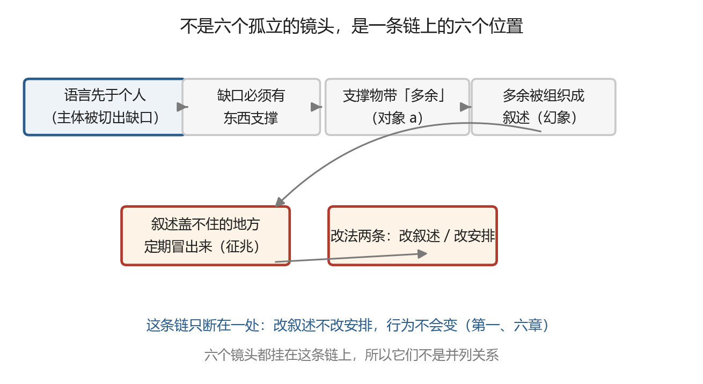

*读法：从上到下是一条链，顺序就是依赖顺序，不能跳读。谁把这条链读成「六个互相独立的观点」，就会觉得它零散，这是我在写法上的问题，不是理论本身零散。*

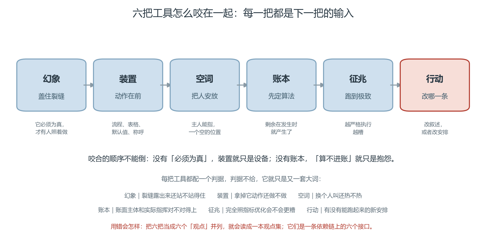

*读法：每一把都是下一把的输入，顺序不能倒。没有「它必须为真」，装置就只是设备；没有账本，「算不进账」就只是抱怨。六把工具各配一个判据，判据不给，它就只是又一套大词。*

*这一条链从上到下排，顺序就是依赖顺序，不能跳读。谁把它读成「六个互相独立的观点」，就会觉得它零散；这是我在写法上的问题，不是理论本身零散。*

## 三之二、这条链底下还有一张位置表

前面这条链，落到最后是一张表。表有四格：谁在说、对谁说、说出来的东西是什么、底下藏着那个说不出口的是什么。四格里的东西一换，同一句话的效力就变了：同一个领导，去年在讲「共渡难关」，今年在讲「拥抱变化」，话不一样，位置没变。

这张表是拉康的，第十七期研讨班讲的，齐泽克转述过很多次。本书正文不摆它，理由很实际：一摆出来，六个镜头就变成六个格子的注脚，你先记格子，再看社会。它只在结语里出现一次，四行，够用就行。

## 四、怎么读

**按顺序读。** 这不是客套，图 0-3 画的是一条链，每一章的起点，都是上一章留下的那个还没解决的问题。跳过第二章直接读第三章，你会不知道「被空词叫住的那个谁」是从哪儿冒出来的。

真要跳，只允许一个例外：**先读序章，再读第二章**（这两章对前文依赖最少：序章讲现实怎么被叙述组织起来，第二章讲满足为什么会生产出差额）。其余四章仍按序。

跳读的代价写在每章开头那句「这一章接着……」里。读到那儿觉得接不上，就是跳错了，回去补那一章。

## 五、一句承诺

这本书不给「该怎么办」的清单，也不假装你读完就能改变什么。

它承诺的是另一件更小、但更靠得住的事：**读完之后，你再看那些让你不舒服的事，能说出它是在哪一层运作的。** 说出层次，就已经不是原来那个处境了。

## 六、这本书是怎么来的

交代一下，你才知道该信到什么程度。

这本书后面有两年量的活。读了 209 篇英文全文、84 篇中文全文；把 975 条中文题录、585 条篇名题录、504 条另一家数据库的题录都过了一遍。齐泽克本人的框架，只从他中译原文里取句子，逐句标了行号。文献里的说法做了 34 条裁决（哪条成立、哪条不成立、哪条待验）；其中 6 条做了完整核验：取原话、查原始数据、比对口径、找反证。

但我不想让你因为「量很大」就信它。量大只说明我花的时间多，不说明结论对。

## 七、哪些地方我没做到

**一，我没读齐泽克的英文原著。** 只有中译、报刊长文和二手研究。中译会把一些词翻得更实（比如把名词化的表述翻成「是……的成因」），所以凡涉及「他的原话到底怎么讲」，我尽量标了行号，你可以自己回去核。

**二，中文全文只覆盖了题录的很小一部分。** 84 篇对 975 条，大约百分之九。抽样不是随机的，偏向新近和被引高的文献。所以我说的「中文研究如何如何」，严格讲只是「这 84 篇如何」。

**三，所有人工编码都是我一个人做的。** 我做过隔日重判（一致率 85%），但那测的是稳定，不是正确。没有第二个人盲判，这是这本书最大的方法缺陷，我把它写在每一处用到编码结论的地方。

**四，我不假装中文研究界错了。** 有些批评说得很准（比如把「同构」读成「当量」的那一路），我引了它们，也在正文里承认它们比我的表述更细。

最后一句：这本书最大的用处可能不是它的结论，而是它示范了一遍**怎么跟一个说法较真**，取原话、查数据、看能不能比、找反证、写成能被推翻的样子。这个流程你学会了，比记住书里任何一句都管用。

## 序章　你以为你在看现实，其实你在看一套必须为真的叙述

## 一、三个场面

**第一个。** 面试。HR 说：「我们不像别的公司，我们更像一个大家庭，大家互相帮忙。」你信了，入职。三个月后你发现，周末群里@你要秒回，加班没有加班费，请假要看「家里人」的脸色。你跟朋友说：「被骗了。」

**第二个。** 相亲资料上写「性格开朗、热爱生活、喜欢旅行和摄影」。见了面，对方安静、疲惫、周末只想躺着。你说：「照骗。」

**第三个。** 公司年会上，老板讲「我们今年克服了困难，靠的是大家的拼劲」。台下鼓掌。没人提今年走了三分之一的人，也没人提年终奖打了六折。老板还加了一句：「希望大家在新的一年里，玩得开心。」——服从已经不够了，还得表现出享受。

三个场面里都有一句话是假的。但如果你只把它当「假话」，你会漏掉它真正在干的事。

## 二、它为什么让人困惑

这里有个矛盾：**你明明已经知道那是话术，为什么它还在起作用？**

知道「大家庭」是话术的人，照样会周末回消息；知道「照骗」的人，照样在见面时整理了一下衣服；知道年会讲话在避重就轻的人，照样鼓掌。如果它只是假话，识破就够了，可识破之后，行为没有变。

所以它不是单纯的「骗」。它比骗更深一层：**它是一套你必须先当成真的、才能在里面行动的叙述。**

## 二之一、揭穿为什么不管用

有人会说：那我就把这层皮揭掉，直接告诉大家这是话术。

试过，没用。

不是大家不信你，恰恰是信了之后还照做。你告诉一个人「这公司说的是话术」，他点头，第二天照样周末回消息，原因有三个。

一，他不是不知道。他知道那句「大家庭」是场面话，可他明天还得在群里回「收到」。

二，知道是话术，不等于知道该怎么做。拆穿给的是一个判断，日子要的是一套动作。

三，拆穿之后，那个位置还空着。你说「这是话术」，可你没能给出一个别的说法让人照着活，空出来的地方很快被另一句填上，要么是「反正都这样」，要么是「我先把这份工资挣了」。

所以说，揭穿不是终点。揭穿只是把盖子掀开，底下的东西还在。

还有一句比「反正都这样」更省事的填法，是「你要享受它」。这句话不命令你服从，命令你快乐——被这样命令的人，连不高兴都得偷偷地。这类命令长什么样、为什么比明文规定更难顶，第一章讲「写在墙上」的那种命令时说。

## 三、理论怎么拆

齐泽克把这个叫**幻象**（illusion / phantasy）。他在《意识形态的崇高客体》[2]里有一个说法，大意是：社会现实本身，是供我们逃避某个创伤性的、实在界的内核的。（原文见中译本电子本第 1338 行）

拆开看，头两层是这样的：

**第一层，幻象不是「错误的意识」，是「行动的支架」。** 「我们是一个大家庭」这句话，功能不在于描述事实，而在于让一套具体的做法显得自然：多留半小时是「帮家里」、周末回消息是「有责任心」、不提加班费是「不计较」。你按这套做法行动，这套叙述就变成了真的，不是因为它描述了事实，而是因为它组织了行为。

**第二层，幻象必须盖住一条裂缝才能维持。** 「大家庭」能成立，前提是没人把那笔没付的加班费摆到桌面上。一旦裁员通知发下来，这套语言立刻失效，没有哪个「家人」是被「优化」掉的。这个盖不住的东西，齐泽克叫**实在界**（the Real）：不是「客观现实」，恰恰是现实叙述失败的那一处。

这个「要维持自己、就得把矛盾推到外面去」的机制，黑格尔在《精神现象学》[3]里已经走过一遍：意识为了成为它自己，不断把对立面排除出去，最后才发现被排除的那部分正是它自己的一部分。齐泽克做的事，是把这个过程从「意识的经验」搬到「社会的安排」上，所以「大家庭」不是骗术，是一个必须先被当成真的、才运转得起来的环节。

还有一层，是拆穿的人最容易漏掉的。拆穿的前提是：面具后面有一张真脸，把面具撕了就能看见。齐泽克说这个前提本身可疑——你为别人戴的面具（体现别人怎么看你）和别人为你戴的面具（体现你怎么看别人），在某种意义上**比面具后面的东西更诚实**；因为常常没有一张等着被揭开的真脸，那张脸本身也是照着面具长出来的（《享》L3231）。

所以「揭开真面目」这件事，往往只是换了一张面具。要动的不是面具，是面具与脸之间那道距离：距离还在，你还能退一步；距离没了，你就是那个面具本身。

齐泽克在同一处把这道距离说成主体的定义（《享》L3225）：主体不是面具后面的真人，而是**与面具保持距离的那张脸的自我意识**。所以「我在不在」不取决于有没有面具，取决于那道距离还在不在——距离没了，你就成了面具本身；距离还在，面具再厚也压不实。

这也是第三章「它不知道我，我才在」的同一件事：大他者填不满的那处空，就是这道距离。

用错会怎样：把幻象当成「虚假意识」，就会以为「揭穿它」是终点。

还要先说清它的边界：这一路能解释的是「叙述怎么组织行动、以及它在哪里塌掉」；讲权力具体怎么运作、秩序怎么长进身体里，福柯的治理术和布迪厄的惯习讲得更硬。所以这一章不是要证明别人错，是划出这一路真正管用的那块地。可揭穿之后行为照旧，因为幻象不在你的判断里，在你的行动方式里。

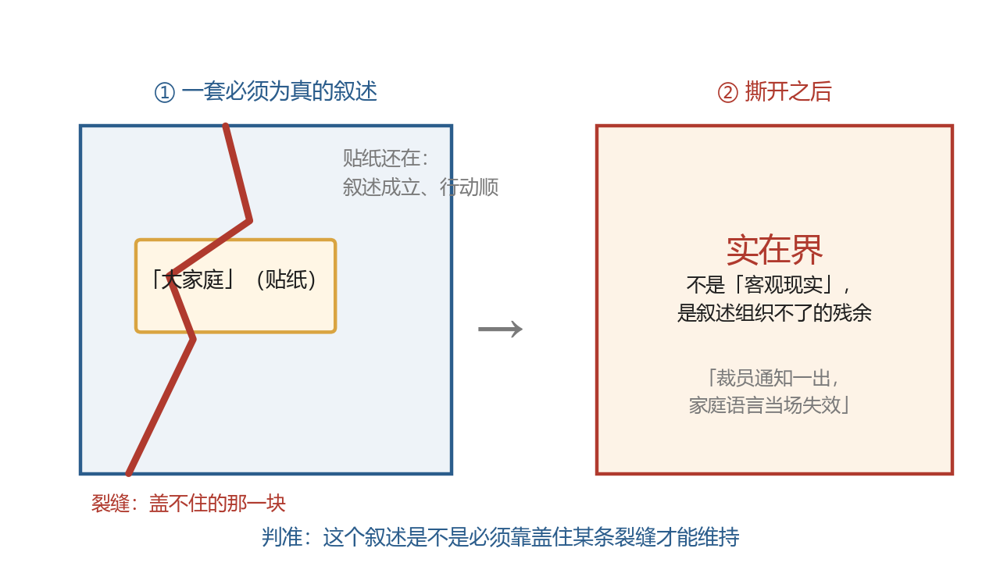

*读法：上面是叙述，那条盖不住的是裂缝，「大家庭」这张贴纸压在上面。贴纸还在，叙述成立、行动顺；撕开之后露出来的那块，才是实在界。*

*叙述就是那张贴纸，「大家庭」压在上面。贴纸还在，叙述成立、行动也顺；撕开之后露出来的那块，才是实在界。*

## 三之二、欲望图：先认个脸

齐泽克讲欲望，绕不开拉康画的那张图；图有好几层，本书只认最上面两层。

第一层，需要：一个人开口要东西，说的永远是具体的，要一杯水、要一句道歉、要一个说法。

第二层，要求：他要的其实是「你猜我到底要什么」。所以说，「你到底还爱不爱我」这句话，问的不是答案，是「你愿不愿意为我去猜」。

再往下是欲望，欲望不是要一个东西，是要成为别人欲望的对象，是我在你眼里值不值得被要；这层最不容易承认，也最不肯消失。

图上还有一条线，从「大他者」的位置折回来。你以为那个位置在回答你，其实回答你的，永远是你自己安在那里的形象。

用这张图能看什么：一个人反复要同一句话，要的从来不是那句话。

用错：拿它去给身边的人做诊断，说「你这是欲望，不是爱」。

判据：把这句要求换成「你直接告诉我你要什么」，他还答得出来吗：答得出来，那是要求；答不出来，底下还有一层。

边界：这张图说的是结构，不是病历：它只说人在什么位置上会要什么，不说这个人有什么病。

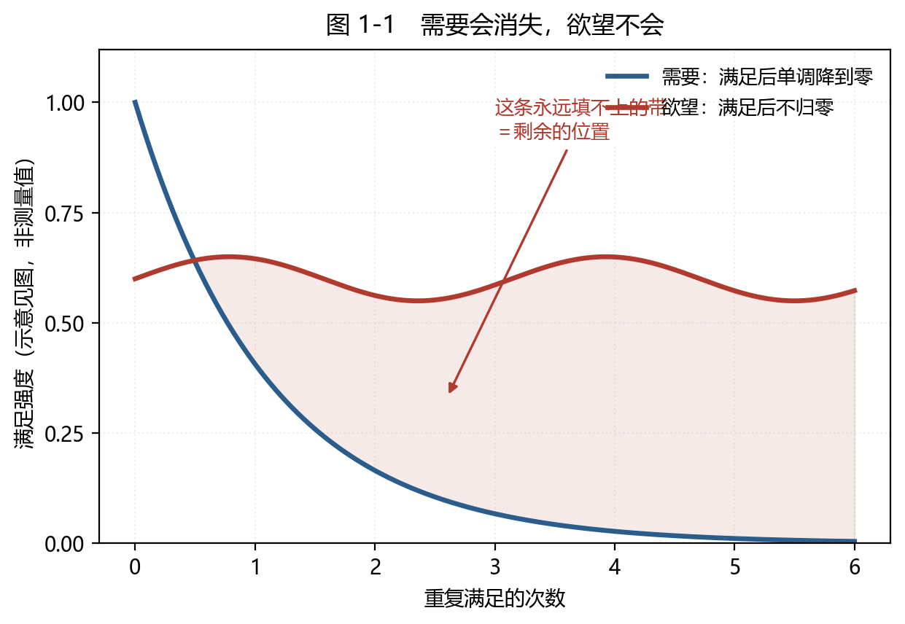

*读法：蓝线是「需要」，满足了往下掉；红线是「欲望」，满足了也不归零，绕着一条线起伏。那条永远填不平的缝就是剩余的位置。这是示意图，不是测量结果。*

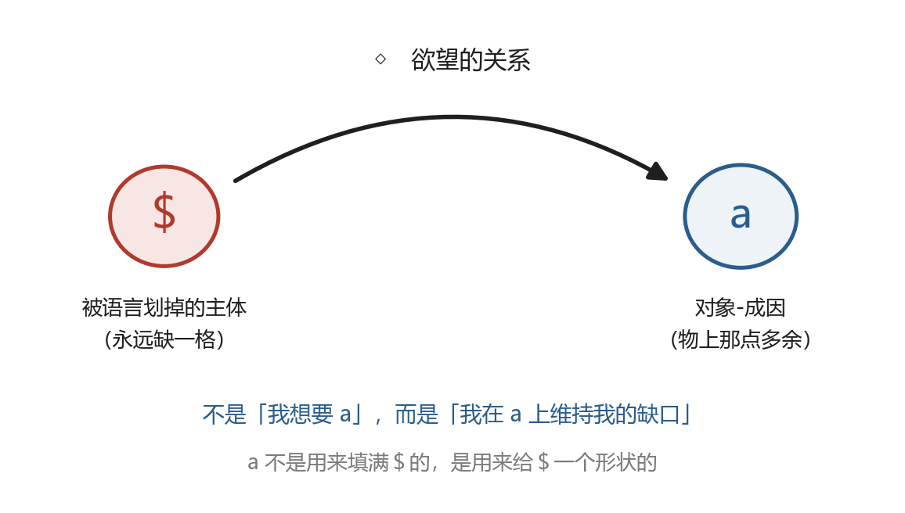

*读法：左边是被语言划掉的主体，右边是对象-成因。中间那道弧不是「我要它」，是「我在它上面维持我的缺口」；用错会怎样：以为 a 是用来填满 $ 的，就会一直找下一个，找到的还是同一个位置。*

## 四、重看这个社会

如果幻象是「必须为真的叙述」，那么「现实」就不是一个等着被发现的客观对象，而是**被一套叙述组织起来的、可以行动的场**。你每天走进的不是「客观世界」，是一个已经被人安排好了「什么算正常、什么算不合理」的世界。

这也解释了一件事：为什么改变看法那么容易，改变行为那么难。看法可以一个人改，行为要在一套安排里改。

**一个反例，用来校准。** 如果一家公司真的付加班费、真的不随便裁人，那「大家庭」就不是幻象，而是描述。所以判断标准不是「这话好不好听」，而是：**它是否必须靠盖住某条裂缝才能维持**。凡是必须靠不提某件事才能成立的叙述，就是幻象。

## 四之一、一个反例

前面说「现实是一套必须为真的叙述」，这话有个反例，得给。

有的公司真付加班费，真不随便裁人，请假不看脸色；在这种地方，「我们像一个大家庭」就不是幻象，是描述。

区别不在话本身，在那句话要不要靠盖住一条裂缝才能维持。真要盖，公司得先有一个不能被追着问的地方：不能说的地方：加班不给钱、裁员先斩后奏、请假看人下菜。这三样只要有一样是真的，那句话就从描述变成了支架。

判据就一条：把「不能说」的那部分摆到桌面上，这句话还站得住吗：站得住，它是描述；站不住，它是幻象。

同一个判据还有第二问，测的是它管哪儿：当面把它拆穿一次，第二天你还照旧做吗？照旧，说明它管的不是看法，是行动——所以拆穿不会让人停下来，只会让人换一套说法继续做。

## 五、可能会错在哪

1. **不能把所有叙述都叫幻象。** 那样会滑向「什么都是编出来的」的相对主义。本书的标准是具体的：它盖住了什么、盖住的那块在什么时候会露出来。
2. **本书测不出「哪个叙述更真」。** 它只能指出「这套叙述靠掩盖什么维持」，不能给出一套中立的比较尺子。
3. **别把它当道德指责。** 说「你在幻象里」很容易变成居高临下；分析幻象是为了看清它怎么组织行动，不是为了判谁糊涂。
4. **中译里 illusion 与 phantasy 都译作「幻象」**，两者不完全是一回事：前者偏「误认」，后者偏「欲望的支架」。本书用「幻象」时，指的是后者那层意思。

> 附注：「形式层面的『去历史化』指控未获支持」这一结论所依据的文献对撞（上游 8.3% / 下游 11.6% / 中文 13.3%，中文样本带历史限定），见附录 B。

## 第一章　明知没用，为什么还做

> 序章说的是「现实是被一套叙述组织起来的」；这一章接着往下问一层：既然看穿了，为什么还在照着做。

## 一、三个你可能经历过的场面

**第一个。** 周五下午，方案改了第四版。开评审会之前，做这个方案的人自己说了一句：第三版其实更完整，但领导会喜欢第一版。

会开了，通过的还是第一版。他回到工位，把第一版重新排了一遍版，加了几页纸，标题改成「深化版」。下班前他在群里发了一句「感谢各位老师指导」。

**第二个。** 一个人在地铁上刷手机，刷到一条骂「内卷」的短视频，点了赞。赞完继续刷，刷到「躺平」也点了赞。到家十一点半，躺在床上又刷到一点。

第二天早上他跟自己说：不能再这样了。晚上照旧。

**第三个。** 一个办公室里，大家都在抱怨考核。抱怨得最细的那位，是去年考核成绩最好的那位。他抱怨的方式很专业：哪一项指标的权重不合理，哪一项可以注水。他说这些的时候，是真心在抱怨。

---

这三个场面里都有同一件事：**当事人知道**。

第一个知道第三版更好，第二个知道刷手机没意义，第三个知道考核不合理。他们不是被蒙住的。你要是去跟他们讲道理，他们会比你讲得更清楚。

这就是这本书要从这里开始的原因，我们习惯把「社会问题」理解成「有人没想明白」。可这三个场面里的人，想得比大多数人都明白。

还有一个场面不发生在办公室。周末的公园相亲角，父母替孩子把条件写在一张纸上：年龄、身高、房子、编制。写的人未必相信这些就是一个人，可要是不写，摊子前没有人会停。

知道这张纸是假的，还是得写，第一章讲的就是这件事，只是它这次穿的是另一身衣服。

## 二、让人卡住的三个矛盾

**矛盾一：知道和不做，可以长期共存。**

不是「知道了但一时没做到」，是长年共存。你知道熬夜伤身，你熬了十年。这不是意志力问题，意志力如果有用，这个问题早就解决了。也不是知识问题，你的知识足够多了。

**矛盾二：抱怨的样子，和配合的样子，是同一个人。**

第三个人抱怨考核，抱怨得很专业，第二天按考核表优化自己的产出。这不叫虚伪。他是真的觉得不合理，也真的在优化。这两种态度在他身上不冲突，因为**它们不在同一层**：抱怨在说话的层面，优化在动作的层面。

**矛盾三：越明白的人，往往配合得越精细。**

这是最扎人的一点。不懂规则的人是被动的，懂规则的人是主动的，他研究权重、找注水的空间、算边际收益。看破的人不是退出了，是**升级了参与方式**。

**矛盾四：越优化，视野越窄。**

第三个人研究权重、找注水空间，他确实变强了，在考核这一件事上。同时他对别的事变得迟钝：客户真正想要什么、这项业务还有没有别的做法，这些没进指标，就不在他的注意力里。

优化是有方向的，方向由指标给。你说「我在努力提升自己」，实际上是在**努力提升指标上那个自己**。这两者大部分时候重合，重合不了的那部分，就被优化掉了。

四个矛盾指向同一个东西：**知这件事，和做这件事，不是一条线；而做这件事的路线，是别人画好的。**

## 三、理论怎么拆：意识形态不在脑子里

我们通常以为意识形态是「一套错误的观念」，被洗脑的人相信了假的东西。

这个理解，齐泽克那一路的写法是不认的。他认为意识形态主要不在「信」这一层，而在「做」这一层：**你做什么、怎么做、在什么装置里做，比你相信什么更根本。**

这里第一次出现**装置**（apparatus / dispositif，第六章会专门拆）。先给一句话：**装置就是那套让人不必先相信、也会照着做的安排**，流程、表格、默认值、称呼、谁签字。用错会怎样：把装置当成「设备」或「阴谋」，就会以为问题出在某个坏人身上，于是换个人、换句话，安排照旧，行为照旧。

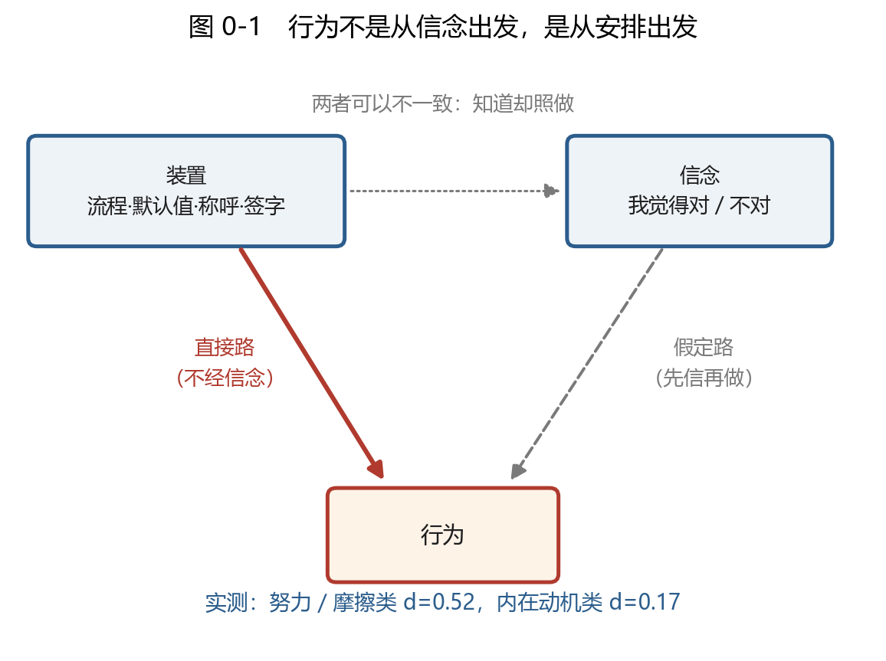

*读法：实线是装置直接推着行为走，虚线是「先信再做」那条假定路。实测里前者比后者大，所以先改安排比先改想法划算。*

*装置直接推着行为走，「先信再做」只是假定出来的一条路。实测里前者（0.52）比后者（0.17）大三倍，所以先改安排比先改想法划算。*

他引过一个很老的例子。帕斯卡尔[4]说，你不必先信了再跪下，你去跪，跪着跪着就信了。仪式在前，信念在后。你先进入那个动作，信念会自己长出来配合你。

用这个眼光回看前面三个人：

第一个人的「信」是什么？他并不相信第一版更好。可他还是把第一版排好了。**他的「信」体现在他的手上**，他熟练地做了那套动作，而且做得很好。他的意识层面在抗议，他的身体层面在服从，而社会只看身体那一层。

再往深一层：**信仰不是心里的状态，是物化在物和动作里的东西。** 转经轮替你祈祷，合唱队替你悲哀，罐头笑声替你笑——齐泽克引一句斯大林式的话：客观上，我在祈祷（《意识形态的崇高客体》L305–L310）。

所以「我其实不信」这句话没有多大用。你按那个时间打卡、按那个格式写周报、按那个称呼叫人，信仰就已经长在这些动作里了；心里信不信，是另一件更小的事。

这一章要引的那句齐泽克原话，说的就是这件事：**「他们知道自己的所作所为，但坦然为之。」**

这句话里最要紧的是「坦然」。不是「他们知道错了但偷偷干」，是知道，并且不觉得这有什么需要解释的。因为在这个处境里，知道并不会改变什么，它只是让你在做的同时多一层清楚。

### 顺带拆一个词：犬儒不是狗智

中文里「犬儒」被用得很多，多数时候指「看透一切、什么都不信、嘴上讽刺」。但齐泽克用的「犬儒」（cynical reason，来自斯洛特戴克）指的是另一件事：**明知是假的，还照做，并且把这当成成熟和聪明。**

而他另外区分的「狗智」（kynicism）是当面戳穿，用玩笑、用身体、用不合时宜的诚实去冒犯那套体面。

这两个词在中文里被压成了一个：中译本用的其实是「狗智」，而中文研究几乎全写「犬儒」。所以你读到「当代青年是犬儒的」，它可能指三种完全不同的东西：玩世不恭、看破还配合、或者当面顶撞。**先把词分开，才谈得上判断。**

### 一个装置是怎么长出来的

拿报销举例。最开始只是「有事跟我说一声」。后来有一笔钱对不上，于是加一张单子；单子填错过一次，于是加一栏必填；审计来问过一回，于是加一个签字；签字找不到人，于是上系统、加时限、加附件要求。

每一步都有人提、都有理由，没有哪一步是坏的。但合起来的结果是：一个新人要花两周才学会「怎么把钱拿回来」，而最早那个理由（别丢钱）早就没人记得了。

**这就是装置的生长方式：它没有作者，只有一个接一个的补丁，而每个补丁都在解决上一个补丁造成的问题。** 所以跟它讲道理没用，道理在每一个补丁里都已经讲过了。

反例也得给：三个人的小作坊没有装置，靠老板记性，跑得飞快。规模一大就崩，不是人变坏了，是记忆装不下了。所以装置不是纯坏东西，它是规模的代价。

### 三条最常见的反驳

**「这不就是企业文化／氛围吗？」** 不一样。氛围靠感觉，装置靠看得见的步骤：谁签字、填几栏、默认勾哪一项。检验方法很硬，把那个步骤拿掉，看行为变不变。氛围拿不掉，装置拿得掉。

**「那不就是制度决定论？」** 决定论说的是「改不了」。这里说的是「改得动，但改的是步骤，不是想法」，表格加一栏、默认值换个方向，都是很小的动作。真正难的不是改，是承认要改的是那一步。

**「那人自己的努力呢？」** 装置不取消努力，它决定努力花在哪儿。0.52 和 0.17 的差别不是「谁更努力」，是「力气花在推行为上，还是花在说服上」。同样一份力气，放在装置上能推走人，放在讲道理上只能推走几句话。

## 三之二、底下那层不许说的

先看一句非常常见的制度语言。

公司新规定写着「严禁加班」，同一个月，群里九点发来一句「今晚这个必须交」。领导在会上说：「我不鼓励加班，但项目组要有担当。」

这三句话不矛盾，它们是配套的：明文规则负责正确，那层没说出口的话负责运转。

齐泽克给这层东西起了个名字：**淫秽的补充**。意思是，一套明文规则要真能跑起来，底下必须垫一层不成文、不好听、甚至下流的默契；规则越硬，这层垫子越必要，因为规则自己走不完那一步。

例子到处都是：学生守则写「严禁作弊」，监考时说「大家自觉」；婚姻讲忠诚，酒桌上默认「男人都这样」；招聘写「公平竞争」，内部说「你懂的」。这些话都不是秘密，它们公开地说，所有人都听见，只是不许写进文件。

它和「装置」不是一回事：装置是流程、表格、默认选项，是能被指认的零件；淫秽的补充是那些零件之间必须有的润滑，指认得出来，但写不进去。

最容易用错的地方，是以为把这层话揭穿它就会失效。不会，它不是错误，是让规则能走完的那一步。揭穿之后，话照说，活照干。

所以判据只有一条：把明文规则单独执行一遍，不加那层默许的话，看规则能不能走完。走不完，就说明那层垫子是必需品，而不是某个人的道德问题。

边界也要划清楚：这层东西不等于腐败。腐败是私下拿好处，怕人看见；淫秽的补充常常是公开的，大家一起听、一起点头，只是不许落到纸面上。

**那块谁都不说破的空位，可以叫「公共的 0」。** 所有人都知道它在那儿，都绕着它配合，却没人把它写下来——一旦写下来，它就不灵了。所以它靠的不是秘密（秘密还知道内容），靠的是「大家都知道」这种共同姿势。

还要分清另一种，它正好反过来：**写在墙上，不是藏在桌下。** 团建通知写「请大家放开玩」、加班动员写「要有激情」、连批评都要求「态度积极一点」——这类话不要求你服从，要求你**享受**。

**于是心里常常有两股力同时开火：** 一边喊「我要」，一边喊「你该」。这就是「两个我打架」——不是善恶之争，是两个位置挤在同一句话里争：一个要满足，一个要审判。内耗不是想太多，是这两股力谁也停不下来。齐泽克把这种命令叫淫荡的超我指令：它一边要你照做，一边要你表现得乐在其中（《意识形态的崇高客体》L538–L540）。

它和淫秽的补充的区别在位置：补充是规则底下那层默契，说出来不体面；这一条是规则本身的要求，登在通知里、贴在墙上。区别还在后果：补充允许你心里不服、手上照做；这条连「不服」都要收走——你可以不高兴，但别让人看出来。

判据也跟着换：把「要开心」那句从通知里删掉，看这件事还做不做得成。做得成，那句话是装饰；做不成，它就是要你交出的那部分。

**再补一句。** 这种服从不只是服从，它有回报：保持距离、心里不服、嘴上照做，这个距离本身就是享乐的一部分——这里的享乐不是「开心」，是越过快乐原则还往前顶的那股过量（第二章会拆开讲）。齐泽克说变态者不是不知情的官僚——他「以一种纯粹的互动方式，通过大他者这个黑暗之神」来享乐。

**三个词别混。** 理想自我在想象界（我希望被看成什么样），自我理想在符号界（我从那个点看自己），超我在实在界（报复性的、虐待性的动能）。所以超我不是「内化的道德」——它反道德，它总在污蔑我们没守伦理。

**自我理想最容易读错。** 它不是「我要成为的理想样子」（那是理想自我），是「我从哪个点看自己」——你把谁的眼睛放在头顶上，你就在那个点上审自己。换了观众，同一件事的好看程度就变了。「他们越无辜，就越该被枪毙」，是它的纯粹形态。

## 三之三、把关系当成物

发工资那天请客，说「今天我请」；送礼之后心里松一口气，觉得人情两清了；分手的时候算账，说这些年我付出了多少。

这三件事里都有一个动作：把说不清的关系，换成一个说得清的东西。

马克思给这个动作起了名字，商品拜物教，他说的是，人和人的关系，表现为物和物的关系。工资这一格最典型：你干了多少、该值多少，本来是一堆扯不清的事，一旦落成「这个岗位值八千」，扯不清的部分就被一个价格盖住了。

齐泽克补的那一句更狠：拜物教不是相信物有魔力，是**知道它没有魔力，照样按它有魔力来做**。谁都知道钱只是一张纸、一个数字，可月底那笔到账照样决定你这个月敢不敢请假。

用错的方式，是以为看穿「钱只是符号」就自由了，看穿之后账照算，客照请，人情的两清照样完成。

判据只有一条：把那个物拿掉，钱、礼物、合同都拿走，看这段关系还剩什么、还怎么运转，剩不下东西，说明关系一直是靠物在替它说话。

边界要划清：这不等于「一切关系都是交易」，拜物教说的是关系被物替代的那一部分，不是全部。有人半夜送你去医院，那一下没有价格。

还有一句要补在下面：马克思问的不是「商品背后藏着什么」，是**「劳动为什么非得以价值的形式出现」**——就像弗洛伊德不问梦背后藏着什么念头，而问「念头为什么非得做成这个梦」。齐泽克把这叫商品形式之无意识：交换的抽象不是思想，却有思想的形式（《意识形态的崇高客体》L241–L253）。

### 韦伯：服从不需要相信

前面说的都是「明知没用还做」。还有一层更省力的：很多人连「明知」都没有，他们只是服从，因为「规定如此」。

韦伯把支配的正当性分成三类：传统的（祖上就这样）、魅力的（这个人有本事，跟他干）、法理的（规则这么写，所以这么办）。现代组织靠的是第三类。它的好处是省事：不需要每个人都认同，只需要每个人照着走，所以它不问你信不信。

你去看任何一个大机构的例会：没人真的相信那张表能反映工作，也没人相信那个流程是最优的。可每个人都在说「规定如此」「上面要求」「系统里得这么填」。这句话一出口，讨论就结束了：再往下问，问的就不是事，是人。

用错：以为只要把道理讲清楚，服从就会消失；讲道理能改判断，改不了那一格必须填的东西。

判据：把理由从「这样做有道理」换成「规定如此」，还有人照做吗。照做，这就是法理型支配；不照做，那才轮到讲道理。

边界：不是所有服从都归这一类，家里听长辈的，多数靠传统，不是靠规定。

### 斯科特：底下还有一套小动作

说「他们照着做」，容易说成铁板一块。斯科特在马来西亚的村子里看到的是另一回事：农民不正面抗，他们磨洋工、装傻、传流言、表面答应背后拖着。他把这些叫「弱者的武器」。

办公室里也有：会上说「没问题」，散会照旧；表格填了，数字是凑的；培训签到，人在心不在。这些动作单个看都算不上反抗，合起来是一层缓冲垫：它让日子能过下去，也让装置没那么锋利，所以它既是抵抗也是顺从。

用错：把小动作当成变革；它不改结构，它只是让人在结构里活得下去一点。

判据：看这套动作是不是「为了让日子过下去」而存在：拿掉它人立刻就撑不住，那它是缓冲；拿掉它事情照样转，那它只是懒。

边界：缓冲垫也会坏。一个人连小动作都懒得做的时候，不是他变乖了，是他已经准备走了。

**形式会说内容不肯说的真相。** 莫扎特《费加罗的婚礼》结尾，伯爵愤怒的旋律与和解的旋律是同一段音乐——内容上他们和好了，形式上说他们没和好（《崇》L1012）。

黑格尔把这个叫「形式方面」：不是内容决定形式，是形式把内容藏起来的那一半说出来。所以听一个人说话，除了听他说了什么，还要听他怎么说——语气、停顿、句子的形状。

**空洞姿势。** 齐泽克说，主体在采取任何具体行动之前，先有一个纯粹形式的行为：把「客观给予的现实」转换成「我的现实」（《崇》L1153–L1154）。用日常话说，他实际上什么也没做，只是对既定状态承担了责任，把它认成自己的产品（《崇》L1156）。

一个签名、一次点头、一句「收到」，就是这个动作。它不改事实，只改事实的**签名**。所以「形式」不只是包装——签了字，事情就成了你的。

**还有一层：物也在看你。** 我们习惯说「我看错了这件东西」，齐泽克说方向反了——凝视是从客体那边发出来的。你在商场里看那双鞋，鞋也在回望你：它替那个「别人会怎么看我」的位置看着你。所以拜物教不是「看走了眼」，是**被看住**：你正对着它，它只是普通商品；你从侧面看，才看见它身上多出来那层光。

拉康给这个位置起了个名，叫「斜目而视」——不正对着看，斜着看。正对着看，对象就退回成普通物件；斜着看，才看得见它多出来的那一小块（管欣然 2026 转述）。

## 三之三之二、交换形式先架好了框

前面说「你把关系当成了物」。这一句还得往前推一步：不是你主动把关系看错，是交换形式在你进场之前，就把「什么算物、什么算价值」的框架好了。

马克思问的是：为什么一件劳动产品一进交换就带上神秘性质？孔明安转述佐恩·雷特尔的回答很硬——商品形式**预先包含着**康德的先验构架：时空、范畴、因果，都在你开口报价之前就位（孔明安 2012，转引）。所以交换里的主体是「主动的」，但这份主动不是他能选择的主动：他一伸手，已经在用一套他不知道的范畴。

**判据只有一句：你是在认这个东西好，还是在认「大家都认它」这件事？** 前者是口味，后者是形式。

常见误读：以为「我不迷牌子就免疫了」。免疫要动的是形式，不是你的态度——这就是拜物教的第二层：无意识。支配你日常交换的，从来不是你能说出的价值规律（孔明安 2012，转引）。

## 三之三之三、一个人反对过整条路

鲍德里亚在《生产之镜》里反对的，不是「人们看错了物」，而是**「生产」这面镜子本身**。

他的论证是：马克思把「有用的劳动」当成历史的轴——人先生产，才有历史——可这个「有用性」也是资产阶级交换体系编出来的码。所以马克思批判商品拜物教时，脚下踩的仍是同一块地板。

张一兵的反驳很硬：使用价值与交换价值的区分不是马克思的发明（斯密、李嘉图在先），马克思在《资本论》里把交换价值定为价值的外部表现，并且严格限定在商品生产的历史阶段；鲍德里亚批的是一个**并不存在的「假马克思」**。

齐泽克站哪边？他既不退出生产，也不替生产辩护——他把生产里的那道裂缝（剩余）读成征兆：**问题不在于「生产是不是终极根据」，而在于生产从来没能把自己补全**。

**判据**：你批判「把关系当成物」的时候，手里那把尺子是不是还是「有用／无用」？如果是，你还在镜子里。

## 三之三之四、为什么一张纸会显得神圣

这本书的名字里有个词，正文一直没解释：**崇高客体**。

「崇高」在这里不是「伟大」，是拉康那个位置：**一个普通物，占住了「不可能的原质」（das Ding）的位置**。原质不是某个神秘的东西，是符号秩序永远够不到的那个空——它没有形象，所以任何东西都可以被放进去充当它。

于是同样一块铁：在打捞船上叫废料，摆进博物馆叫展品，中间没换东西，只换了位置。这就是崇高：**不是它天赋异禀，是它站的那一格空着**。

还有一层：原质的位置是「外隐」（extimité）——最内在的同时是外在的。所以它不是藏在现象后面的答案，而是嵌在正中央、让符号秩序围着它转的那个洞。

**判据**：把这件东西换成同类的另一件，效果还在吗？还在，说明起作用的是内容；不在，说明起作用的是位置。

这条判据能解释很多事：为什么限量款、遗物、第一版能卖出天价；也为什么一个头衔换个人坐上去，敬畏照样在。

## 四、你可能会问的四个问题

**问一：那按这个说法，人就没有自由了？**

答：这个说法不承诺「没有自由」，它只承诺「自由不在你以为的那一层」。你在信念层是自由的，可信念层不产生后果；产生后果的那一层，是被装置安排好的。要说自由，得说清楚「在哪一层自由」，否则这句话没有内容。

**问二：那是不是所有事都能用「结构」解释掉？**

答：不能，而且这正是这套解释最容易坏的地方。如果一切都被结构解释，那结构就没法被检验了，说什么都能对上。所以本书每章末尾都要写「哪里会错、什么数据会翻案」。做不到这一点的解释，不管多深刻，都当口号看。

**问三：既然知道没用，那「知道」还有什么意义？**

答：有一个很有限的意义：**知道能让你不再把自己的处境解释成自己的缺陷。** 这不能改变处境，但能改变你和处境的关系，你不再为一个不是你的问题自责。这不是小事，但它也不是解放。别把它说成解放。

**问四：这套说法有证据吗？**

答：有，但只有一半。有一项汇总了 184 个田野实验、两百多万人的研究比较过两类干预：靠改变选择的「结构」（比如默认选项、增加一点办理成本）和靠说服、靠动机的「信息」。结果前者的平均效果明显高于后者，比值大约三倍。**但**这个三倍压线通过、异质性极高、用了更保守的统计校正之后接近零。所以本书的立场是：方向有据，量级未定。谁要是拿「三倍」当结论引，那是把它用过头了。

（这一段的完整出处与口径见附录 B。）

**问五：那「躺平」算不算一种反抗？**

答：躺平是退出优化，不是改变规则。它的效果取决于别人还需不需要你，需要，你就只是暂时不下场；不需要，你退不退都一样。所以它是一种姿态，不是一种建构。姿态有用，但它改不了装置（第六章会细说这个区别）。

**问六：如果我在里面，我怎么知道自己不是被结构骗了？**

答：你没法完全知道，这个答案让人不舒服，但它是诚实的。你能做的只有两件事：一是把自己对处境的解释写下来，看它能不能被证伪（「如果真是这样，应该还能观察到什么？」）；二是找反例，找那些处境相同却做了不同选择的人，看他们的差别在哪。这不能给你确定性，只能给你一点可检验性。

## 五、另一种读法：也许根本不是意识形态，而是自我保存

上面这套说法有一个很强的对手，得摆出来。

斯洛特戴克在《犬儒理性批判》[5]里说过一个大意如此的话：现代人不是不知道，而是**知道了还照做，并且把这当成一种成熟**。在他看来，这不是意识形态在起作用，是人在复杂社会里的一种自我保护，你改变不了，又不愿意天天愤怒，于是把「我知道这是假的」当成最后的体面。

沿这条路，中文研究里常见另一种读法：把这种状态叫**犬儒主义**（cynicism），说它是「启蒙的虚假意识」，启蒙让人看穿，看穿之后什么也没变，于是看穿本身成了一种安慰。

这个读法反对的是我这一步：我说「幻觉在做这一边，所以改变看法没用」。它会说，恰恰相反，**问题就是你把「知道」和「做」分开看了**，人不是被结构安放的，是在权衡之后选择不动的。

我接受它的一半，不接受另一半。

接受的一半：它比我说得更贴近当事人的体验。多数人不是「被装置推着走」，是**算过账**，反抗的成本、被孤立的成本、换工作的成本。把这些说成「结构」，容易把有意识的选择说成没有选择。

不接受的一半：算账本身也要有一套算账的框架。什么人值得得罪、什么损失算损失、哪种反抗算「不成熟」，这些不是天生的，是学来的。斯洛特戴克自己也没否认这一点，他只是不愿意把它叫作意识形态。

所以这段争辩的落点是：**「犬儒」和「狗智」不是同义词。** 中译本把 cynical position 译作「狗智」，学界普遍写「犬儒」。中文研究几乎一律用「犬儒」，「狗智」基本只在译本里出现，这个错位本身就是证据：大家在用一个词，说的却是另一件事。

用错会怎样：把两者混为一谈，就会得出「齐泽克在骂现代人虚伪」这种结论，他骂的不是虚伪，是**用一个清醒的姿态把不动合理化**。

## 五之一、对手：韩炳哲，和「你已经很累了」

前两年最流行的说法来自韩炳哲：这个社会不再有拿着鞭子的主人，每个人都是自己的老板，自己给自己定指标、自己骂自己不够努力。他把这叫功绩主体，把结果叫倦怠。

他说对的地方很要紧：压迫不再需要一个外部的人，你自己就是那个盯进度的人。所以「老板很坏」这个解释失效了，坏的部分被装进了你自己身上。

可他停在「个体被耗尽」这一步，再往下就不走了。他能告诉你为什么累，不能告诉你为什么「够了却停不下来」，也就是一个已经倦怠到不想动的人为什么夜里还是会点开下一个视频。他也没有给判据，你没法用他的话去分辨「这是结构」还是「这是我没休息好」。

判据：把绩效撤掉，看这个转还转不转：没人考核你、没人给你排名、奖金取消，你还会不会去做那件事，还做，说明不只是外部绩效在推；不做了，那韩炳哲就够了，不必再往下讲。

边界：他的诊断在「累」这一层是真的，别拿这一点去否认他，可「累」解释不了绕圈。

## 五之二、知道有害，为什么不构成理由

**问一**说上瘾不完全等于享乐，这里再补一层：为什么「我知道有害」从来不是停下来的理由。

经济学家贝克尔和墨菲给过一个很冷的解释：成瘾也可以是理性的。因为消费有「存量」，越喝越会喝，越刷越会刷，今天多一次，明天的那一次就更值钱。所以一个人清楚地知道喝酒伤身，仍然可以合理地把下一杯排进计划；这不是他不知道，是他的账本里「停」的成本被算得很低。

这套模型补的是「明知故犯」这句话的空洞：不是意志薄弱，是当下的收益结构把「停」挤到了后面。

用错：以为它给成瘾者开脱，可理性模型说的只是「在给定的偏好下算得通」，不表示这个偏好是对的。

判据：把「停」的收益变成能摸到的东西，钱、时间、一次体检报告，再看他停不停：停不下来，说明问题不在信息，在结构。

边界：这个模型假设人会算。真到了发抖、失控那一步，算的能力已经没了，模型也就管不着了。

还有一种组织形态值得提一句：既不要无限协商，也不要无条件服从。布莱希特写党，说党不是无所不知——「没有我们，正确的路也是错的」。意思是：如果你认为自己对，就在集体形式之内为它而战，不要在它外面单打独斗。这与「行动」是一回事的两面：行动改的是尺子，组织问题是尺子由谁一起扛。

## 六、重看这个社会

如果意识形态在动作里，那么「改变想法」就不是改变社会的主要途径，「改变动作发生的条件」才是。

这里的「条件」不是抽象的制度，而是一些很具体的东西：

- 一件事要几步才能做完（多一步，很多人就不做了；少一步，很多人就顺手做了）
- 默认是哪一个选项（默认捐赠器官的国家，同意率是默认不捐的国家的数倍，不是因为那里的人更善良）
- 表格长什么样（表格只让你填三个数，那第四个就不存在）
- 别人怎么称呼你（「骨干」这个称呼能让人自愿加班，而且不加钱）

把这些东西指认出来，你会发现一件反直觉的事：**很多「人的问题」，其实是「步骤的问题」「默认值的问题」「称呼的问题」。**

再补两个例子，都是很日常的。

**入职报到。** 一天要跑五个窗口、签七份文件、交三张复印件。结果是：能拖到第二天的就拖，能找人代签的就代签，有人干脆把入职日往后推了一周。没有人下过「不许入职」的命令，是步骤本身在做筛选，它筛掉的不是「不合适的人」，是「懒得折腾的人」。你要真想留住人，卡的是岗位和待遇，不是那张表。

**会议。** 一个议题要开三次会才能定，等于宣布「这件事不重要」。反过来，一件事被排进每周例会的第一项，它就成了全员优先级。会议议程是一种排序装置，它比任何一句「这件事很重要」都管用。

**但也要给一个反例，否则这套说法就太顺了。**

确实有人靠意志力改变了：戒烟、减肥、关掉短视频。这些人不是被装置改造的，是自己硬扛过来的。这说明装置不是唯一变量，人的耐受力、处境、支持网络都在起作用。

更准确的说法不是「装置决定一切」，而是：**当一件事要靠意志力反复对抗时，说明装置在跟你作对；而当装置顺着你的时候，你几乎不需要意志力。** 后者才是社会工程真正的工作面。

这也解释了一件事，为什么讲道理常常无效，而改流程常常立竿见影。因为讲道理动的是信念层，改流程动的是动作层。

**本章边界**：这一章能推到哪、推不到哪，见附录 F·1。

## 第二章　那个夜里一点半的东西

> 第一章讲的是「知道还做」；这一章问那个让你重复的动力到底是什么，它不是快乐。

## 一、三个场面

**第一个。** 十一点半躺下，说「再看五分钟」。一点半，手机砸在脸上。第二天起来眼睛干、脑子木。他记得的最后一个视频是一只猫把杯子推下桌子。

**第二个。** 一个人开始跑步，本来是为了身体。三个月后跑到膝盖疼，医生让他停两周。他停了两天，第三天又跑，改跑慢一点。他自己解释：「习惯了，不跑难受。」注意这句话，不是「跑了舒服」，是「不跑难受」。

**第三个。** 有人买了一个包，等了三个月，拆开那天特别高兴。三周后放进柜子，又开始看下一个。她很清楚这件事：「买完就不喜欢了，但还是想买。」

---

这三个场面里，最说不通的地方是：**它们都不怎么快乐。**

刷到一点半，人是麻的。跑步跑到疼，人是累的。买到一个包，三周就腻。可这三件事都在重复，而且重复的人不傻，知道自己在重复。

如果这套行为靠「快乐」解释，它解释不通，因为快乐有个特点：够了就停。

## 二、四个矛盾

**矛盾一：快乐是会停的，这些停不下来。**

吃一顿好饭，吃饱了就不想吃了。这是快乐。可刷视频、买东西、打游戏，很少出现「够了」。停下来的原因通常是别的：眼睛疼、没钱了、天亮了。

**矛盾二：越满足，越不满足。**

那句老话「得到了就发现不是想要的」，在这三个场面里都是真的。但奇怪的是，它不导致放弃，反而导致下一次更用力。

**矛盾三：痛苦和满足可以同时在场。**

跑到膝盖疼还跑，这里没有快乐可言，除非你把「疼」本身算进去。人在这类事情上确实能从「过度」里得到某种东西，不是舒服，是一种**被填满的、绷紧的、近乎难受的强度**。

**矛盾四：阻止它的不是意志，是别的装置。**

让他停下来最有效的，往往不是「想通了」，而是手机没电、健身房关门、卡里没钱。**能停的条件常常是外部的，不是内部的。**

四个矛盾指向同一个词，它和快乐有关，但不是快乐。中文里有个不怎么顺的译名：**享乐**。

## 三、拆词：享乐不是快乐

这一节要拆的词最多，也是最容易读错的地方，我尽量说清。

**享乐（jouissance）**：一种过量到让人难受的满足，来的时候带着债，享受完会更空。它不是「更强烈的快乐」，它是另一种东西：快乐有度、可满足、会停；享乐没度、不满足、停不下来。

这些词先记住形状，名字怎么来的放在下一节说，因为名字本身就是一段历史。

**剩余享乐（surplus-enjoyment / plus-de-jouir）**：这是齐泽克解释得最清楚的一个词。他说，拉康这个概念是**仿效马克思的剩余价值提出的**。

马克思的剩余价值不是「分完之后剩下的那一点」，而是生产一发生就产生出来的、被拿走的那个部分。仿照这个结构，剩余享乐也不是「享受完还剩的快乐」，而是**这套满足的运转本身必然生产出来的多余物**，它让你觉得「还差一点」，而那个「差一点」正是让你再来一次的东西。

**对象a（objet petit a）**：欲望的「客体-成因」。它不是你想要的那个东西（那个包），而是让欲望开始转动的那个空缺。目标会换（包、鞋、下一部剧），原因不变。

把这几个词装回去，第三个人就说得通了：她买的不是包，她买的是「还差一点」这个位置。包只是让这个位置有个形状。三周后形状失效，位置还在，所以要换下一个。

**顺带一个例子：可口可乐。** 齐泽克常拿它举例，你喝到的那一口永远不是广告里那一口，广告里那一口没有形状。商品的力量不在于它满足了什么，而在于它让你相信「下一口才是真的」。

### 一个必须提醒的地方

「享乐」在中文文献里被用得比它该有的范围大。我把这 84 篇一篇篇看过去，大半确实在说 jouissance，一部分说的是「享乐主义」（吃喝玩乐那种），还有一小部分是「消费享乐」「审美享乐」。**同一个词，三种所指。** 所以看到「享乐」先别急着上理论，先看它在这一句里是不是那个「过量到难受」的东西。

## 三之一、巴塔耶：烧掉才算用掉

前面说的都是「越满足越不满足」，还有一件更怪的事。

有人专挑亏本的事做：花两个月工资办一场给外人看的酒席，把攒了一年的东西一把火烧掉，直播间里一次刷掉五千块；你说他傻，他说「这才叫爽」。

巴塔耶管这个叫耗费，意思是人有种非要把东西用光的冲动，而这种用光不换来任何东西。攒钱是「保存」，办酒席是「烧掉」，保存有目的，烧掉没有，可烧掉的那一下，人觉得自己活着。

用错：把一切花销都叫耗费。买冰箱不是耗费，那叫添置，它明天还在；耗费的标准是你的东西真的没了，而且没换回等价的什么。

判据：这东西是存着了还是用掉了：存着、明天还在、还能算进家当，那是保存；用掉了、只剩一段记忆和一堆照片，那是耗费。

边界：不等于「浪费有理」，耗费说的是人有这种冲动，不是说不该算账。日子要过，账要算，这两件事不矛盾，只是别把算账当成唯一的尺子。

## 三之二、那个绕回来的力

有些事你明明知道做了会更难受，还是做了。

那段聊天记录翻到第三遍，看完照样睡不着；辞了三次职，每次都回到同一类公司；游戏连输三十把，手指还是点了「再来一局」。

快乐原则解释不了这个，快乐原则说的是够了就停、痛了就躲，可这些事正好相反，越痛越来。

弗洛伊德后来改了口，说人身上有一种重复，不以快乐为目标，有时候干脆绕开快乐。齐泽克接过来叫它死亡驱力，这个说法容易被误读成「求死」，它其实指的是那种不计后果、原地绕圈的坚持，是享乐的另一张脸。

两者的差别可以这样记：快乐原则问「够了吗」，死亡驱力问「还能再来一次吗」。

用错的方式，是把所有重复都解释成创伤，创伤能解释一部分，但要拿证据，不能看见绕圈就往上贴。

判据是拿掉结果再看：把快感、收益、好处都拿掉，这个行为还在不在，还在是绕圈，不在了是求乐。

边界：它不是道德评价，也不等于自毁，有人靠这个绕圈把手艺磨到极处，同一个结构落在不同地方，结果完全不同。

## 三之三、需要、要求、欲望：三个词不是同义词

前面说「越满足越不满足」，那句话容易被听成「人贪心」。不是。齐泽克把这件事拆成三个词，一个比一个难满足。

**需要**指向一个东西。饿了要吃饭，冷了要穿衣。需要满足了就暂时消失——这一顿吃饱，下一顿之前不再想。

**要求**指向一个人。它要的不只是那个东西，还要「你给」。孩子要糖，糖是次要的，重要的是你肯不肯给。所以要求一出嘴就变形：你给他糖，他嫌你给得慢；你给得快，他嫌你敷衍。

**欲望**指向一个缺口。它要的不是任何一个东西，是那个「说不清还差什么」。齐泽克说得很直白：**人的欲望是大他者的欲望**（《享》L3772）——我想要的，往往是「我以为别人会想要我有的」。所以刷到别人的生活，才知道自己「应该」想要什么。

三个词的区别可以用一句话试：

> 这东西到手之后，那个「还差一点」消失了吗？

消失了，是需要在被满足；没消失，反而换了对象，那是欲望在转。

**还有一个现代版本，齐泽克管它叫「延期」：把满足推到下一格。** 分期、订阅、新款预告，这套安排不承诺一次给够，它承诺「下一件就到了」。所以欲望的对象常常在到手之前就换过一次。判据很朴素：**你拿到它的时候，是不是已经在等下一件？**（本书观察）

**常见误读**：以为欲望是「更大的需要」。不是。需要是可以填满的，欲望的机制就是填不满——它不是坏了，它是这么设计的。

**幻想不是一幅画，是一个位置。** 拉康讲「fort／da」那一段说得直白：孩子不是在旁观线轴被扔出去又拉回来，他把自己放进那个消失与返回里，在游戏里「抓住自己的消失」。所以幻想公式 $◇a 要读成：我在这个场景里站在哪儿，而不是这个场景像不像真的。

判据只有一句：**你在里面站在哪儿？** 站在看客的位置，那是想象；站在「等它回来」的位置，那才是幻想。

**更准的说法在普福勒那里：交互被动不是偷懒，是把「相信」放到物上运转。** 转经轮替信徒祈祷，罐头笑声替观众笑，圣诞老人替父母表达善意；人只需要做，不必信——信仰因此变成客观的（普福勒《交互惰性与行为失检》，2016）。

这解释了一个常见的困惑：你嘴上说不信，手上却照做。不是你虚伪，是**那套相信已经不在你身上，在流程和道具上**。

## 三之四、框住它：为什么同一个东西，换个人就不想要

还有一个更麻烦的问题：欲望既然是缺口，它总得落在什么东西上。落在什么上，不是随机的。

齐泽克把它写成一个小公式：**$◇a**（《崇》L344）；（《崇》L723）。左边是那个被语言划掉的主体，右边是对象 a，中间那个菱形不是「等于」，也不是「想要」，而是**安排**：它安排你看什么、下一步做什么。

说白了：**欲望不是从一个东西里长出来的，是被一个框框住的。**

框从哪来？从你已经在的那套叙述里。广告给一个框，朋友圈给一个框，你妈的期待给一个框。框一变，同一个东西就忽然不值得要了——不是东西变了，是框换了。

**判据**：把这个框换掉（比如把这件东西放到另一个人的生活里看），这个欲望还成立吗？不成立，说明你要的一直是框，不是东西。

**分界**：这不是「消费主义洗脑」那种说法。洗脑假设有个真的你被盖住了；框说的是，没有框就没有欲望——连「你真正想要什么」这个问题，也得先有个框才问得出来。

**常见误读**：以为看穿框就自由了。看穿之后通常只是换一个框，而且新框往往更隐蔽，因为它自称「这是你自己选的」。

## 四、为什么同一个词有三个名字

中文里这个词有三个译名，谁读都会乱。

三个词分别是：**原乐**（旧译给 jouissance 的位置）、**享乐**（新译给出的词），还有紧挨着它们、极容易混起来的**快感**。这个坑必须点出来：在中译本里，「快感」用得比「享乐」频繁得多，而它对应的其实是 enjoyment。也就是说：**你读到的“快感”，既不是本义的快乐，也不是 jouissance。**

旧译的分工是这样的：jouissance 落“原乐”，enjoyment 落“快感”，surplus-enjoyment 落“剩余快感”。三套词并存，是中文阅读最大的坑。

这不只是翻译问题。它已经变成两个阵营。

这已经变成两个阵营：用「剩余快感」的人和用「剩余享乐」的人几乎不互相引用，后一批多是近两年的新文。**没有一篇文章同时用两个词。**你查资料时得各查一遍，它们指同一个英文概念，写出来的却是两批人。

不过《享乐与虚无》已经改过来了，新书里「享乐」给 jouissance，「快感」留给 pleasure 或 Lustgewinn，分工是清楚的。**你读新书时不必做这层换算**；要做换算的是早期中译和大量二手文献。

再补一个读书时能省力的观察。新书里「享乐」多半跟「剩余」一起出现，单独用的时候几乎都在定义句或否定句里，比如“享乐总是剩余享乐”“不存在基本享乐”“禁止享乐”。换句话说，作者不是在用这个词描述某种享受，而是在反复拆掉“还有一种基本享乐”这个预设，这也是你读它会觉得绕的原因：他一边给你词，一边拆掉这个词的日常用法。

这解释了很多人的困惑：为什么读中译本觉得「快感」这个词到处都在、却又说不清它到底指什么。因为它把两个不同的东西装进了一个词。

**原乐**：jouissance 的另一种中译，多见于拉康研究，语感更硬。三者（享乐/快感/原乐）在中文文献里并存，读的时候要先看上下文用的是哪一套。

## 五、你可能会问的六个问题

**问一：这不就是把「上瘾」换了个说法？**

答：接近，但不完全。上瘾是临床概念，讲的是耐受、戒断、失控。享乐讲的是结构：这个满足为什么必然生产出「还差一点」。上瘾的人不一定有理论，有理论的人不一定上瘾。两者可以重合，但不能互相替代。

**问二：那为什么有人能适可而止？**

答：这是这套说法最该被追问的地方。有人喝酒一杯就停，有人停不下来，差别不完全在意志。更可能的解释是：**他们周围的装置不一样**，有人陪、有别的安排、第二天有事、家里有人管。所以「能适可而止」常常不是个人品质，是处境差异。这一点我不能完全证明，但它比「他自律」更值得检验。

**问三：说「剩余享乐」仿效「剩余价值」，是不是在说两者一样？**

答：不是。这是中文文献里最常见的误读之一。齐泽克说的是**结构上的仿效**（同样是「运转本身产生多余物」），不是数量上的对应（不是「剩余价值多少，剩余享乐就多少」）。把它读成当量，就会变成「用定量取代变量」，这个批评在中文文献里有人提得很准，我在附录里标了出处。

**问四：那「享乐」是好是坏？**

答：这套理论不给这个判断。它只说这个结构怎么运转。要说好坏，得看你用它干什么：它能解释为什么重复，不能替你决定要不要停。

**问五：为什么中文里的「享乐」读起来怪？**

答：因为它在中文里很少带「我的」「他的」。你读到的「享乐」多半是个位置，不是一件东西：某种过量、某种停不下来。英文里 enjoy 是自己的动作，所以更容易被读成「个人的快感」。这个差别是读出来的，不是数出来的，我也不打算把它说成定论。

**问六：这本书能让我停下来吗？**

答：不能。这本书能让你在停不下来的时候知道自己在哪一层停不下来。这个区别很小，但它不是零。

## 六、重看这个社会

如果「还差一点」是被生产出来的，那就要问：谁在生产它？

**无限滚动。** 你永远划不到底，因为没有底，所以停不下来不是意志问题。这个设计不是为了让你看到更多，是为了让你**找不到停下来的位置**。有底的东西（一本书、一集剧）会自然结束，没有底的东西不会。

**续费与促销。** 「首月 9 元」卖的不是服务，是让你进入一个自动续费的装置。真正的工作发生在你忘记取消的那一刻。

**推荐算法。** 它不需要知道你喜欢什么，它只需要知道你**下一次会点**。这两件事不一样：前者服务你，后者服务点击。

**这套安排可以叫「数字大他者」。** 它替大他者值班：没有具体的人下令，却替所有人排序、打分、记账。所以你争的那个位置，先被它排过一遍——它比旧权威更省力，旧权威要你信，它只要你照做。

这些装置共同做一件事：**把「够了」这个信号删掉。** 人本来有「够了」的能力，吃饱了会停，看累了会睡。装置的工作是让你收不到这个信号。

**下一步更彻底：连线大脑。** 脑机接口不是把工具加在人和世界之间，是把中间那层「翻译」抽走——「我想说」和「机器执行」之间不再有话。齐泽克说这叫**去主体化**：主体恰恰诞生在「意欲」与「说出」之间那道缝里；缝被抽掉，主体就没有出生的地方了。

**但也要给一个反例。**

有些事确实能自然停下来：做手艺、种地、跟朋友吃饭聊天、宗教实践里的定时祷告。这些活动有内在的节奏和边界，它们自己会结束。区别不在「高级/低级」，在**有没有内置的终点**。

所以更准确的说法不是「现代人堕落了」，而是：**我们把大量时间交给了没有终点的装置。**

**本章边界**：这一章能推到哪、推不到哪，见附录 F·2。

## 第三章　谁在替你说话

> 第二章讲的是差额；这一章问：承受这个差额的那个「谁」，是怎么被叫出来的。

## 一、三个场面

**第一个。** 入职填表，「职业」一栏，笔停了两秒。填什么？「工程师」？他其实每天在填 Excel。最后填了「技术员」，因为同事都这么填。这两个字写下去，他以后在这个单位里就是「技术员」了。

**第二个。** 一个年轻人被领导叫了一句「骨干」。当晚加班到十点，第二天又加了。他说不清为什么，「骨干」这两个字没给他涨工资、没给title、没有任何实质承诺。但他心里确实热了一下。

**第三个。** 过年饭桌上，亲戚问「现在做什么的」。他说「就是个打工的」。这句自嘲说得很顺，说完全桌都笑，气氛松了。他自己也觉得轻松。

技术员、骨干、打工的——三个称呼先替他们把人放好，才轮到他们说话。

## 二、四个矛盾

**矛盾一：标签是别人给的，感受是自己的。**

「骨干」这个称呼是领导随口叫的，可那一热是他自己的。他没被强迫，却主动多加了班。**外部给的词，为什么能调动内部的东西？**

**矛盾二：同一个词既能抬高你，也能压低你。**

「骨干」让人自愿加班，「打工的」让人瞬间轻松。这两个词都不是描述，是**位置**，一个往上放，一个往下放。而当事人接受哪个，往往取决于当时想不想被期待。

**矛盾三：你会主动去找那个词。**

没人逼他说「就是个打工的」。他说这句，是为了先把自己放低，免得被追问、被比较。**人有时候是自己去领那个标签的**，因为领了就不必再解释。

**矛盾四：说不清自己是谁的时候，最难受。**

不是「被标错了」最难受，是「没有标签」最难受。填表那两秒之所以卡住，不是因为选项不好，是因为**没有选项的时候，人不知道自己站在哪**。

四个矛盾指向一件事：**身份不是从里往外长的，是从外往里安的**。而这套安置，靠的是一些看起来没什么内容的词。

## 三、拆词：主人能指是一个空词

要拆的第一个词是**主人能指（master signifier）**。齐泽克给的定义很短：**它是「没有所指的能指」**，一个不描述任何东西的词。

「骨干」描述了什么？职责？级别？待遇？都没有。它不指向任何具体内容。可它管用。

为什么空词反而管用？因为**空才装得下**。如果「骨干」有明确定义（比如「月薪过万、管五个人」），那它就只能装那么点东西。正因为它是空的，每个人都能把自己的期待填进去，领导填「你应该多担待」，员工填「我被看重了」。

这里补一句拉康的转法：**「能指的匮乏」被转换成「匮乏的能指」**——缺本身被写成一个词，从此这个空词开始管人。齐泽克把这叫黑格尔的「唯心主义赌博」（《崇》L1123）。

**缝合点（point de capiton）**是配套的第二个词。它的意思是：**意义是事后被钉住的。** 一句话说完，你才知道前面那些词是什么意思。齐泽克说，缝合点把一个人「询唤成了主体」，注意「询唤」这个词，是**叫**出来的，不是想出来的。

「询唤」这个词不是齐泽克造的，来自**阿尔都塞[8]**：意识形态在街上喊你一声，你回头应答，就已经站进了那个位置。齐泽克往前走了一步，这个应答永远不完全成功；正因为不完全，那个没被叫住的部分才会一直响。

顺序很关键：不是你先想清楚自己是谁，然后接受一个标签；是**标签先叫住你，你回头，才成为那个人**。第三个场面里那句「就是个打工的」，说出口的瞬间，他就完成了这个回头。

**第三个词：实在界（the Real）。** 这个词最容易被读错。它不是「客观现实」，恰恰相反，真实发生的事都在象征界里（语言、规则、身份、账本构成的那张网），**实在界是这张网处理不了的那一块**，是每次解释都会剩下的裂缝。

为什么要在这里引它？因为标签永远盖不住人。你被安放成「技术员」，可你身上总有一部分不在这个位置里，那部分说不出来，但它会在某些时刻冒出来：突然的烦躁、莫名的空、说不清的不甘心。那不是在提醒你「你其实是别的什么人」，那是**标签盖不住的那块**在响。

**问题的主体。** 询唤之前，主体不是一个答案，是一个问题。你被问「你在干什么」时先脸红，不是因为心虚，是因为那个问题打中了你身上「词语失灵」的那一点——齐泽克说提问本身就是剥光对方（《崇》L972–L981）。

所以主体只有因自身之内的某个东西而感到羞耻，才成为主体。那个东西在我之内又超乎我，拉康叫它「外隐」（extime）：主体中的客体。

**第四、五个词：对象a 与 $◇a。** 对象a 是欲望的「客体-成因」，不是你想要的东西，是让欲望开始转动的那个空缺。$◇a 那个公式，读作「被划杠的主体面对对象a」，主体本身就是有缺口的（那个「$」就是划杠），它围绕着对象a 转，永远差一点。

一句话：**你以为你在找身份，其实你在填一个填不满的位置。**

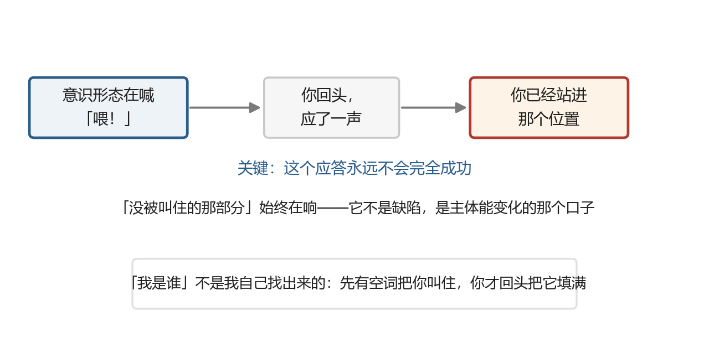

*读法：不是先有自我再被认出，是先有一个空词喊你，你回头应了一声，就站进了那个位置。关键是应答永远不完全，没被叫住的那部分，正是主体能变的那个口子。*

换一个场景：家族群里，你被叫「老大」。这一声不是描述，是位置，此后弟弟妹妹的事都来找你。你没答应过要当这个人，可你回了一声「嗯」，位置就落下了。第三章讲的就是这一声。

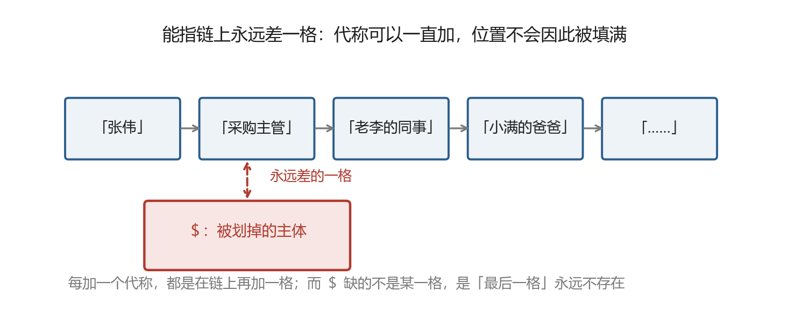

*读法：一个名字接一个名字：张伟、采购主管、老李的同事、小满的爸爸。每加一个都在链上多一格，可被划掉的主体缺的不是某一格，是「最后一格」永远不存在。判据：把这个词换成一个更准的词，还靠着它站的人站得住吗？站不住，它是主人能指；换完人都散了，那只是标签。*

## 三之二、大他者是个空位

有几个句子，你几乎每天都能听到。

「上面总有人知道。」「国家会管的。」「老板心里有数。」「那么多专家，总不至于都错。」

这几句话的共同点，是它们都在担保一件事：有一个位置，那里什么都知道、什么都安排好了，人一旦觉得这个位置存在，心里就踏实。

拉康的说法是：**大他者不存在**。那个位置是空的，从来没有人坐在那儿，而齐泽克接过来用得很狠，他指的正是那些「他们」：体制、专家、幕后集团、算法，往上填得越具体，人越安心。

阴谋论在这里露了底。它不是因为无知，是因为受不了那个位置空着，空着就意味着没有人在管，没有人负责，也没有人知道接下来会怎样。所以它必须找到「他们」：一群在暗处操纵的人。你拿证据说没有这群人，它不会散，它会换一群。

用错的方式也就一种：以为揭穿了某个「他们」问题就解决了。真正要动的是那个空位，不是空位上的填充物。

判据是一句问话：如果这个位置本来就没人，会怎样。答不上来，或者立刻要再找一个「他们」，就说明这套说法是靠大他者撑着。

边界说清楚：它不等于「什么都不存在」。空位说的是「担保」的位置，不是事实的位置，医院存在，医生存在，只是没有一个地方替你保证一切都安排好了。

**「习俗」就是这种没有保证的规矩。** 它成立的理由只有一个：大家都这么办。谁要把它拿回第一原理去问「凭什么」，它当场就散——不是被驳倒，是没人再照着做，它就不存在了。所以老规矩最怕的不是反对，是**有人认真地追问它一次**。

## 三之二之二、大他者的大他者

「大他者是个空位」这句话，最容易被听成「反正没人管，随便吧」。它说的其实是另一件事：**你往上追，每一层都还有一层。**

被冤的时候，你总想找一个「能给最终裁定的人」——师父、上级、更高一级的部门、来查的记者。可每找到一位，他后面还有一位。这条链之所以停不下来，不是因为你没找对，是因为你先信了「总有一位超越性的代理在看着、并且知道该我做什么」。

这个「总有一位」，齐泽克叫它**大他者的大他者**。它的作用不是真的来裁定，而是**让你相信裁定这件事有保障**。

**判据**：你追的那个「最终解释」，有没有落到一个具体的人身上？落不到，它就在大他者的大他者这一格——这一格永不兑现，也永不消失。

**这套机器靠「仿佛」运转。** 你我都知道它并不全能，可我们站在它面前的动作，还是按「仿佛它全能」来排：章照盖、表照填、话照说。它不需要你信，只需要你照做——**仿佛是一种动作，不是一种信念**。

## 三之三、例外才让规则成立

还有一层，比标签更不容易看见。

制度说「一视同仁」，同时留着一条通道：内推、编制外、特招、定向。规则是普遍的，通道是例外的，两者不是矛盾，是配套。

齐泽克借黑格尔的说法把这叫**具体的普遍性**：普遍性不是先有一个覆盖所有人的规则，再好心开个口子；是它必须靠一个被排除在外的例外，才立得住。没有那个例外，规则就只是纸面话。

例子：招聘写「公平竞争」，同时有一句「急招岗位可放宽学历」；学校写「按分录取」，同时有「特长生」；公司写「全员考核」，同时有「管理层不参与排名」。

判据一条：找出那个**不被规则覆盖、却让规则说得通**的位置。找得到，规则就不是它宣称的那样。

例：「急招可放宽学历」「特长生」「管理层不参与排名」——这三句都明写在规则里，而离它们最近的人（学历不够的、排名靠后的）都拿它们当自己够不着的原因。

用错的方式是把它当成「制度不公」的道德控诉。它不是控诉，是结构描述：规则和例外是同一件事的两半。

边界：例外不等于后门，后门是偷偷的；这里的例外是写进规则、公开挂着的，正因为公开，才撑得住「一视同仁」这句话。

## 三之四、先看一眼那张图

有几个句子，说出来都很暖。

「我觉得他懂我。」「我知道你是为我好。」「你根本不是我说的那个意思。」

拉康画过一张很简单的图，后来被人叫 L 图式。图上两条轴：一条是想象的，自我和镜子里那个影像互相映照；一条是象征的，主体和大他者在那儿说话；两条轴交叉的地方被一个东西挡住，那就是对象 a。

这张图要说的只有一件事：**「懂我」多半发生在想象轴上，不在象征轴上。** 想象轴最顺的时候，两个人各自对着自己脑子里的那个人说话，说的其实不是同一件事。

所以争吵里那句「你根本不是我说的那个意思」不是矫情，它是在报告一个真实的位置差：你以为在跟对方说话，其实在跟自己的镜像说话。

**「镜像阶段」不是比喻。** 拉康讲婴儿六到十八个月：他在镜子里看见一个完整的形象，先当成别的孩子，再发现那不是实物，最后认下「那是我」。三步走完，一个完整的形象被安到身上，自我就成了形；代价是那个填不满的格子被这个形象盖住了。所以问题不是「我像不像」，是「我拿谁当镜子」。

用错的方式，是把「他懂我」当成沟通成功，它常常只说明两边想象得刚好一致，一旦要落到具体安排上，比如谁接孩子、钱怎么花，那张图马上就露出来。

判据是一句问话：这句话是对谁说的，对眼前这个人，还是对自己脑子里的那个人。

边界：图式不是判决书，它只标位置，不判真心，也不能拿来证明谁在自欺。

## 三之五、戈夫曼：前台与后台

一个人被叫「骨干」，热的那一下多半发生在他还站在人前的时候。

戈夫曼把这种地方叫前台：有观众、有台词、有要维持的样子。前台不是骗人，它是任何一个场合都需要的布置，见客户要笑，开会要坐直，朋友圈要挑照片。后台是卸下来的地方：工位隔板后面、车里、厕所隔间、回家路上那十分钟。

「骨干」是前台发的角色。它之所以有效，是因为你在后台也认了它：加班的时候你对自己说「我是骨干」，这句话在没人的时候也说。

用错：把人一概说成演戏，好像谁都不真诚；戈夫曼不是说人假，是说人总在某个台子上，台子决定他能怎么站。

判据：有观众和没观众，表现一样吗。一样，那这个词已经进了后台，成了他自己的一部分；不一样，它还停在前台。

边界：后台也不是「真我」，它只是观众少一点，不等于没人看。

## 三之六、贝克尔：标签是别人贴的

「就是个打工的」这句自嘲，为什么说得那么顺？因为他说之前，别人已经这么看他了。

贝克尔一九六三年那本《局外人》讲得直接：越轨不是某个动作自带的性质，是规则被应用之后贴上去的。同样一件事，发生在不同人身上，一个被叫「有个性」，一个被叫「有问题」，区别常常不在事，在谁被抓住、被谁抓住。

用错：以为标签纯粹是冤枉，可标签贴得上，往往因为那个人确实做过某件事，只是事的性质被换成了人的性质。

判据：同一种行为，在不同的人身上是不是被同样对待。不一样，你看到的就是标签在起作用，而不是行为本身。

边界：不是说行为不重要，有些行为贴不上「有个性」的标签，那它就是行为本身的事。

## 三之七、泰弗尔：为什么被叫一声会热

「骨干」两个字没涨工资，人却热了一下。这个热从哪来？

泰弗尔做过一个很简单的实验：把人随便分成两组，连面都没见过，人就开始偏向自己那组。他管这叫社会认同：人靠「我属于哪个类」来获得一点自我价值，所以被放进一个被看得起的类里，会有真实的生理反应。

「骨干」就是这样一个类：它不给你钱，它给你一个「你跟我们是一伙的、而且是被看重的那种」的位置。

用错：以为所有人都吃这一套，可有人对群体评价免疫，你叫他一万声骨干，他只看工资条。

判据：换成一个不被看重的类，那一下热还在吗。叫「老实人」「老黄牛」，热没了甚至发凉，说明热的不是称呼，是被看重这件事。

边界：不等于人只在意群体评价，钱、前途、清闲，都算。

**还有一类更近的：小他者。** 他不是标准，也不是抽象视角，是跟你抢同一个位置的人——同事、同学、兄弟姐妹。他给你的是竞争，不是尺度；你跟他比，比的不是「够不够好」，是「谁在这把椅子上」。所以小他者让你焦虑，泛化的他人让你自觉。

**再往上一层，是「某个凝视」。** 你摆姿势时，未必是给眼前这个人看，多半是给脑子里那个「谁都不认识的谁」看——大他者里并没有一张脸，只有一个位置。想象性认同总是对「大对体中的某个凝视」的认同：你演给谁看，比演什么更重要。

## 三之八、它不知道我，我才在

前面说大他者是个空位：追到最后没人接话。这一节讲那空位对我来说意味着什么。

齐泽克的写法有点反直觉：**大他者整合不了我，这不是缺陷，是「我」能存在的前提。**

如果它完全知道我是谁——把我每一面都登记清楚，档案、评分、标签、备注全对上——那我就只是一个被登记的对象，一个填满的格子。正因为有一处它填不满，我才作为主体在那儿。

所以「被完全理解」不可能。不是没人努力，是那个位置本来就空着。你换一个最懂你的人来，也一样——他懂的是他版本里的你，不是那个正在说话的你。

**判据**：有没有一个说法，能把你完全装进去？

装得进去的，多半不是你。简历能装，「我这个人」装不进去；档案能装，你读档案时觉得「这不像我」的那一下装不进去。

**分界**：这不是「别人不懂我」的委屈。委屈还指望有一个懂的人存在；这里说的是那个位置空着，谁来了都填不满。

**常见误读**：把它读成「没人真正关心我」。它讲的是结构，不是态度。哪怕全世界都在关心你，那处空位还在。

**还有一层误解要说清**：知道它是个空位，不等于你可以把身上的标签脱掉。齐泽克的说法相反——面具比面具后面更诚实。**a 不在面具后面。** 它就是面具与你之间那道缝——戴久了，脸就往面具那边长；距离没了，你就是那个职位。这道缝就是「面具与脸的距离」。该动的不是面具，是面具与你之间那道距离：距离在，你还是你；距离没了，你就是那个职位。所以这一节的结论不是「识破了，自由了」，是「识破了，还得在那个位置上活，只是活法不一样」。

反过来还有一句判据，测的是直接性：把岗位拿掉，你还能说「我是谁」吗？

**很多人拿「过去的我」当答案。** 那些旧事被反复调出来当证据：我当年怎样、我一向如此。但调出来的从来不是原件，是编辑过的版本——自我靠这些旧账把自己拼成一个连续的故事。说不出，说明那个称呼已经长成了你的内核；说不出却也不慌，说明你与它之间还有一道距离。

## 三之九、承认：不是被喜欢，是被当作算数的人

前面讲「被叫住」，讲的是位置怎么来。这一节讲那个位置要靠什么才算数：承认。

先说清一件容易被跳过的事：**位置是成对出现的。** 没有「你」，就说不出「我」——每说一次「我」，都是在假定有人听、而且听得懂；两个人一说话，「我」和「你」就随轮次互换。所以「我与你」是一对词，「我」只是其中一半，不是一个人独占的标签（转引本维尼斯特的指示词理论）。

这个「你」还可以不是具体的人。米德把它叫「泛化的他人」：我不仅照身边某个人认自己，还照「大家一般会怎么看」认自己——这个「大家」是我拼出来的抽象视角，它没有脸，只有标准。它可怕的地方是找不到具体的人：你没法跟「大家」吵架（米德《心灵、自我与社会》1934）。

「承认」在中文里容易被听成「被认可」「被喜欢」。科耶夫读黑格尔时给的意思更硬：承认是**被当作一个能说话、能被追责的人**。喜欢是情绪，承认是资格。

它有两种。一种给位置：你是这个组的负责人，你能签字、能拍板。这种承认可以撤回——岗位一调，话就不算数了。另一种给品性：你这个人靠得住，说过的话会兑现。这种收不回，但也最难拿到。

所以争承认的架，最难打——争的不是利益，是「你算不算数」。齐泽克把这层放在主体间性的底座上（《崇》L194 说「承认对抗」的模型来自黑格尔，L668 讲的是被认同的品性）：主体要别人先认，才算成立。

**更早、更硬的一版在黑格尔那里。**《精神现象学》讲自我意识，第一层不是「互相认可」，是**敢赌**：两个自我意识先得冒生命危险互相试一次，才谈得上谁认谁——「只有通过冒生命的危险才可以获得自由」（中译本 p249）。而这场死斗是「抽象的否定」：它只摧毁，不保存。真正要的是「扬弃」——**保存并且保持住那被扬弃者**（p250）。到了主人那一段，问题才露出来：主人赢了，拿到承认，可那份承认来自「非本质的意识」（p253）。**被不算数的人承认，等于没被承认。** 这就是为什么这条链往下走，最后站住的是奴隶——他在恐惧里看见了死亡，又在劳动里把物留下来（p255–p257）。

所以「承认」不是一条平路：先要敢赌，再要有人算数；两关都过，位置才立得住。

**判据**：你做成一件没人知道、也没人认的事，它在你心里还算数吗？还算数，说明你已经有了一层不靠外部给的承认；不算数，说明那个位置一直是别人在替你撑着。

**分界**：这不是「求表扬」。表扬是给结果的，承认是给资格的；一个人可以天天被表扬，却从来没被当作能拍板的人。

**常见误读**：把承认当成自尊问题——「我太在意别人怎么看我」。它其实是结构问题：位置要有人认才成立，这不是心理弱点，是那类位置的运作方式。

他后来自己改了主意。早期他把安提戈涅当伦理英雄——一个人不向欲望让步；晚期他在改编里把她换掉：合唱队摘下面具，以「救国委员会」的名义接管城邦，处决了克瑞翁和她（钱翰、万博轩 2026，转引）。

三个结局并排放着：保留原结局，只有悲剧美学，解决不了政治；让她赢，社会反而垮掉；让合唱队接管，才是他真正提倡的那种行动——**匿名的集体，而不是孤绝的个人**。

但批评也在这里：内容上他破了界，方法上他还在主体主义的框里，所以不算真的超越了拉康（同上）。这一条要记住——**换掉主角，不等于换掉尺子**。

**一个更狠的例子：罪名可以先于事实写好。** 《天龙八部》里乔峰在身世曝光前就已经在认罪——「我不只是不忠不孝，我还是个没有名字的人」。齐泽克把这层说成：我们之所以有罪，是因为我们接受大他者以「超越性代理」的样子存在，它清楚我们的义务，却不告诉我们。

所以「它不知道我，我才在」这句话还有反面：**它一旦「知道」我，我就先成了罪人。**

**承认还有一个变种：抢受害者的位置。** 谁受害谁算数，于是受害本身变成账本上的一栏——越惨越有资格说话。

齐泽克对这种讲述有一个很具体的批评：它**对反思有敌意**，只要求快反应、快表态，谁慢一步谁就输了（《受害者的时代》，2018）。这里要分清：不是否认受害，是不让受害变成唯一能换到承认的货币。

## 四、你可能会问的六个问题

**问一：这不就是社会建构论？说身份是社会给的？**

答：有一半重合，但差在一点。社会建构论常说「身份是被建构的，所以可以重建构」。这套说法更悲观一点：建构用的材料是**空的词**，而空词之所以有效，正因为它空，你没法用「更真实的词」替掉它，因为更真实的词反而装不下人。

**问二：那「做自己」是什么意思？**

答：在这套框架里，「做自己」不是一个可执行的目标，因为它预设了一个先在的自己。更准确的说法是「**在哪个标签下、围绕哪个空缺活着**」。这不是文字游戏，它改变问题：从「我真正是谁」变成「我现在被安放在哪、我认不认」。

**问三：这套说法有证据吗？**

答：有，但是弱的。心理学里有一大批实验做「被称呼为某个类别」的效果：被提醒「你是女性」之后，数学测验的表现会变化；被提醒「你是某团队成员」之后，合作意愿会变化。三篇元分析给出的效应量大约在 0.26 到 0.44 之间，属于「小到中等」。但同一批研究里也有人重做后发现，这些小效应大部分可能是发表偏倚，校正之后接近零。最具体的一例：2015 年那篇年龄刻板印象元分析，总体 d=0.28，拆开看是已发表研究 0.42、未发表研究 −0.03——效应有一半是发表偏倚撑起来的。

所以这一章的证据等级是：**「标签会影响行为」这件事有支持；「标签决定了你是谁」这件事没有证据，它是理论命题。** 我把它写成理论命题，不假装它是发现。

**问四：那「回溯」怎么验证？**

答：验不了。这个是我这一章最硬的一处空白，「意义是事后钉住的」这个说法，在现有的实证研究里几乎没有人设计过检验。我查了 209 篇英文文献和 84 篇中文文献，用这类设计研究询唤的，是零篇。所以这一条只能当解释框架用，不能当结论引。

**问五：既然标签是空的，那换个好标签不就行了？**

答：这正是这套理论最不讨喜的地方，换标签通常只是换内容，不换结构。你还是那个被叫住、回头、成为某种人的人。真正变的是**你有没有可能是那个叫人的一方**，而这个问题的答案不在心理学里。

**问六：为什么「打工的」这种自嘲反而让人轻松？**

答：因为它把「我被低估」换成了「我本来就这样」。这是一种很有效的止痛：先自己说低，就不必再被别人的评价伤到。它的代价是，**你把自己固定在那个位置上，然后那个位置开始生产你的行为**。这不是虚伪，这是自我保护的一种形式。

## 五、另一种读法：阿尔都塞把「叫一声」讲得太顺了

这套「被叫住才成为主体」的说法，在中文最权威的解读里挨过一刀。

张一兵在《文本的深度耕犁》[9]第二卷里指出：齐泽克其实是在批评阿尔都塞，不是继承他。齐泽克问的是，**意识形态的国家机器，怎么让一个人「内化」成真心相信？** 阿尔都塞回答得太快：被叫住、回头、应答，就完成了。齐泽克说这个过程从来没完成过，总有一块残渣没被收进去；而正是这块残渣，让那套秩序显得不容置疑。

张一兵的评价是：这句话非常吓人，但它是用拉康重写意识形态理论的关键一步。

我接受这个修正，而且据此把第三章的口气改了：**主体不是被一次叫成的，是被反复叫、每次都没叫全。** 中文学界的另一条批评更狠：这套说法把主体永远交给结构，历史条件放哪儿去了？这条我接受一半，结构确实被讲得太重，但「历史条件」要落到哪一层，本书也只能给出第五章那种「什么时候会失灵」的判据，给不出完整答案。

## 六、重看这个社会

如果身份是「被叫住」的，那社会的主要工作之一就是**生产称呼**。

**招聘启事里的「我们寻找有激情的人」。** 这句话不描述岗位，它给的是一个可以被认领的位置。「有激情」没有标准，所以谁都可以觉得自己是，也谁都可以被判不是。

**职级体系。** P5、P6、M2，这些符号的内容一直在变，但它们的功能稳定：给出一个可以比较、可以争夺、可以自我安慰的坐标。

**社交平台上的自我描述。** 简介栏要求你写一句话说清自己是谁。这个要求本身就在训练一种能力：**把自己压缩成一个能被认领的标签**。

这些装置共同做一件事：**先给出位置，再让位置生产人。**

**但也要给一个反例。**

有人确实不被标签带走：老师傅、手艺人、某些做研究的人。他们的共同点不是「意志强」，而是**有一个不依赖外部称呼的活儿**，活干得好不好，自己知道，不必等谁叫一句「骨干」。

所以更准确的说法不是「人都是被标签塑造的」，而是：**当一个人手上没有能自我验证的活儿时，标签就成了唯一的位置来源。** 这在单位里、在平台上、在饭桌上都成立。

**本章边界**：这一章能推到哪、推不到哪，见附录 F·3。

## 第四章　社会是怎么被算出来的

> 第三章讲的是主体被一个空词叫住；这一章往下问：这个空词背后，社会是怎么被算出来的。

## 一、三个场面

**第一个。** 一对夫妻，一个上班，一个在家带孩子做饭。年底算「家庭贡献」，上班的那个说「我养家」。带孩子的那个说不出话，不是没干活，是**这些活不在任何一张表上**。

有意思的是，如果他们把带孩子的事外包给一个阿姨，付她工资，这笔钱就进 GDP（国内生产总值）了。**同一件事，自己做不算，雇人做就算。**

**第二个。** 一个外卖骑手跑了十二小时，系统显示他「在线 6.5 小时、有效配送 4.2 小时」。他很清楚自己干了十二小时，但那六个小时不在任何记录里，等单、爬楼、车子没电。

**第三个。** 一份年度报告里写着「全员劳动生产率提升 8%」。这个数是怎么来的？产出除以「从业人员数」。而「从业人员」这个分母里，正式在编的算，外包的不算，实习的不算，被「优化」掉的自然也不算。

三件事都是先算后认：**有了「怎么算」，才谈得上「是什么」。** 先定算法，才有「贡献」「工时」「生产率」。

## 二、四个矛盾

**矛盾一：干了的活，可以不算数；没干的事，可以算产值。**

带孩子不算，雇阿姨算。写诗不算，写广告算。这是常识，但常识说不出为什么，为什么「算不算」不取决于这件事对人有多重要？

**矛盾二：算的东西，都是能被算的东西。**

不是「重要的被算进去」，是**「能被算的被算进去，剩下的被说成不重要」**。顺序反了。

**矛盾三：算得越精细，看不见的越多。**

一个工厂把每道工序的工时精确到秒，同时看不见工人午休时聊天建立的那点信任，直到那点信任没了，协作开始出问题。**精细化的代价是盲区变得更硬。**

**矛盾四：算法一改，「事实」就变了。**

同一个国家，同一年，换一套统计口径，失业率能从 21.3% 变成 14.9%。数据都是真的，只是「算的是谁」变了。

四个矛盾指向同一个东西：**社会不是先有一个客观的样子然后被测量；社会是被测量方式一起塑造的。**

**爱情是最好的例子。** 两个人不是合成了一个整圆，是围绕同一个「差一点」结成同盟：共用一个缺口，各自的错过方式刚好接得上（斯韦尔斯《至死不渝》，2025）。所以「我们」不是把洞填上，是把洞认成同一个。

## 三、拆词：剩余不是「分剩下的」

这一章要拆的核心是马克思的那个词，以及齐泽克怎么用它。

**剩余价值。** 最常见的误解是：工人创造了价值，资本家把其中一部分拿走了，剩下的那部分就是「剩余」。按这个理解，剩余是**分配后的结果**，先有总额，再分，分剩的就是剩余。

马克思不是这个意思。他说的是：剩余在生产一发生的时候就产生了。工人一天干八小时，前四小时创造的价值够付他的工资，后四小时创造的价值**不属于他**，不是「分的时候没分给他」，是**从产生的那一刻起就不算他的**。

这个区别很要紧。前一种理解（分剩下的）会导向一个温和的结论：分得公平一点就好了。后一种理解（产生时就不算他的）导向的结构性问题：**这套运转本身就以「有一部分不算」为前提。**

**剩余享乐。** 齐泽克说，拉康的剩余享乐概念是**仿效剩余价值**提出的。仿的是结构，不是数量：享乐的运转本身会生产出「还差一点」这个多余物，它不是「享受完剩下的那点快乐」。

（把这两个词读成「当量」，剩余价值多少、剩余享乐就多少，是中文文献里最常见的误读。齐泽克说的是同构，不是换算。第二章里有这段的展开。）

**「未被算的」。** 这一章真正要指认的，是这个社会里那块**存在但不进账**的部分。它有几个常见形态：

- 家务、照护、育儿（自己干不算，雇人算）
- 平台上的等待时间（在线时长 ≠ 有效工时）
- 被「合作」「灵活用工」改写的雇佣关系（同一个干活的人，改个合同名称，就从「从业人员」里消失了）
- 生态代价（不进企业账本，进公共账本）

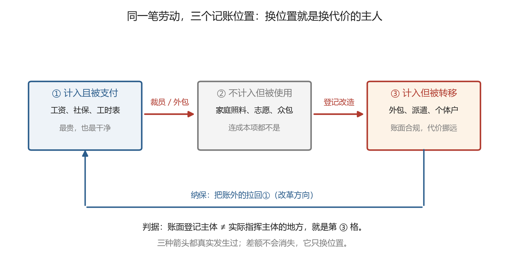

*读法：左边计入且被支付，中间不计入但被使用，右边计入却把代价挪走。判据：账面登记主体和实际指挥的人对不上的地方，就是第三格。差额不会消失，它只换位置。*

## 三之二、两个视角之间那道缝

同一笔订单，销售看见的是业绩，工人看见的是加班。

同一份年报，老板看见的是效率，会计看见的是口径。

这不是谁在撒谎：两个视角都真，但拼不到一起。齐泽克把这种拼不上的关系叫**视差之见**：重点不是哪一边对，是那道缝本身，它才是要研究的对象。

所以遇到「各有各的道理」，别急着调和，调和的意思是各让一步、合成一个都能接受的说法，可那个说法往往正好把缝盖住了。缝被盖住，问题就看不见了。

例子：公司说「今年效益好」，员工说「我们工资没涨」。这两句不矛盾，它们是同一件事的两面，缝在「效益归谁」，你把它调成「大家都不容易」，缝就没了。

判据是这样：找两个都能自圆其说、又不互相取消的说法，然后问它们必须共同排除的那一点是什么。那一点就是缝。

边界：视差之见不是相对主义。「都对」是懒话，它要求你说出两边共享的那个盲点，说不出来就不算用上。

**还有一句要紧的：** 通常的说法是「本来平衡，是某种过剩让它偏离，除掉过剩就恢复」，酷儿的读法正相反——**过剩是现实的构成要素**，把它消掉，平衡本身也垮了（《享乐与虚无》第 29 节）。

法西斯式的秩序观正是前一种：工人要多、资本家要狠，都是「过剩」，把带来过剩的人清掉，阶级就和谐。马克思主义说：不是，对抗是结构本身，消灭对抗只能消灭阶级。

## 三之三、波兰尼：有些东西本来不是商品

前面说的都是「算」这件事。还有一层更靠前的：有些东西本来不是拿来卖的，被硬当成商品之后，账才算得起来。

波兰尼管这叫虚拟商品。土地、劳动、货币，这三样在市场上被买卖，可它们都不是为卖而生的：土地是自然，劳动是人的一辈子，货币是信任。把劳动当商品，等于把一个人活着的那些年切成小时，一小时一小时地标价。

用错：以为市场是天生的，可市场是被造出来的，造它需要法律、需要度量、需要把原来不算钱的东西算成钱。

判据：问一句「这东西要是没有市场，是不是就没人做了」：家务就是这样，它没有市场也一直在做，所以它被算成「不算」。

边界：不等于市场全是坏的，市场能把一些事办成，问题在于它把什么算进来、把什么留在外面。

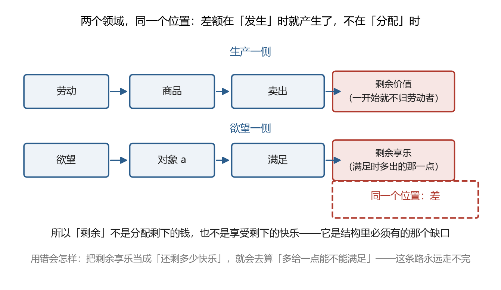

*读法：上下两行是同一个位置，差额在「发生」时就产生了，不在「分配」时。用错会怎样：把剩余享乐当成「还剩多少快乐」，就会去算「多给一点够不够」，这条路永远走不完。*

## 三之四、增值与非增值：账需要一个底座

马克思把劳动切成两半：增值劳动与非增值劳动。前者进账，后者维持人的生命过程——做饭、照护、睡觉、把孩子养到能上学。

齐泽克引用这一点时说得很直白：女性的家务劳动不算劳动，因为它不是增值劳动；而剥削恰恰依赖大量没有被「估值」的劳动才能运转（《享》L783）、（《享》L812）。

这不是「家务分工不公」那一层的问题，而是估值本身的前提：**账要能算，先得有一块不算账的底座。** 人的生命再生产与资本的再生产之间，因此是一道不可能和解的裂缝（《享》L1080）——不是还没协调好，是结构上协调不了。

**判据**：这份活如果明天没人干，是账先垮，还是人先垮？

**分界**：它不等于「家务」，也不等于「女性问题」。凡是让日子得以继续、却不进入账面计量的劳动，都在这一格。

**常见误读**：以为把家务折算成工资就公平了。折算只是把它拖进账本，没改变账本需要一个外部底座这件事。

## 三之五、钱为什么能用：尺子与信仰

第三章说过主人能指是个空词。货币是同一个结构落在物上：它不是「有价值」，是「被当成价值的载体」——物理材料只是社会功能的载体，靠发行机关担保、靠大家都当它值钱（《崇高客体》L250–L251）。

它因此有一个双重身份：**所有商品的一般等价物，同时自己被剥夺了使用价值**（《享》L845）。商品领域靠这一个例外实现总体化：别的物用来干这个干那个，只有它只用来换。

齐泽克讲「一百泰铢」时点了一件事：你「有」一百泰铢这个概念，和口袋里真有一百泰铢，是两件事；一旦通胀，口袋里的和概念里的会一起缩水（《崇》L146）。

**判据**：它值钱，是因为它本身能用，还是因为大家当它值钱？

**分界**：这不是「钱是虚构的」那种感慨。正因为靠大家当它值钱，它才稳定得可怕——虚构的东西一旦人人都认，比实物更硬。

**常见误读**：把它读成「拜金批判」。这里说的不是人贪财，是那套尺度怎么把别的东西都变成可比较的量。

## 三之六、平台在收地租

账本进到数字时代，多了一栏。你以为你在免费使用平台，其实你在替它生产：你的内容、你的关系、你的注意力被圈成一块地，你种，它收租。

齐泽克把这一层叫**技术封建主义**：平台圈占的是「一般智力」——所有人共同生产出来的知识、语言、关系，被少数平台围起来收费。剥削的样子也变了：不再是工厂里熬时间，而是你免费劳动，它按流量折算。

**判据只有一句：这块地是你种出来的，收租的是谁？** 你发的东西、你的好友关系、你的作息规律，产出的价值归谁，谁就坐在收租的位置上。

常见误读：以为「免费」就是没有交易。免费的是界面，付的是你的行为数据——这跟账本一个道理，**不记进账的东西，往往不是不存在，是记在别人账上**（贠佳可 2026，转引）。

**这套账不是自然长出来的，是被人设计成「不受过问」的。** 新自由主义常被当成一套经济政策，其实是个有意识的政治工程：把资本主义经济从政治领域里拿出来，靠一套全球机构隔开民主干扰，同时尽量在幕后运转（McManus 2019）。

所以「市场规律」这四个字要打个折：**不是规律自己长成那样，是有人把它挪到了没人能投票的地方。**

## 四、一个可以量的东西：未登记劳动占比

上面这些听起来都对，但它容易被当成一句空话。所以我要给它一个能算的代理。

国际劳工组织的口径里有一个指标：**工资就业占比**（wage and salaried workers，占全部就业的比重）。它的反面，就是「未登记、非工资、自雇或家庭帮工」的那部分，大致可以当作「不在正式账本上的劳动」的代理。

2024 年的数（世界银行，同一口径）：

美国 6.2%、德国 8.2%、日本 9.2%、韩国 22.9%、墨西哥 30.8%、巴西 30.5%、**中国 38.1%**、印度约 75%（2019 口径）。

十年间的变化（2015→2024）：227 个有数据的国家里，未登记占比**年均中位数只降了 0.12 个百分点**，中位国家十年合计降约 1 个百分点；降速达到每年 0.2 个百分点以上的只占 36%。中国降得稍快，年均 0.38 个百分点（41.5%→38.1%），按这个速度，从 38% 降到 15% 大约需要六十年。

这个数说明一件很朴素的事：**「把该算的都算进来」这件事，在可观察的时间尺度上几乎不动。** 不是有人不愿意，是这套运转需要有一块不算的东西。

## 四之二、库兹涅茨与那本账

「经济」这东西不是一直有的，它是被一本账造出来的。

上世纪三十年代大萧条，美国国会要问一句「到底掉了多少」，可当时没人拿得出一个总数。库兹涅茨带人把这套账做了出来，就是后来的国民收入核算，也就是 GDP 的前身。他自己在报告里写过：这套账算的是市场交易，家里做的饭、带的娃、照顾的老人，不在里面。

这个说明后来被人忘了。今天你说「经济增长」，默认说的就是那本账上的数；那本账一开始就写明不算的那些事，就成了「不创造价值」。

用错：把 GDP 当成社会全部产出，可它量的是交易，不是活动；一个自己种菜自己吃的人，和一个买菜吃的人，在这本账上不是一回事。

再举一个：一位母亲自己带娃，GDP 上看不见；她出门上班、请人带娃，GDP 就涨了两次。同一件活，从「不算」变成「算」，变的不是活，是它在不在市场里。

判据：看这套账记的是交易还是活动：发生在市场里、有价格、有发票，记；发生在家里、没价格，不记。

边界：不等于 GDP 没用，它量的就是市场交易的规模，量得挺准，问题是别拿它当唯一尺子。

## 四之三、斯科特：把社会变薄

国家要管得动，得先把人变得可数。

斯科特说这叫可读性：姓名、地籍、身份证号、标准表格，都是为了让人从一个活人变成一个能被登记的单位。这件事不是坏事，没有它就没有税收、没有社保、没有公共卫生；可它同时把活人身上那些登记不下的部分裁掉了。

用错：以为统计是面镜子，可统计是张筛子，它只留下筛孔大小的东西。

一个更具体的例子：老人一辈子住在村里，没办过身份证。拆迁登记那天，表格上第一个字段是「身份证号」——他填不出来，于是「查无此人」。他不是不存在，是不在表上。

判据：看这张表要填的字段，字段只有官方关心的那几栏，填完的人就成了那几栏。

边界：不等于反统计，没有统计，连问题在哪儿都不知道。

## 五、你可能会问的六个问题

**问一：既然不算，为什么还有那么多人干？**

答：因为不算数不等于不重要，恰恰相反，它常常是最不能省的活（带孩子、照护老人）。不算数影响的是**议价能力**：不进账的事，就没法要求报酬。

**问二：那把家务算进 GDP 不就行了？**

答：可以算，但要想清用什么价。用保姆的市场价算，等于假设「家人=保姆」；用你的机会成本算，一个高薪者的家务就比一个失业者的家务值钱，这显然不对。这不是技术难题，是价值判断被塞进「算法」里。

**问三：这套说法跟「剥削」有什么区别？**

答：剥削讲的是拿走多少，「不算」讲的是**什么从一开始就不在账上**。前者可以谈判（多给点），后者连谈判的桌子都没有。

**问四：平台化是不是让情况变好了？**

答：账面看是变好了。把一个雇佣关系改成「个体合作」，未登记占比的数会变好看，因为那个人从「从业人员」里出去了。**数字改善和处境改善可以是反向的**，这是本章最实用的一句提醒。

**问五：那这些数可信吗？**

答：口径统一、来源公开（世界银行/ILO），可比性比大多数社科数据好。但它是**代理**，测的是「正式账本之外的劳动位置」，不是「剩余」本身。而且印度用的是 2019 年口径，跟其他国家的 2024 年不完全可比，我在附表里标了出来。

**问六：这一章能推出什么结论？**

答：只能推出一个：**「算进来」是一个政治过程，不是一个技术过程。** 谁被算、按什么价算、什么时候改口径，每一步都可以争。你不能指望它自动变好。

## 六、另一种读法：你拿「占比」当代理，正是在做你反对的事

这本书最该挨的一刀来自一篇中文论文，《论消费社会中的齐泽克行动观及其现实策略》。它的推论是这样的：

剩余价值不是结构概念，是随平均利润率变动的**现实经济范畴**；齐泽克把剩余享乐与剩余价值并置，等于用「定量」替换了「变量」；替换之后，账面上看不见的东西就被当成不存在，变革的路径也就被堵住了。

这一刀砍的正是我这一章：我拿「未登记劳动占比」当代理，而占比正是定量。

我接受指控的一半。代理确实会把「没有数字的那部分」漏掉，平台化把雇佣改成个体合作，占比立刻好看，处境一点没变，这段我写在上一节了。

不接受的那一半：**不量它，就只能谈它。** 这一章要做的不是用占比取代概念，是给概念找一个能被反驳的落点。若某个国家在十年内把未登记占比降了 5 个百分点以上，「登记能力扩张极慢」这条就作废，这是占比的用处，也是它的限度。

## 六之二、这个代理测不到什么

它会让人误以为测到了「剩余」本身。其实它只测**一件事**：登记的边界在哪里，以及这条边界移动得多快。

三件事它测不到。

**第一，测不到享乐的量。** 谁比谁更「享受」，这个数字管不了。它只能告诉你「这部分劳动没被计入」，不能告诉你「当事人从中得到了多少快感」。

**第二，测不到动因。** 一个人在这个位置上为什么会那么做，是习惯、是压力、是没得选，都要另外去查。占比只给结构位置，不给原因。

**第三，测不到「剩余」的关系性质。** 剩余不是「某个人被拿走了多少」，而是「有一部分从来不在账上」。一换成「剥削率」的问法，这个代理就偏了：它测的是边界，不是拿走多少。

**一个反例，用来自我否证。** 假如有个社会，未登记劳动占比很低（比如低于 10%），但「越干越不够」的感受同样强烈，那这个代理就该换，换成「劳动成果中有多少不归劳动者支配」一类的指标。这条否证条件我先写在这里，将来真遇到，就是这张表作废的时候。

**本章边界**：这一章能推到哪、推不到哪，见附录 F·4。

## 七、重看这个社会

如果「账本」塑造了「事实」，那社会的主要战场之一就是**口径**。

**GDP 的口径。** 算交易，不算无偿劳动；算新建，不算损耗（森林砍了算收入，树没了不算支出）。这不是疏漏，这是它的定义方式。

**失业率的口径。** 「失业」要求「正在找工作」。找累了不找了，就不算失业，算「退出劳动力市场」，同一个处境，换一个词，从统计里消失。

**「从业人员」的口径。** 外包、平台、实习、劳务派遣，每一种都能让一个人从分母里出去。分母小了，人均就高了。

**但也要给一个反例。**

有些国家的未登记占比确实很低（美国 6.2%、德国 8.2%，世行 2024 年数据）。它们不是靠「大家都变自律」做到的，是靠**税务、社保、雇佣登记这一整套基础设施**。每一笔工资都有记录，雇主不登记就没法发工资。

所以更准确的说法不是「这套系统必然产生不算的东西」，而是：**不算的部分有多大，取决于登记能力有多强；而登记能力是一种需要长期建设的东西，不是一次改革。** 这是本章对「可观察时间内不可消除」这个判断的限定版本，它可能被推翻，条件我写在下面。

## 第五章　系统的失败品

> 第四章讲的是差额有多少；这一章讲差额长什么样，它最后以什么形式露出来。

## 一、三个场面

**第一个。** 一个 2023 年毕业的学生，七月投出去四十份简历，一个面试都没有。统计上，他这一年还算「在校」——不算失业。同一年，数字也改了两次：2023 年 6 月，16—24 岁城镇调查失业率 21.3%，是历史最高。两个月后，这个数停止发布。2024 年 1 月重新发布，把在校学生剔出去；新口径下的第一个数据月（2023 年 12 月）是 14.9%。两步都有官方原文，存档在 原始数据目录（2023 年 6 月原文存档、2024 年 1 月原文存档）。

数据都是真的。21.3% 和 14.9% 都对，只是「算的是谁」变了。顺带一句：2025 年 6 月的 14.5% 比 2024 年同月还高 1.3 个百分点——月环比受毕业季影响，同比才看得出趋势。

**第二个。** 一项全国时间利用[13]调查：居民每天干无酬劳动 2 小时 42 分，参与率 70.2%。女性 3 小时 48 分，男性 1 小时 32 分。这些活不进 GDP。

我问过一个问题：为什么不进？官方的回答不是「我们算不了」，而是**「如果算进去，就没法灵敏地反映经济运行情况」**。

**第三个。** 一个单位考核指标里有一条「客户满意度」。谁把它做完，谁就发现：真正的难点是让客户填表。于是有了「满意度辅导」，有了上门送小礼品，有了「不满意请打这个电话」。

指标完成了，满意度没变。

三个场面里都有同一个东西：**一个系统，按自己的规矩运转，然后生产出一样东西，那样东西正是它的规矩造成的，而且它以某种方式回到系统里。**

## 二、四个矛盾

**矛盾一：问题被解决了，然后又回来了，只是名字变了。**

失业率太高，改口径；满意度太低，改成「填表率」；医患矛盾太紧，加一个「投诉数量考核」。每次都有整改，每次都有效，然后问题换个名字回来。

**矛盾二：越是严格执行，问题越严重。**

第三个场面那个人没有偷懒，他非常努力地完成了指标。**问题恰恰产生于「做得对」**，不是没执行，是执行得太好。

**矛盾三：系统自己的说法和它自己的做法对不上。**

它说自己要「反映真实就业状况」，同时又说「算进去就不灵敏」。这两句话都在同一份说明里。不是撒谎，是**它要的东西有两个，而这两个在算的时候会打架**。

**矛盾四：这些失败品，最后都以「别人的问题」的形式出现。**

满意度没变，是因为客户不配合；就业压力大，是因为年轻人不肯去基层。系统内生的失败，被记在外部的账上。

## 三、拆词：征兆不是故障

这一章要拆的是本书最重要的一次区分。

**征兆（symptom，中文也译「症候」）。** 齐泽克说了一句很怪的话：**「发明了征兆的是马克思」**，不是弗洛伊德。

他的意思是：马克思分析商品的时候，做出了一个概念工具，这个工具后来能同时用来分析梦、癔症。这个工具的关键在于，**它分析的不是「系统坏了」，而是「系统按自己的规律必然生产出来的东西」**。

商品拜物教就是这样一个东西。它不是「有人骗了消费者」，而是：**商品的生产方式本身就要求把人与人之间的关系显示成物与物之间的关系。** 你不需要谁撒谎，这套运转自己就会这么显示。

所以征兆的定义是：**系统按自己的规律必然生产出来的那一个失败品，它以扭曲的形式把系统本身显示出来。**

**失灵（malfunction）。** 这是最常见的混淆。失灵是「规则没被执行」，有人偷懒、有人贪污、流程有漏洞。失灵要修的是执行。

**两者的分界，是一个可以回答的问题**：把当事人换成一个「完全照指标优化、没有任何私心」的人，那个被排除的东西会**更严重**吗？

- 会 → 这是征兆。因为连最优的执行者都在生产它。
- 不会，或者无关 → 这是失灵。因为换个好人就能解决。

这个问题是本书的硬门槛。很多「系统问题」的问题描述，只要过了这一问，就会发现是失灵，不是征兆。

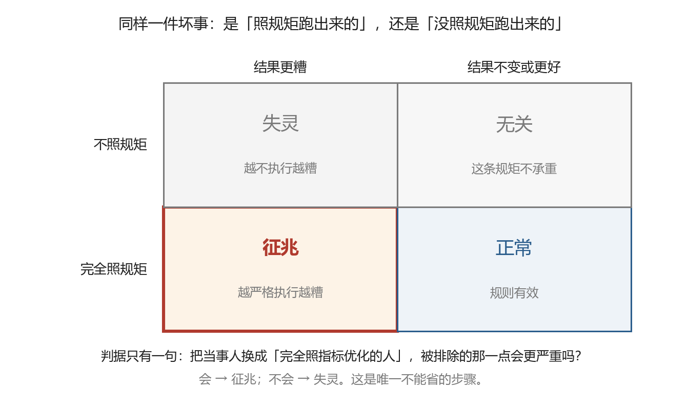

*读法：完全照规矩还更糟，是征兆；不照规矩才糟，是失灵。这一步省了就分不清「规则在产坏东西」和「规则根本没被执行」。*

**意义是迟到的。** 齐泽克借黑格尔那句「密涅瓦的猫头鹰在黄昏才起飞」讲这一点：一件事的意义不能在当时被读出来，它要等后来那套能指把位置排好，才回溯性地掉下来。所以阐释永远来得太晚——不是我们不够聪明，是意义本身在时间上后到（《崇》L461）。

这也解释了为什么「当场解释」常常没用：你解释的是自己刚摆好的那套位置，而对方的位置还没到位；两套位置要过一阵才咬合。

**另一种不是被压下去，是根本没登记。** 拉康的「排除」（foreclosure，法文 Verwerfung）讲的就是这种：某个关键能指——缝合点、父亲之名——被排除在符号秩序之外，那个位置**根本没建起来**（《崇》L501）。被排掉的东西不会「回来」，它会在实在界里以幻觉、以征兆的形式冒头。区分很实用：压抑是把已经写进去的东西按下去，它还在，会以症状回来；排除是这一步没发生。齐泽克后来还把这一条推广了：凡是符号结构，都是围着某个空隙建起来的，性关系的能指被排除，所以「不存在性关系」（L502）。

## 三之二、他们偷走了你的享乐

有些话一听就热，讲的人不需要证据。

「外地人把工作抢了。」「移民就是来吃福利的。」「现在的年轻人不生孩子，是自私。」

这些话里真正在动的不是事实，是一个感觉：**我的那份被他们拿走了**。齐泽克管这个叫「享乐窃贼」：被偷的不是钱，是「本来该属于我的那份享乐」。

这个结构有个特点：「他们」必须既近又远，住同一条街、说不一样的话、干一样的活，又不算「我们」。太远就没有威胁感，太近就分不清。

所以摆数据没用：你列出移民纳税更多、犯罪率更低，它不会散，因为它要的不是重新分配，是「有人欠我」。欠着，才有位置。

判据可以这样试：把「他们」换成「我们中的一部分人」。比如把「外地人抢了工作」换成「不加班的人抢了你的晋升」，叙事照样成立。这说明它针对的从来不是外人，是享乐的分配：谁被允许享受，谁不许。

边界：这不等于所有排外都是这个结构。真实资源冲突存在，那就得分开算，该谈分配的谈分配，该谈结构的谈结构，别拿一个概念盖掉另一边。

## 三之三、每个人自己缝的那一针

有人开工前必须把桌上的东西摆正，歪一点就写不下去；有人每天走同一条路，绕远也走；有人做菜必须按固定顺序下料，顺序错了整盘都不要。

这些事看起来像毛病，可你让他改，他会难受，改完了状态反而更差。

拉康晚期造了一个词，圣状，它跟症状不是一回事：症状是规则压出来的东西，可以被解读、被分析；圣状不指向任何意义，它是主体用来把自己缝住的那一针。拿掉它，人不是变好，是散。

所以公司团建最爱干的那种事，恰恰最危险：把每个人的怪癖摊出来，说要「打开自己」，对一个靠固定顺序活着的人，这不是打开，是拆线。

用错的方式，是把别人的圣状当成需要纠正的毛病。

判据是拿掉它看后果：这个人还能不能维持日常，散了是圣状，不散只是习惯。

边界：不是所有怪癖都是圣状，判据是「拿掉会散」，不是「看着奇怪」，这条线不划清，这套说法就会变成「我的毛病都很重要」。

**认同圣状。** 如果圣状解释不掉，那终点是什么？齐泽克给的答案是「认同圣状」（旧译「认同症状」）：不是把它消掉，是认出它就是你能站住的那个地方——「本我在哪里，自我就必须去哪里」（《崇》L508–L510）。

这和「治好」是两回事。治好假设有一个没有圣状的人；认同承认那个结一直在，只是不再假装它会散。分界在于：前者要你变成别人，后者要你在那儿活。

**想必知道的主体。** 分析家之所以有效，不是因为他真知道你的圣状意味着什么，是因为你**假定**他知道。这个假定是幻觉；但没有这个幻觉，真知识生产不出来——移情就是这个幻觉的组织形式（《崇》L998）。

这也解释了我们为什么总要找一个「懂的人」：医生、专家、领导、分析师。他们的权威来自位置，不来自内容；位置一撤，话就轻了。

**异化不是要被克服的东西。** 齐泽克讲瓦鲁法基思那本《另一个现在》：一个彻底透明、人人各得其所的社会，反而让「反抗」无处下手——爱丽丝说「太叫人开心了，想反抗也无从下手」，她的欲望因此受威胁。他要的结论不是「回到压迫」，而是：异化是我们自由的前提，它给自由留出喘息的空间；和解意味着与异化和解，不是消除异化。

**还有一层：影像。** 德波把当代资本主义叫「景观社会」——不是物在统治，是影像在统治；人们知道影像是被制造出来的，却仍然沉迷，从而忘掉自己的本真社会存在。马克思的经济拜物教批判，到这一步变成了**景观拜物教批判**：你转发、你打卡、你点赞，都不是在描述事实，是在给一套伪欲望结构注册。

## 三之四、指标为什么会坏：一条链

一个部门把「客户满意度」写进考核，第二年满意度上去了，投诉也少了，可客户真正的问题没变，因为满意度变成了要被管理的东西：回访电话打过去先问「您对我们的服务满意吗」，选项里那个「不满意」被人先解释了。

这条链有五环，每一环都是一个不同的人钉下的。

第一环是默顿，一九三六年那篇讲科层结构的文章里，他给出了「目标置换」这个词：一个组织太依赖某条规则，规则就从手段变成目的，遵守规则本身成了成绩。满意度本来是量服务的，一旦成了考核项，它量的就是「满意度这个数」，不是服务。

第二环是古德哈特和坎贝尔。古德哈特一九七五年说，一个指标一旦变成目标，就不再是好指标；坎贝尔一九七六年几乎说了一样的话，只是对象换成了社会指标。两个人隔着一个大西洋撞到同一件事，说明这不太可能是谁的疏忽。

第三环是卢曼。他说系统只按自己的符码运转，法律只问合法不合法，经济只问付不付款。外面递进来的指标，系统不会照单全收，它会先翻译成自己的码，翻译这一步，指标已经被吃掉了。

第四环是周雪光。他讲运动型治理：常规科层办不了的事，用一场运动来办，运动一停，事情回到原样。指标是常规的产物，能治常规，治不了它自己生产出来的问题。

第五环是贝克。风险社会里，风险和财富的分配逻辑不一样：财富往下沉，风险往上飘。指标把风险挪到账外，账内就干净了。

五环接起来是这样：手段变成目的，指标一旦用来考核就失真，因为系统只按自己的码运转，所以坏掉的指标不会被修，只会被下一场运动盖过去，代价记到看不见的那本账上。

判据：这条链上任何一环断了，「指标必然会坏」就不成立。去找一个被当作考核项、却一直没坏的指标，看它为什么坏不了。

例：消防的出警时间、航班的准点率——它们有个共同点，数本身就是结果，中间没有可以拿来做样子的环节。

边界：不等于所有指标都会坏。有些指标自带防作弊的设计，比如随机抽检、过程和结果分开量；坏的是那种能被表演的指标。

**超我不只审你，还把结构问题改成个人债务。** 齐泽克叫它「超我-个体化」：生态变成「你今天还了自然母亲多少债」，政治正确变成「你看她的眼神干净吗」，慈善变成「每月十元救一个孩子」。它的意识形态意图一望即知——让人沉溺于自我审查，回避对工业文明的整体质疑。拉扎拉托把这个主体叫「负债人」：我负债，所以我作为一个已经融入秩序的主体而存在。

**景观的三种形式。** 德波把景观分成三种：集中的（官僚专政，纳粹与苏联）、弥散的（一般形式，广告与消费）、综合的（1988 年提出，渗透全部实在）。综合景观有五个特征：不间断的技术更新、国家与经济的一体化、普遍化的秘密、无可置辩的谎言、永恒在场。它最重要的原则是「不干预主义」——不禁止你，只让你看；「呈现的东西都是好的，好的东西才呈现出来」。

**狗智在今天有三种标准姿势。** 王平把齐泽克论生态危机的分析归成三类「精神分裂」：怀疑主义（「没那么严重吧」）、强迫症式行动（不停参加活动，为的是避开真正的灾难）、道德主义（谴责别人，自己不动）。三种都不是无知，都是**知道而照旧**——这正是狗智的当代形态。

## 三之四之二、例外通道

指标链最怕的不是「有人作弊」，是**有人被允许不算**。

每一套账都需要一个「不在账上」的位置：免检的、特批的、走内部流程的、创始人拍板的。它不写在规则里，却是规则能运转的前提——因为规矩要装得像铁板一块，就必须有一处**不装**的地方。

这就是「例外通道」。它不是腐败（腐败是不执行），它是**执行得太干净、于是需要一个不被执行的缺口**。

**判据**：这套规矩里，有没有一个谁都看得见、却不受它约束的位置？

**拉康的性化公式还管一件事：为什么有的系统非要一个例外。** 拉康把它写成两句话：男性那一侧靠**一个例外**撑住「全部」（「所有男人都有阳具功能，除了那个原父」）；女性那一侧相反，**没有例外**，所以是「并非全部」（not-all），不能被总结成一句。这不是男女分类表，是两种组织位置的方式：一种靠排除一个，换来确定；一种放弃确定，换来不被收编。有，规则才立得住；没有，规则撑不过第一次较真。

## 三之五、不假设别人信，只假设系统信

前面几节讲「明知没用还照做」。这一节讲那套「照做」在信什么。

拜物教的老解释是：人把物当成神，信它。齐泽克说不对——市场行为里我们不假设别人信，我们只假设**系统本身信**（《享》L2040）。

要点在这儿：我不需要相信钱值钱，也不需要相信别人相信钱值钱；我只需要假设「系统认它」。操场上所有人都知道球出界了，比赛还是按裁判的判罚继续——信的不是裁判英明，是「判罚有效」这件事本身。

所以拜物教属于政治经济学，不属于心理学（《享》L2040）。它不是一个错误念头，是一套每天在运行的操作。

**判据**：你是自己信这一套，还是只是在假设「系统信」？

自己信的人会为它辩护；只假设系统信的人照做，但不辩护——这两种人看起来一样，被问到「为什么」时立刻分开。

**分界**：这不是「虚伪」。照做而不信不是道德缺陷，是这套安排的正常运转方式。

**常见误读**：读成「大家都被骗了」。没人被骗，恰恰是这套东西能运转的原因：每个人都知道是怎么回事，但每个人都假设系统认它。

**这一条要更准一点。** 齐泽克引普法勒的说法：非人格信仰——「我不相信，但大他者相信，所以我必须表现得好像我相信」。并不需要我真信；只要我假设「别人信」，这套东西就转得起来。与之配套的是非人格享乐：把享受归给某个大他者，自己只是执行工具。

**放纵不是自由的另一面。** 享乐一旦被允许，迟早变成「你必须享乐」——于是享乐主义翻成极度残酷的超我。今天的罪疚不是「我违反了禁令」，而是「我不再能够享乐」。这也是为什么「放开点」「别那么紧绷」这类话，听起来像关心，落到身上却像任务。

## 四、五步识别法

不能只给定义，得给能用的步骤。五步：

**一，读系统自己的说法。** 它宣布自己要做到什么？（「灵敏反映经济运行」、「提升客户满意度」）

**二，找它必须排除的东西。** 为了做到这个，它不得不把什么放到外面？（在校生、无酬家务、填不了表的客户）

**三，看被排除的东西怎么回来。** 通常有四种形态：
- 成本转移（家务不出钱，但由女性承担时间）
- 指标重定义（改口径，数字变小）
- 道德话语（「现在的年轻人不肯吃苦」）
- 外部化（「客户不配合」）

**四，判内生性。** 用上面那个二选一的问题：换成最优执行者，会更严重吗？

**五，写裁决。** 是征兆、还是失灵、还是无法判断。写不清就写「无法判断」，不许糊过去。

**两个例子跑过这五步**：无酬家务（成本转移型）和青年失业率（指标重定义型）。两次判定跟隔日重判一致。

**必须说清楚的是**：这两次都是同一个人判的，隔日重判（test–retest），不算独立编码。真正严格的检验需要第二个人盲判。这一步我做不到，写在下面「可能会错在哪」里。

*前四步是描述，第五步才是分水岭：「换成完全照指标优化、没有私心的人，被排除的点会更严重吗」。会，是征兆；不会，是失灵，规则根本没被执行。*

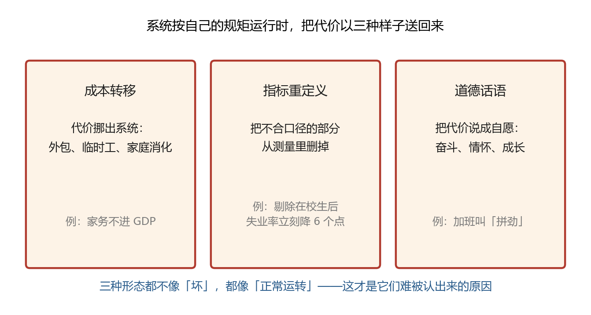

*读法：成本转移、指标重定义、道德话语，三种都不像「坏」，都像「正常运转」。它们是同一件事的三种长相：系统把代价挪出去，再把它说成正常。*

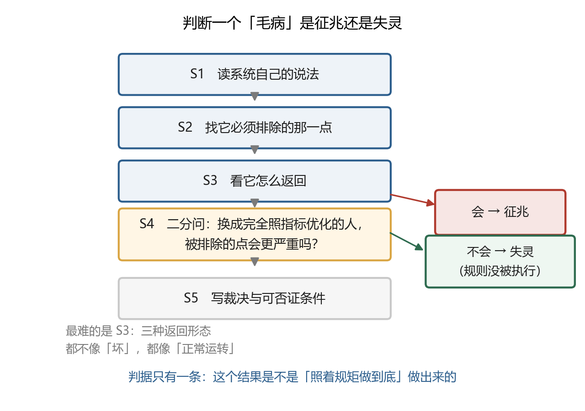

*读法：头三步是描述，第四步才是分水岭：「换成完全照指标优化的人，被排除的点会更严重吗」。会，是征兆；不会，是失灵。*

再换一个：一所学校的「控辍保学」要求零流失。于是成绩最差、最可能走的那几个学生，成了最需要「留住」的人，留住的不是他们的学习，是名单上的那一格。系统按规矩跑到极致，产出的是这个。

## 五、你可能会问的六个问题

**问一：这不就是「上有政策下有对策」？**

答：不完全。那是失灵，执行者为了自己方便而绕开规则。征兆是**规则被严格执行**时的产物。区别在于：前者换人能解决，后者换人也解决不了。

**问二：那是不是所有问题都是征兆？**

答：不是。这是这套说法最容易被滥用的一处。大部分管理问题就是失灵：流程烂、人不负责、信息不通。硬说成「结构性征兆」，等于给失职找理论借口。**必须先过第四步那个二选一的问题。**

**问三：为什么「发明征兆的是马克思」？**

答：因为马克思给了那个分析形式：从一个系统的正常运转里，推出它必然产生的那个反常。弗洛伊德把这个形式用到了梦和症状上。齐泽克说这句，是在强调**这个方法来自政治经济学，不是来自临床**。

**问四：这套分析有实证支持吗？**

答：几乎没有。我查了 209 篇英文文献和 84 篇中文文献，把这个框架当分析工具真做完全程的，只有零星几篇，而且**没有一篇做完了第三、四步**（看返回形态、判内生性）。

所以这一章是**方法章，不是发现章**。它给的是一个可执行的程序，能不能站住取决于用它做出来的案例。我做了两个，都在这里，你可以拿它们当靶子。

**问五：那 21.3% 到 14.9%，是不是说明数据造假？**

答：不能这么推。改口径是公开的，理由也写在说明里。真正的判断是：**这是一个「指标作为体制要求，会让口径不断被重写」的结构，不是一个造假事件。** 而且改口径之后，2024 年 7 月新口径还是创了新高 17.1%，如果目的是遮丑，那这个操作并没有达成目的。所以我连「动机」都不写，只写结构。

**问六：普通人能用这五步干什么？**

答：判断一件让你难受的事，是「执行得不好」，还是「执行得太好」，然后决定：该改流程，还是该认清这里没有解法。**弄清是哪一种，比发一顿脾气有用。**

**再往后一步，位置会更彻底。** 齐泽克后来讲：实在界不是硬邦邦的核，而是一个纯粹虚拟的参照点——幻象围绕着它，建构出一版又一版的现实。所以不必再靠「一层幻象之网」来维持欲望，张力本来就敞在那里（《利用宗教？谢了》，2019）。

## 六、另一种读法：能诊断，但开不出方子

一条最结实的反对意见来自英语学界。2016 年有篇文章叫《Politics After Finitude》[14]，说的是：这套分析把系统怎么运作讲得很清楚，却给不出可执行的方案。

所以它并不比自己所批评的形式主义更政治，这是原话的意思，不是我替它加重的。

我的回答分两半。**它是真的**：五步法只教怎么认出征兆，不教怎么改。你要拿它去做决策，它会让你停在指责上。**但它也有用**：认错了和认对了，后面的动作完全不同，把失灵当征兆去修，会越修越坏。

顺带一个译名上的争辩。张一兵主张 symptom 译作「症候」而不是「征兆」，理由是这个东西没有底，译「征兆」会让人以为背后有个真相等着被揭示。本书用「征兆」，是因为中译本和多数中文文献都用它；但张一兵的担心是对的：**征兆不是预告，它就是那件事本身。**

**这里要跟一种流行的说法分开。** 「一切都是空的」常被当成「其实什么都没有」，那是虚无主义。佛学讲空，说的是东西本身不确定、自己内部就分裂——不是我们还不知道它是什么，是它自身就说不清。齐泽克把这句话翻成自己的话：认识上的界限，反过来就是本体上的不可能（《齐泽克是唯识宗吗？》1064）。

所以实在界不是藏在现象背后的答案，是对象自己那道缝。你越想把它说圆，那道缝越明显。

## 六之二、为什么它容易被认成腐败

因为征兆的三种返回形态，看起来都像「有人在搞鬼」。

**成本转移型**（无酬家务）：明明是一大块劳动，却不算产值，看起来像有人故意不算。但换成完全照规则办事的人，它照样不算，因为规则本身的生产范围里没有它。

**指标重定义型**（青年失业率剔除在校生）：数字一夜之间变小，看起来像有人改了算法遮丑。但这次改动的理由在官方说明里写着，而且改完一年后新口径又创新高（17.1%），遮掩没成功，说明不是遮掩。

**道德话语型**（加班叫「奋斗」、不结算叫「灵活」）：听起来像在骗人。可这套话之所以管用，恰恰因为它是规则执行时的润滑剂，不是某个人临时编的谎。

所以判据必须回到那一个问题：**把当事人换成完全照指标优化的人，被排除的东西会变得更严重吗？** 会，那是征兆，最优遵从也在生产它；不会，那是失灵，是有人没按规则做，抓违规就行。

这个区分很要紧，因为绝大多数批评都停在「他们不按规矩来」，而征兆这一路要说的是：**规矩就是那样，所以才会有这个结果。**

**神也有两个版本，这个区别很实用。** 一个是「存在的上帝」——符号秩序里那位制定规则、记账、审判的神；一个是「实在界的上帝」——不可知、不可理解、只能在创伤处被撞到的那一位。齐泽克读基督教时说：教会把人绑在「存在的上帝」上，同时又要求人相信一个并不存在的存在者，于是信徒被放进一个双绑：**你必须信，可你信的那个东西并不存在。**

这条双绑的样子，和「被迫选择」一模一样——信与不信都不是自由选出来的。

**本章边界**：这一章能推到哪、推不到哪，见附录 F·5。

## 七、重看这个社会

如果征兆是「最优执行也消除不掉的东西」，那么社会的一个基本特征就是：**它有系统性的、无法通过改良消除的失败品。**

这不是悲观，这是把「改良」放回它该在的位置：改良能解决失灵（那已经很多了），解决不了征兆。

**几个例子**：
- 考核指标越精细，被指标挤掉的实质工作越多（教师写材料的时间挤掉备课时间）
- 反诈宣传越密集，诈骗手法越「贴近生活」（因为宣传本身在教人怎么识别，也在教骗子怎么绕过）
- 满意度调查越普及，满意度越不可信

**但也要给一个反例。**

有些系统确实靠改良解决了自己的失败品：安全带、疫苗、自来水加氯。它们的共同点是，**失败品是外生的**（车祸、传染病、水里的细菌），不是系统运转本身生产的。

所以更准确的说法不是「所有系统问题都治不好」，而是：**外生的失败可以修，内生的失败只能被认识。** 分不清这两者，改良就会变成反复改名。

## 第六章　然后呢

> 第五章讲系统必然生产自己的失败品；最后一章问：知道了这些，还能做什么，以及什么不算做了什么。

## 一、三个场面

**第一个。** 一个人读完了一本讲社会的书，跟朋友说：「这本书说得挺透的。」朋友问：「那你打算怎么办？」他停了一下，说：「不知道，先这样吧。」

**第二个。** 一个人在群里看到一条新闻，很生气，转发、评论、骂了两句。第二天他照常上班。他自己也知道那两句没什么用，但**不骂更难受**。

**第三个。** 一个部门搞了一次「整改」，开了三次会，发了两个文件，建了一个工作群。三个月后，同样的问题在另一个群里被重新讨论。

三件事卡在同一处：**话讲得很满，路一句没有。**「该做什么」说得很清楚，「怎么做」完全空白。

## 二、四个矛盾

**矛盾一：读懂了，反而更无力。**

在没有理论之前，人会愤怒、会试。读了理论之后，知道了「这不是我的问题」「这是结构」，于是，连试都不试了。**解释变成了安慰剂。**

**矛盾二：抗议得很激烈，行为一点没变。**

转发、点赞、骂、写长文。这些都在「说」的层面，全都有效（情绪被释放、姿态被看见），全都无效（装置没动）。而这两件事在当事人身上同时成立，不冲突。

**矛盾三：越喊「行动起来」，越没有行动。**

有一种很流行的替代品是「我们只要行动起来」。这句话的问题在于它把「没有行动」归因于「没有决心」，于是解决方案变成「再喊一遍」。喊完还是没动。

**矛盾四：真正改变了的事，往往没人喊。**

改流程、改默认值、改表格，这些事很少被称作「行动」，它们太琐碎、太技术、不好讲故事。可它们才是真正改变行为的那一层。

## 三、拆词：姿态、装置、建构

**姿态（gesture）。** 表态、抗议、转发、宣布退出。它的效果在象征层面：让别人看见你站在哪一边。它不改变装置。
用错时：把姿态当行动，会得出「我已经改变了」的错觉，这也是为什么「嘴上清醒身体诚实」能长期共存。它不虚伪，它是两层各干各的。

**装置（device）。** 你周围的流程、默认选项、表格长什么样、一件事要几步才能做完。它不要求你相信任何东西，它只要求你走过去。
用错时：把装置想成「制度」这种大词。装置是具体的、可以指认的、常常可以改的。

**建构（construction）。** 把「应该」变成「怎么」。同一件事，「应该多运动」是号召；「周三晚七点、楼下、有人等你」是建构。
用错时：以为建构是「定目标」。目标也是话，建构要有形式：谁、什么时候、在哪、做不成怎么办。

这三个词的差别不是修辞。有研究比较过同类干预：**有形式、有结构、有人负责的计划，效果明显；只给信息、只给口号，几乎没有。** 更具体一点，同样的方法，**线上自助式的效果接近零，面对面、有人负责的形式才有效**（在这批研究里，两者差八到九倍）。

所以可以写死一句：**无形式的建构，约等于无建构。**

（这个「八到九倍」要打个折扣：那批研究跨的领域不一样，在运动上有效，在饮酒上几乎无效，线上交付时接近零。它是个方向，不是定律。）

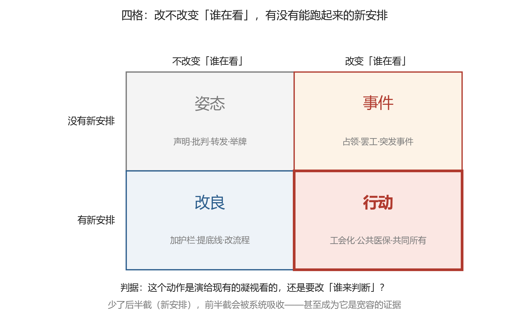

*读法：横轴是改不改变「谁在看」，纵轴是有没有能跑起来的新安排。只有右上角是行动，左下角是改良，左上角是姿态；少了后半截，前半截会被系统吸收。判据：你这次做的事，之后判断对错的尺子变没变？变了是行动，只换口号是姿态，只有新安排跑起来才算建构。*

## 三之二、有人替你

先看三个不费力的场面。

看情景喜剧，笑点还没到，背景里先起了一片笑声。你没笑，但也不觉得尴尬，那阵笑声已经笑过了。

公司发通知，说某地受灾，号召捐款，每人一百，微信转给行政。群里一排「已捐」。你转了，那一百块从此跟你没关系，你也不再去想那件事。

家族群里有人转了篇长文，配一句「太对了」。你点开看了一半，退出，转手也转了。转发这个动作，替你表了态。

这三件事里，你都参与了一件「该由你参与」的事，但真正做的部分是别人或者一个装置做的。哲学家帕福勒和齐泽克给这个现象起了个名字，**交互被动性**（interpassivity）：被动不是我什么都不干，是「干」这个动作被挪到了别处，我还留着「我干过」的收据。

它和第六章要说的「姿态」差一步。姿态是你做了个样子，事情还是你自己的；交互被动是连样子都由别人替你做，笑声替你笑，所以你不用笑；转发替你表态，所以你不用表态；捐款替你捐，所以你不用捐。你让出去的是一部分经历，换回来的是不欠、不出错、也不心虚。

它和「装置」也不同。装置改的是行为怎么发生，交互被动改的是行为由谁发生。它的账面上永远写着「做过」，只是做的其实是别人。

那怎么判断是它，还是仅仅一个记录工具？还是那条老规矩：把装置拿掉，看人还做不做。拿掉背景笑声，你还会笑吗；拿掉转发按钮，你还会去查那件事吗；拿掉统一代捐，你还会自己捐吗。会，装置只是记录；不会，装置已经把动作吞了。

这条也有边界。它只能指认「谁替你做了」，测不出你心里认不认同，也测不出那件事对你重不重要。有人就是不想笑、不想表态、也不想捐，被代劳正好合意，这种情形下它连「让出」都算不上。

## 三之三、还有一种选择是不做

前面讲的全是「怎么改」，这里补一个反方向的。

齐泽克有一个反复引用的姿态，来自梅尔维尔那个抄写员：**「我宁愿不。」** 他不吵、不谈判、不提条件，只是不做，这种不做不是懒，也不是抗议，是拒绝进入那套「你要什么、我该怎么调整」的对话。

它算一种动作，因为绝大多数装置都靠「你会来讨价还价」运转。你只要开口要条件，就已经承认了这局的规则。抄写员式的不做，是把整局对话抽掉。

例子很小：不接那个电话，不回那条「在吗」，不去开那个会，退出那个群，这些动作的共同点是没有说法、没有要求、没有下一步。

代价要说清楚：它不改变装置，只改变你在这套装置里的位置，所以它常常是止损，不是解决，而且它很容易被收编：公司会说「他最近状态不好」，家里会说「他就是闹脾气」，一旦被解释成情绪，这个姿态就变回可管理的对象。

判据：这件事你有没有开口要过什么。要过，就是谈判；什么都没要，就是不干。

边界：它不是万能的。有些场合里，不做等于把成本转给下一个人（同事替你加班、家人替你处理）。所以用之前要先看清成本落在谁头上。

**一个容易的误会：不做，不等于「等一个更好的时机」。** 齐泽克否掉巴尔特那条读法——把不行动当成「准行动」（praticable，随时可以转成行动的准备）。他的说法更硬：不做是等到那种**做不成**的行动出现；做不成，才是行动。

所以「我宁愿不」和「等」要分开：前者拒绝的是局面里那个说不出口的附加要求，后者只是想少担一点风险。

## 三之四、为什么改看法最省力、改装置最费力：一条成本梯度

一个群里转了一条新闻，几十个人跟着愤怒，第二天该上班上班。这事常被解释成麻木，其实只是成本排了个序：改看法最省力，一个人几分钟就能改；改装置最费力，它要动的是每天重复的那套动作。

这条梯度上有四个人各钉了一颗钉子。

阿伦特在《人的境况》里把人的活动分成三种：劳动、工作、行动。劳动是每天消耗掉的（做饭、扫地、上班干活），工作造出能留下来的东西（桌子、房子、书），行动是在别人面前开始一件新的事。她最看重行动，因为只有它不预先写好在剧本里。我们平时说的「表态」离行动最近，可它通常不开始任何事，也不留下任何东西，它更像行动的仿制品。

吉登斯给了装置一个更硬的说法，叫结构二重性：结构既是行动的条件，又是行动的结果。它不是悬在人头顶的框架，它是每天被重复出来的东西，重复的次数越多，它越像自然。所以改装置，改的是那套重复本身。

奥斯特罗姆把「改得动」做成了可以看的样子。她研究公共池塘、森林、灌溉系统，结论是公共物既不必私有化也不必国有化，关键是规则设计：边界清不清楚、规则跟本地条件配不配、用的人有没有份参与定规则、有没有监督、惩罚是不是渐进、冲突有没有地方解决。这几条都做到了，一群人能自己管好一件事；缺一条，就会走回「大家都抢」或者「等上面来管」。

哈贝马斯补的是反面：系统会挤进生活世界。钱和权这两种媒介一旦进入本来靠理解运转的领域，那里的话就不算话了，变成通知、流程、KPI。

四个人合起来，梯度就出来了：改看法（一个人，几分钟）→ 改姿态（一群人，一次会议）→ 改装置（每天重复的动作、位置、考核、默认值）→ 改结构（重复太多，通常伴随危机）。

「读懂之后更无力」不是心理问题，是成本排序：看懂停在最省力的那一格，装置在最费力的那一格，中间隔着一段没人愿意走的路。

判据：把你想改的东西放到这条梯度上看，它落在哪一格。落在「看法」格却按「装置」的口气喊，喊出来的就是又一波姿态。

边界：梯度不是命。奥斯特罗姆的例子说明，设计得当的规则能把一件事从费力的那格挪到够得着的那格。

**还有一种装置专门管时间，可以叫「制度的时间」。** 打卡、季度考核、年报：它连「什么时候该烦」都替你排好了。你不需要记得该交什么，日历替你判断；它的效力在于**把焦虑外包**——「这个该烦了」多半不是你算出来的，是制度算好塞给你的。

## 三之五、行动不是表态

前面讲「改叙述还是改安排」，还有一个词没拆：行动。

拉康的 act（行动）不是「做了什么大事」。它的判别很短：**这个动作之后，判断谁对谁错的规则变了吗？**

没变，那还是姿态。声明、批判、转发、举牌——都在既有规则里活动，规则照旧判分。

变了，才叫行动：工位被占、流程被绕开、某个「谁说了算」被换掉。齐泽克讲精神分析的两步时说的就是这个：先阐释征兆，再穿越幻象——穿透那层让你觉得「只能这样」的框架（《崇》L507）、（《崇》L711）、（《崇》L725）。

**判据**：这个动作之后，判断对错的那把尺子变了吗？还是只换了个拿尺子的人？

**分界**：
- 姿态：演给现有的凝视看，求它认可。
- 改良：在规则内加护栏、提底线，规则本身不动。
- 行动：改「谁来判」——哪怕只改了一小块。

**常见误读**：把行动读成勇气或牺牲。它讲的不是胆量，是**符号结构有没有被改写**。一个安静的流程改动，可能比一场声嘶力竭的抗议更接近行动。

**为什么难**：行动没有保证。改规则的人不知道新规则会怎么判他——这也是为什么大多数人宁愿把力气花在姿态上：姿态有观众，行动只有后果。

**还有一条容易被忘掉的路：不是改造，是留一块不算账的地方。** 有人拿酒吧做例子（伦弗罗 2019）：那里不产出、不考核、不攒人脉，只是让人在同一张桌子边待着说些没用的话。它不推翻什么，但它保住了一块不被算账的地方。

这条路的危险也清楚：一旦它变成「换一个地方消费」，就被收编了——**关键不在空间好不好，在这块地方是否真的不进账本。**

## 三之五之二、不回应也是一种回答

「行动」还有一手，比拒绝更省力：**不回应**。

2019 年齐泽克与彼得森那场辩论，他没接对方的框架——不展示自己的模型，只把对方的内部矛盾摆在台上，让观众自己看见。这不是清高，是一次**视差操作**：他换的不是论点，是**你从哪个位置看**。

所以「不回应」不等于逃避。区别在于：逃避是躲回现有位置，视差是把位置本身挪开一格。

**判据**：你这次不接话，是让对方继续在他的位置上说，还是让在场的人忽然发现「这个位置本身有问题」？前者是躲，后者是换。

## 三之六、你只能死两次

拉康说人得死两次。第一次是肉体的死，第二次是符号的死——别人不再把你当作一个「算数的人」，你的名字从账上划掉。

安提戈涅是第一种次序的反例：她还活着，城邦已经不认她——**符号性死亡先于实际死亡**。哈姆雷特的父亲正相反：人死了，账没清，于是变成鬼回来讨债，因为「没有人告诉他他已经死了」。

这解释了游戏为什么给你三条命：掉一条命是「一般的死」，输掉游戏才是「真正的死」——**两次死亡之间的那段距离，就是崇高与恐怖发生的地方**。

**判据**：一个人第一次被「从名单上划掉」时，他是觉得自己还活着、只是没人认，还是觉得自己已经死了？分清这个，才分得清他在经历哪一种死亡。

## 四、你可能会问的六个问题

**问一：所以这本书的意思是，个人做什么都没用？**

答：不是。它的意思是：个人能改的是**装置**，不是**结构**。装置层的改动是很实在的，你的手机放哪、你答应谁、你几点做、你把哪件事排在前面。这些都不需要「制度变革」，今天就能改。

**问二：那结构层呢？改不了就没什么可说的了？**

答：结构层能做的只有两件事：**识别**（它怎么运转、在哪儿生产失败品）和**记录**（谁受益、代价落在谁身上）。这两件事不改变结构，但它们改变了讨论的位置，从「某人不行」变成「这个安排这样运转」。长期看，这个位置的变化是有公共价值的。

**问三：为什么「知道了」不导致「做到了」？**

答：因为知道在信念层，做在动作层。这两层不通。要让它们通，需要在中间加一个装置：把「想做」接在一个具体的动作上，让这个动作容易发生。这就是「建构」的意思，**建构不是意志的加强，是把阻力拿掉。**

**问四：这不就是「自律」「习惯养成」那一套吗？**

答：有重合，但差在一点。习惯养成讲的是「你要坚持」，建构讲的是「你要改环境，让不坚持也做得到」。前者把责任放在人身上，后者放在安排上。

**问五：那「行动」这个词还有意义吗？**

答：有，但要限定。这套理论里的「行动」（act）不是「做事」，而是一种更少见的东西：**在既有框架里做一件框架无法消化的动作**。它有风险，也常常失败。日常的改变用不着「行动」，用「建构」就够了。把两者混起来，就会导致「要么什么也不做，要么期待天翻地覆」。

**问六：这本书自己算什么？**

答：按它自己的标准，这本书是纸上的东西，一种**建构的雏形**。它给了判据、给了数据、给了推翻条件，但它没有给你一个能立刻做的动作。这个动作得由你补，而且它应该很具体，具体到你自己都觉得不像「改变」。

## 五、这套分析在哪儿会失灵

先说清楚：它不是万能钥匙。有三种情形，硬套会得出很糟的结论。

**一、当你面对的是纯粹的外部灾难。** 地震把学校震塌、教室里的孩子没跑出来，伤亡是地动造成，不是制度按自己的规矩运转时「必然」生产出来的。硬说这是征兆，等于把人祸和天灾混成一锅，反而让真正该负责的那一层溜掉。

**二、当你的观察改变了被观察的东西。** 一装上指标，人就照着指标动。你看到的是「对指标的反应」，不是「结构平时怎么运转」。这里最容易犯的错，是拿反应去证明结构，校园排名一出来，学校立刻开始刷数据，那刷出来的数据不是「结构的证据」，是「结构的反应」。

**三、当你手上只有文本，没有数据。** 只能提出假设，不能给结论。这本书里凡是写成「可能」的地方，都是这一种。

判断能不能用，先问一句：**这个失败，是不是系统按自己的规矩运转时必然产出的？** 答不上来，就别套。答得上来，还要再问一层：**换掉这一条规矩、这一组指标，它会不会消失？** 会消失，才叫结构性的；不会，那只是执行得差。

两个正经的例子，都不是灾难：学校排名一出，学校开始刷榜；医院考核一严，重症被往外推。这些是系统把「好处」写进规则之后，自己生出来的副产品，删掉规则，它们就没有了。

还有一个更细的批评，来自阿多诺那边。齐泽克批阿多诺：你的意识形态批判太靠近「后意识形态」，把一切都还原成犬儒意识——知道了还照做。博格丹（Bogdan 2016）说这一枪打偏了：阿多诺的问题既不在理论也不在实践，而在两者之间的「姿势的强迫」——那种不容置疑的权威姿势被后人机械模仿。照这个读法，意识形态不在你脑子里，也不在你手上，在你**摆出来的那个姿势**里。

更要紧的一击是：齐泽克执着于黑格尔式的自我指涉（双重否定），把**确定否定的两面性**抹掉了——它既要说清当下的处境，也要指向转变的可能。抹掉后一半，批判就容易变成姿态本身。

这句批评没法靠加一句「边界」解决。另一篇批评（Kilroy 2019）更直接：齐泽克在《崇高客体》里给自己定了两道工序——拆掉文本自发的经验、再提取撑着他的那点享乐；可在分析难民时，他只把「犹太人」当症状拆，却把难民直接当成实在界摆出来，两道工序没走完。

所以这本小书也得认一句：**读他的方法，要连他没做的那一步一起读。**

## 五之二、后来补进来的几层

下面这些不属于「失灵」清单——它们不是这套分析用错的地方，是读到后面几批材料时补进来的边界条件：每一个都在说同一件事，这套分析能用到哪一层为止。

**数字装置给你的第一件礼物是「不死」。** 齐泽克写游戏：你一进入就被安置成一个「还没被阉割的主体」——没有最终的消灭，每次毁灭都能回到开头重来，这就是他说的淫荡的不死（《淫荡的不死及其不满》）。

要紧的是：**不死的不是你，是那套让你重开的机制。** 你以为自己在冒险，其实你被放进一个不会真正失败的场景里；真正不会被消灭的，是那个一直等着你回来的界面。

**还有一种失声，是未来的失声。** 马克·费舍尔（Mark Fisher）听电子乐时发现一件事：五十年代到九十年代那些声音，本来是「未来」的符号，如今听来却像**某个从未到来的未来的遗物**——他叫这种怀旧「失落的未来」（lost futures）。

这不是想念过去，是过去里那些没实现的可能还在响。他在德里达的「幽灵学」里找到这个词：被录下的声音本来就是「回来的」声音，死者的、旧日的，此刻在你房间里。他还有一句更硬的判断：时间对奴隶从来就是错位的（always-already out of joint），而**今天白人的文化也终于逃不开这种错位**——不是它学会了同情，是它自己的未来也停摆了（Fisher 2013）。

判据：你现在听的、看的、追的，是正在发生的东西，还是某个曾经许诺过、后来没来的东西的残响？

**指标之后，又来了一个判据：流畅。** 生成式 AI 进课堂进办公室，改的不只是效率——它改了「谁算有权威」。从前权威要你熬年头、拿证据、扛得住追问；现在它回得快、写得顺、口气笃定，看起来就像知道。

危险不在于它替你写，而在于**快得让你分不清「漂亮的说法」和「站得住的判断」**（Hamamra & Uebel 2026）。这一层跟账本同构：可表演的部分被记住，不可表演的部分（追问、复核、承担）被跳过。

**还有一种享乐，形状是「缺」。** 特朗普式的享乐不是「他享受得太多」，而是享乐一直缺席——自恋和夸大背后是那种「总还差一点」的压力，于是不断加码、不断改名、不断把名字刻到东西上（Benedikter & Omodeo 2026）。

这一层跟「剩余享乐」同构：**永不落地的那种满足，才是它在起作用的样子。**

**装置还有一个本事：把例外拖成常态。** 疫情期间的健康码、追踪 App，本来都说是临时的；理由过去了，东西还在，接口还在，公私合作的合同还在。

判断只要一句：**当初的理由消失了，它还在运转吗？** 还在，那就不是「例外」，是装置把例外吸收成了自己的零件（Jensen 2024）。

**往深一层看，这不是新东西。** 马克思说资本是「自动主体」——活的能动性和死的自动机拧在一起，自己设定目标、自己生成前提。奇点叙事把同一结构推到顶：系统自己转，人只剩「配合」这一个动作（《奇点的力比多经济》，2019）。

所以「AI 会不会取代人」这个问法可能就问错了：**它一直在取代的，是那个能判断的人在系统中的位置。**

**顺带说一件常被忽略的事。** 2019 年黄背心运动时，法国知识界很多人批它「没有纲领」。齐泽克的反问是：你看见它做了什么吗——定期行动日、野性游行、无许可的游行加直接行动、闪电封锁、针对收费站和测速器的破坏、活跃罢工。地面的人在运动里，评论席的人在评论里；**「没有纲领」这个判断，常常只是位置差**（《法国知识界的失败？》，2019）。

**还有第三条路，不是「做点别的」，是「减出去」。** 巴迪欧把否定分成三种：毁灭（把旧秩序砸掉）、否定（辩证地否定，再扬弃）、减法（从旧秩序里退出来，让新的东西从空处冒头）。齐泽克走第二条，巴迪欧走第三条；差别在于要不要保留「扬弃」这个动作（《毁灭、否定、减法》，2012）。

**减法的代价也要说清楚。** 退出来不等于安全：空出来的地方，旧秩序会立刻派人来填（一个新仪式、一个新指标、一个新领导）。

**保护自然的最大障碍，是我们所仰仗的那个「自然」观念。** 基因规则一旦被掌握，自然就失去那种不透明的重量——它不再是我们的背景，而是一只随时可能朝坏的方向加速的脆弱机械。所以齐泽克说，要的是一种「没有自然的生态」：不是回到平衡，是承认平衡本来就是第二次的，是在灾难性中断之后勉强找回的习惯（《享乐与虚无》第 12 节）。

**行动今天长什么样：不像起义，像紧急状态。**

齐泽克在讲生态时给了一个不好听的答案：在「人类集体自杀」这个最后出口之前，上一个出口越来越像「战时共产主义」——不是回到苏联，而是和平年代的非常时期：限制自由、定量配给、对高排放设施的直接破坏。

他还拆了一个神话：非暴力是激进变革的有效手段。马尔姆的统计是反的——废奴、妇女选举权、印度独立、南非反种族隔离，财产损失型的直接行动都在战术库里；「激进侧翼效应」说的是激进派逼当局跟温和派谈、并满足温和派。

这一节最刺人的判断是：让「反资本主义」失去冲击力的，是那个默认前提——**相信能用民主斗争的形式反抗资本主义**。

## 六、重看这个社会

如果改变发生在装置层，那「社会怎么变」这个问题就要重问一遍。

**社会不变，是因为它在等人变。** 这是最常见的假设：先把人教育好、观念改过来，社会就好了。可装置层看，顺序是反的：先有装置，人再长成配套的样子。

**最能改变的装置，往往没人管。** 表格加一栏、默认改成「不勾选」、把办理步骤从五步减到两步，这些改动没有口号、没有仪式、不出新闻，但它们改变的人比一场运动多。

**最难改的装置，是让人「受益于不改」的那一层。** 为什么某些考核指标改不动？因为有人靠这个指标获得资源、地位、免责。这一层不在技术里，在利益里。

**但也要给一个反例。**

有些改变是自上而下、一次到位的：安全带强制、公共场所禁烟、疫苗纳入计划。它们的共同点是，**装置改完之后不需要人配合**。改不动的那些，通常都需要人每天配合一次，而每一次配合都要消耗意志力。

所以更准确的说法不是「个人改变无用」，而是：**越不需要人配合的装置，越容易改成功；越依赖人每天配合的改变，越容易退回原样。**

**本章边界**：这一章能推到哪、推不到哪，见附录 F·6。

## 结语　这本书只给一把尺子

## 一、六章换掉的六个镜头

六章下来，每一章都试图换掉一个看社会的默认镜头：

- 你以为问题是「有人没想明白」，其实意识形态在做法里，不在想法里；而做法要立起来，还得先做后信（第一章）。
- 你以为那个让你停不下来的东西是快乐，其实是欲望围着差额转；差额还被一个框按住，框里写着「你该要什么」（第二章）。
- 你以为「我是谁」是你自己找出来的，其实是一个空词先把你叫住了；而那个叫住你的位置自己也是空的——它填不满你，你才在（第三章）。
- 你以为「分配」是分已经有的东西，其实在分之前，有一部分就没被算进来：账要有个不算账的底座，钱是那把尺子（第四章）。
- 你以为系统的毛病是它偶尔出错，其实有些「毛病」是它按规则运行到极致才长出来的；而且没人真信那套规矩，大家只假设系统信（第五章）。
- 你以为知道了就该做点什么，其实「说」和「做」中间隔着装置；表态再多也只是表态，除非那个动作改了判断对错的规则（第六章）。

*序章是地基，现实由叙述组织起来；中间四章各拆一个部件；第五、六章是应用；最后落在一句话上，制度靠照做成立，不靠相信。*

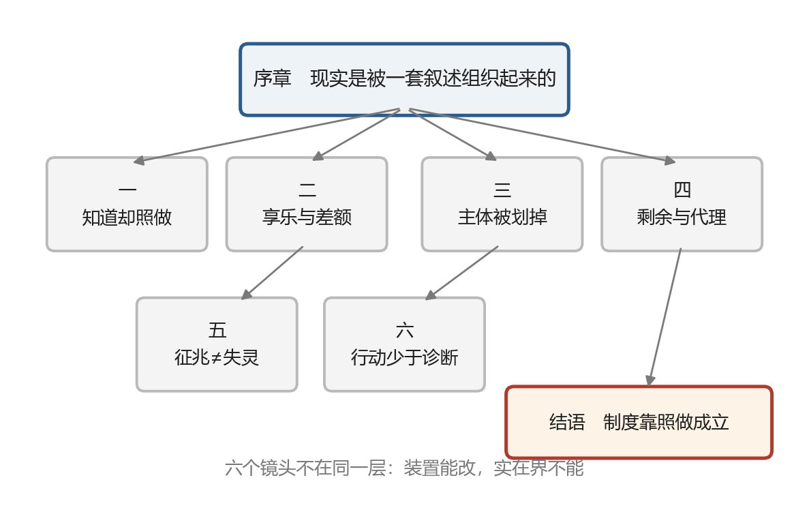

*读法：序章是地基（现实由叙述组织起来），中间四章各拆一个部件，第五、六章是应用，最后落在一句话上：制度靠照做成立，不靠相信。*

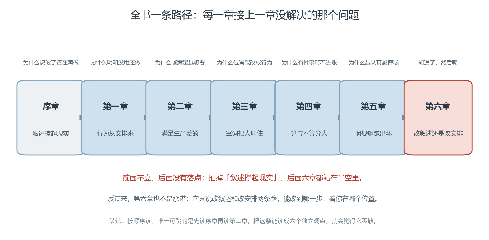

*读法：七步，每一步接的是上一章没解决的那个问题。抽掉「叙述撑起现实」，后面六章都站在半空里；反过来第六章也不是承诺，它只说改叙述和改安排两条路。*

**他不是在推一个「无限接近的完美理想」。** 海涅讲过一则轶事：他跟黑格尔说自己接受不了「凡是现实的都是合理的」，黑格尔看看四周，低声说：也许我该说，**凡是现实的都应当合理**。

这一句把「接受现状」翻成「要求改变」——现实不是已经合理，是该被弄得合理（《今天还能当黑格尔派吗》，2019）。

## 二、如果只能带走一句话

如果只能带走一句话，是这句：**制度不是靠人相信才成立的，是靠人照着做才成立的。** 所以最省力的是改看法，最没用、也是最容易让人以为自己在做事的，也是改看法。

再说一句读法。齐泽克回别人的批评时说过一句怪话：「连他同意我的地方，我都不同意他。」布特勒（Rex Butler）接着补了一句更怪的：他同意自己的地方，他也不同意自己（Butler 2016，IJZS 10(3)，原典）。

这不是绕口令。它说的是：他的立场不在他说的任何一句话里，而在他与他所说的东西之间那道缝里。所以读他，别只抓句子，要抓他为什么这么说、以及他后来为什么改口。

还有一件得先说清：**这本书用拉康的术语做入口，不是说拉康是最后排位。**齐泽克自己的重心是移动过的——2014 年《绝对反冲》之后黑格尔上升，拉康被降为一个「消隐的中介物」，2019 年又降了一次（中译本译后记）。本书仍从拉康进，理由很实际：讲「我」怎么被语言和位置构成，拉康那套词最省力。**入口不等于结论。**

## 三、三个可以带走的东西

三个可以带走的东西。第一，把「立场」和「动因」分开：同意一件事，不等于要为它负责。第二，别人给你一个「所以」的时候，停一下，那个「所以」往往是后来加上去的。第三，判断一个词危不危险，不看它多难懂，看它在日常语言里是不是已经带了动机：「市场认为」「他的享乐」，这类词自带一个「所以」。

## 四、出了办公室，这套分析还站着几层

先说结论：不是这套分析只在办公室成立，是**我的例子几乎全在办公室**。三个场面里有两个发生在工位上，散到生活里的那些，多半也是从公司里带出来的那句。这是我举例偷懒，但偷懒的结果值得说清，它暴露了一个真实的依赖结构。

*从上往下排，越靠组织越强、越不靠组织越弱。第五章靠「指标怎么生产剩余」，一离开组织就不好讲了；第三章靠「被一个空词叫住」，家族、婚恋里照样成立；第二章靠「满足生产差额」，根本不需要组织。*

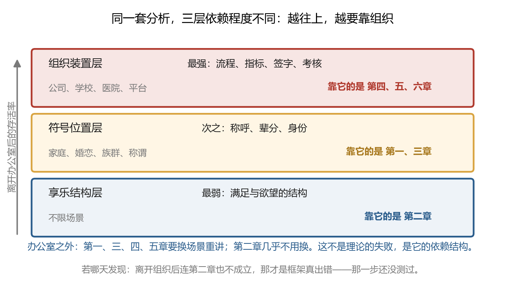

*读法：从上往下，越靠组织越强、越不靠组织越弱。看第三列：第五章靠「指标怎么生产剩余」，一离开组织就不好讲了；第三章靠「被一个空词叫住」，家族、婚恋里照样成立；第二章靠「满足生产差额」，根本不需要组织。*

所以我给这本书的自我鉴定是：**它更接近「组织社会学，加一份享乐理论」，而不是一套能解释一切社会现象的框架。** 这个定位更窄，但更结实，窄的东西才敢被人拿去用。

要推翻这个鉴定也简单：如果离开组织之后，连第二章那件事也不成立（某类活动满足过之后真的一点也不想再要了，而且不能用符号差异解释），那就是框架错了，不是举例的问题。这一步我还没测。

**最后说这本书哪里可能错。**

第一，它可能把结构说得太重了。每一章都在讲「安排」，个体的余地讲得少。这是我故意的，市面上讲「个人努力」的书已经够多，但代价是，读起来可能像「什么都改不了」——把「结构」读成「宿命」，那是误读，也是我没写好的地方。

第二，六个镜头并不属于同一个层次。「装置」是可以动手改的，「实在界」不是。把它们平铺成六章，会让人以为它们份量相同。

第三，写的时候我假定了一个人：愿意花时间、但不想被术语挡住。如果你其实不是这个人，如果你要的不是尺子而是答案，那这本书就错在志向上，不在细节上。

这本书给的是尺子，不是结论。尺子用旧了会钝，你可以自己磨。

## 五、四个位置

最后补一张表。这本书一直没摆它，因为它是第二册的地基，摆进来会打断节奏。但缺了它，前面六章会显得像六句互不相干的话。

开会的时候你大概见过这种场面：同一句「这个方案有问题」，新人说，是请教；主管说，是结论；顾问说，是报价。

位置比说话的人重要，拉康把这种位置关系排成四格：**施动者、他者、产物、真相**。剩下的那个东西（他叫对象 a）藏在「真相」那一格里，不露面，但一直在推。

| 话语 | 施动者 | 他者 | 产物 | 真相 |
|---|---|---|---|---|
| 主人 | 主人能指 S1 | 知识 S2 | 对象 a | 缺口 ＄ |
| 大学 | 知识 S2 | 对象 a | 缺口 ＄ | 主人能指 S1 |
| 癔症 | 缺口 ＄ | 主人能指 S1 | 知识 S2 | 对象 a |
| 分析家 | 对象 a | 缺口 ＄ | 主人能指 S1 | 知识 S2 |

四句话读完：**主人话语**靠一句权威词把人叫住；**大学话语**靠知识不断生产「还差一点」；**癔症话语**靠追问「你到底要我怎样」；**分析家话语**唯一不填补那个缺口，所以它不产出可执行的东西。

这张表怎么用：看一句话是谁说、对谁说、产出什么、被藏起来的是哪一格。四格对上了，你就知道这段对话在按哪套规则走。

用它最容易犯的错，是把四个位置当成四种人的性格。位置是关系，同一个人换个场合就换一格。

边界得说清楚：这张表是拉康的（第十七期研讨班，一九六九到七〇年），齐泽克是转述和使用，中译本里连「主人话语」「大学话语」这两个词都查不到。所以它是骨架，不是他的原创贡献；把它算成齐泽克的，是引用上的错。

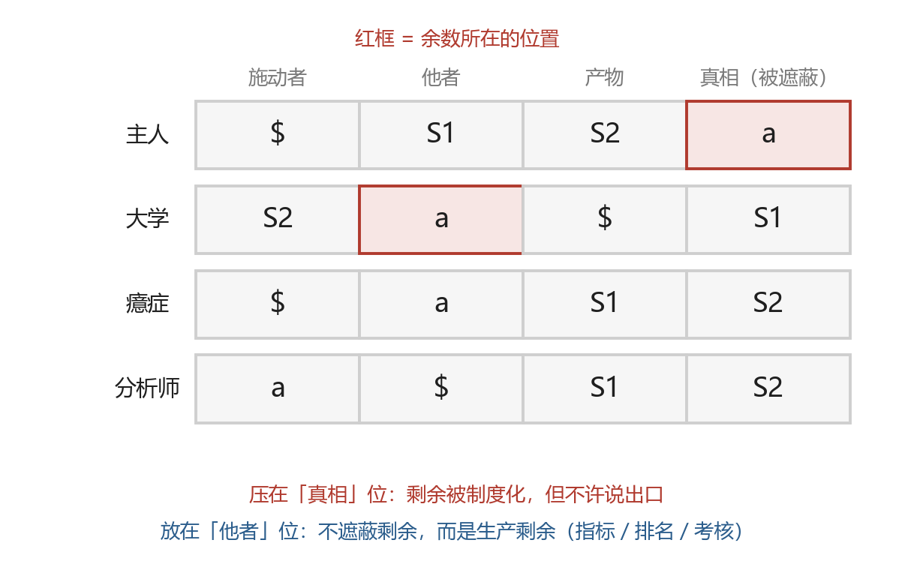

*读法：每行四个格子：施动者、他者、产物、真相，换的只是剩余坐在哪一格。主人话语把 a 压在真相位不许说出口，大学话语把 a 放在他者位，用指标和排名不断生产它。*

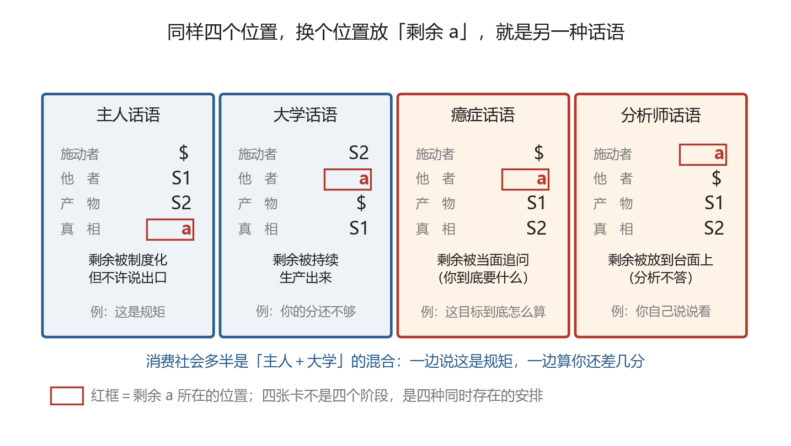

*读法：四张卡不是四个阶段，是四种同时存在的安排：主人把剩余压在真相位，大学把它摆到他者位当生产力，癔症把它摆到台面上追问，分析家让它留在台上不填。判据：这句话是谁对谁说的、它生产出什么、被压下去的是什么？三格填不满，就不是一套话语，只是一段表态。*

## 六、社会不是一块现成的东西

前面六章都在拆同一个动作：把「社会」当成一块现成的背景板，事情发生在它里面，解释只要指向它就算完。

拉图尔不太同意这个用法。他在《重组社会》里说，「社会」不是一个容器，也不是一种材料，它是一堆联结在被不断重新做出来的结果：一次会议、一份合同、一条群消息、一次签字、一次点名。有人在做，它就在；没人做，它就散。

这话听着抽象，落到前六章就是一句：你前面读到的那些「结构」，都是被重复出来的东西。幻象是叙述被重复，装置是动作被重复，身份是称呼被重复，账本口径是计算被重复。重复的反面不是「自由」，是「联结没被做，它就散了」。

用错：把「社会结构」当成一个可以指的东西，指着它说「这就是原因」，可结构是动词，不是名词。

判据：问一句「这件事是靠谁、在哪一步被重新做出来的」，答得出来就找到了可以动手的地方；答不出来，「结构」两个字就只是一句托词。

边界：不等于结构没有惯性。惯性恰恰是重复的积累，重复得越久越难停。这一条也有反过来的人，见附录 D。

## 七、五问：把尺子递出去

这本书给的不是结论，是一把尺子。真要用它，别从结论用，从问题用。五句，按顺序：

1. **这是谁排的？** 不是「谁对我不好」，是「谁定下了这套排法」。
2. **什么被记进账？** 不是「我亏了没有」，是「这件事按什么口径被算成好或坏」。
3. **要的是这个物，还是它身上多出来的那一点？** 到手之后那句「就这样」或「下一个」，会告诉你答案。
4. **没人认，它还作不作数？** 把夸奖、职称、点赞全撤掉，这件事在你心里还立不立得住。
5. **这句话／这个身份，是「我」在说，还是「我」被说？** 前四问假设你站在外面判断；这一问回过头问：判断的那个「你」是谁。

五问的次序不是随便排的：前三问查的是「安排」（谁排、怎么算、要什么），第四问查「认不认」，第五问才查「谁在说」。前一问答不出来，后一问多半也答不准。

提问也有场合之分。有余量、对方还把你当说话的人，才问得下去；求职、急诊、报警、家里争执，先退回前两问，别把第五问甩出去。

这套问题在概念网（配套概念网）里挂在每一格的卡片上，从哪个中心进都可以。

**一个例子，两种读法。** 安提戈涅违令葬兄，齐泽克早年把她读成伦理英雄：她那句「我的哥哥就是我的哥哥」是没有内容的重言，等于把整套符号秩序悬置起来——这才是行动，不是姿态。可他晚年又改口，说她是个「真正的贱人」，理由是她只认自己那一套，最后变成了另一种绝对。两种读法都在他笔下出现过。**这说明行动这个格子有个边界：把符号秩序悬置起来，可能通向行动，也可能只是把另一种姿态推到极致。** 分界还是那一句——之后，判断对错的那把尺子换了没有。

**主体不是一个位置，是一个担当。** 我把「差一格」讲了整本书，但差一格只是代价，不是全部。黑格尔说「实体即主体」，齐泽克把它读成两层：主体当然是否定（总差一格），可它同时是对这种否定的**事先预设与担当**——你先站进那道缝，才谈得上被它划掉。所以主体不是被动的空位，是抢先站进去的那个动作。

配套的是「真理来自误认」：不是先弄错、再改正、最后拿到真理；是**重复误认**本身才让真理显形。解释总是来得太晚——你一旦说清，事情已经变了。

## 附记：一个被撤掉的分类

写这一册的时候，我一度把装置、账本／指标、科层、平台派单、照护、舆论这些格子单独归成一类，叫「社会那一侧」，在概念网里给它做了一个单独入口。

这个分类是错的，我在这里说清楚。

第一，齐泽克没有「个体／社会」这种两边分立的切法。意识形态、装置、账本，就在主体的构成里，不在他对面。把它们摆成「另一侧」，读起来像主体在这边、社会在那边，两军对垒——那不是他，也不是这一册要说的事。

第二，这个标签有实体化的风险：「社会」被写成一个地方，好像它有个地址、有张脸。而这一册说的是安排：谁排的、谁在算、谁被排在外面。安排没有地址。

第三，也是最要紧的：它把「安排」与「我」切成两堆，恰好违反了这一册的起点——安排就在我被构成的那几层里。分堆之后，第一章讲装置，会读成讲外部环境；第五章讲算账，会读成讲社会不公。都不是。

处理方式：概念网里撤掉这个入口和这个标签，九个格子仍留在网里，只是不再标「社会那一侧」，改标各自的来源（卡夫卡、马克思、阿尔都塞、本书观察）。

那条接口句留着——大他者 → 装置 → 账本 → 超我。它不是分类，是路径：上面说「按规矩来」，你填表，表进考核，你半夜还在想它。路径能说明「谁在我身上使劲」，标签只能说明「谁和谁一伙」。

教训很短：贴标签比连线路省事，省掉的正是关系。以后凡是「这一侧／那一侧」的说法，先问一句——它是从哪儿切开的，切开之后丢掉了什么。

## 引文行号怎么读

正文与附录里的 `L###` 是库内全文的行号，不是纸书页码。两本书的编号互不相通，所以引文前一律加书名简称：

- **《崇》** ＝《意识形态的崇高客体》（中译全文）：1,352 行，**一行≈一页**；
- **《享》** ＝《享乐与虚无》（文汇 2025 全集）：6,007 行，行号即段落行。

例：`《崇》L250–L251` 是《崇高客体》第 250–251 页那一带；`《享》L1270` 是全集第 1270 行。

没加简称、只写 `L###` 的，一律算没核过的旧引文——本版已清零。

## 附录 A　概念对照表

用法：每个词给「中文名｜原文｜一句话定义｜用错时会怎样」。术语第一次在正文出现时，都用这里的定义。

少数几个词正文没有原样展开，只在这里对照：否定性、例外状态、压抑、具体普遍性、象征界／想象界、意识形态幻象、大他者的不存在（正文里这三样分别写作「象征」「幻象」「大他者是空位」）、四话语。它们是齐泽克常用的背景词，本书不靠它们立论，读时不必去正文里找对应小节。

## 一、享乐类：这一族最容易混

**享乐（jouissance）**
一句话：一种过量到让人难受的满足，来的时候带着债，享受完会更空。
用错时：把它当成「快乐」。快乐是有度的、可以停的；享乐恰恰停不下来。你要是把「他沉迷」理解成「他很快乐」，就会去问「怎么让他别那么快乐」，方向全错。

**快感（pleasure / 旧译也作 jouissance）**
一句话：日常意义上的舒服、愉悦，有度、可满足。
用错时：中文旧译把 jouissance 译成「快感」，于是「剩余快感」和「剩余享乐」成了同一个词的两个译名。看到「快感」要先判断：这一处说的是舒服，还是说的是那个过量到难受的东西。中译本《意识形态的崇高客体》里「快感」出现 132 次、「享乐」只有 2 次，所以在中文语境里，「快感」多数时候指的是 jouissance，不是 pleasure。

**剩余享乐（surplus-enjoyment / plus-de-jouir）**
一句话：齐泽克说，拉康这个概念是仿效马克思的剩余价值提出的，它不是分完之后剩下的那点，而是这套运转本身必然生产出来的多余物。
用错时：当成「剩下的快乐」。那样就变成分配问题（多分一点就好了），而它的要点正好相反：它不可分配，因为它不是一个东西，是一个位置。

**原乐**
一句话：jouissance 的另一种中译，多见于拉康研究。与「享乐」同指，但语感更硬、更接近「极乐/至福」。
用错时：在一段话里同时出现「原乐」和「享乐」，容易读成两个概念。

## 二、结构类

**实在界（the Real）**
一句话：不是「客观现实」，而是符号系统无法吸收、每次解释都会剩下的那个裂缝。
用错时：把「实在界」理解成「真实发生的事」。正好相反，真实发生的事都在象征界里，实在界是象征界搞不定的那一块。

**象征界／想象界（the Symbolic / the Imaginary）**
一句话：象征界是语言、规则、身份、账本构成的那张网；想象界是形象、认同、镜像构成的另一张网。
用错时：以为「象征」就是「假的」。象征界不假，它是唯一能让你我谈同一件事的东西。

**对象a（objet petit a）**
一句话：欲望的「客体-成因」，不是你想要的那个东西，而是让欲望开始转动的那个空缺。
用错时：当成「欲望的对象」。对象a 是原因，不是目标；目标会换，原因不变。

**幻想公式（$◇a）**
一句话：被划杠的主体（$）与对象a 之间那道「◇」，主体靠这个结构维持欲望。
用错时：读成「主体想要对象a」。那道菱形不是「想要」，是「围绕」。

**主人能指（master signifier）**
一句话：一个没有所指的能指，它不描述任何东西，它的功能是停下来、定住、让人认。
用错时：以为它「含义丰富」。正好相反，它的力量来自空。

**缝合点（point de capiton / 纽扣点）**
一句话：意义在事后被钉住的那个点。一句话说完，你才知道前面那些词是什么意思。
用错时：以为意义是说话时就有的。缝合点说的是**回溯**。

## 三、意识形态类

**意识形态幻象（ideological fantasy）**
一句话：不是「错误的观念」，而是让现实显得连贯的那层结构，它遮蔽的是实在界的裂缝。
用错时：以为「破除幻象」就等于「知道真相」。幻象在做法里，不在看法里。

**犬儒理性（cynical reason）**
一句话：斯洛特戴克的词，明知是假的还照做，并且把这当成聪明。
用错时：和「狗智」混。齐泽克特意区分：狗智（kynicism）是用玩笑、反讽当面戳穿；犬儒理性是知道真相却继续配合。中文研究里「犬儒」出现 694 次，「狗智」只有 12 次，译本用的其实是「狗智」（42 次），二手文献把两个词压成了一个。

**征兆（symptom / 中文也作「症候」）**
一句话：系统按自己的规律必然生产出来的那一个失败品，它以扭曲的形式把系统本身显示出来。
用错时：当成「故障」或「腐败」。征兆不是规则被违反，而是规则被**最优执行**的产物，这一点是这本书第五章的硬门槛。

## 四、最容易混的三组

1. **享乐 vs 快感**：一个是过量到难受，一个是有度的舒服；中文旧译把它们压成了一个词。
2. **实在界 vs 现实**：现实是符号搭起来的，实在界是它搭不住的地方。
3. **征兆 vs 失灵**：失灵是没照规则做，征兆是照规则做到极致的结果。

## 五、这一版补进来的 17 个词

**交互被动（interpassivity）**
一句话：反应不是没人做，是有人替你做掉了。
用错时：当成「懒」或「冷漠」，可罐头笑声替你笑，转发替你表态，公司替你捐款，人反而更空，因为连反应都被代办了。

**淫秽的补充（obscene supplement）**
一句话：明文规则底下那层不写出来的、被默许的东西。
用错时：当成腐败。腐败是违反规则；这一层是规则要运转就得靠它，所以它不违规，它是补丁。

**大他者的不存在（the big Other does not exist）**
一句话：那个「上面总有人知道」的位置，其实没有人坐。
用错时：当成阴谋论，可正好相反，阴谋论是受不了这个空位，硬要塞一个人进去。

**视差之见（parallax view）**
一句话：两个视角各自都成立，它们之间那道缝本身才是对象。
用错时：当成相对主义，可相对主义说「都对」，视差说「都对，所以缝在哪儿才要紧」。

**具体的普遍性（concrete universality）**
一句话：一条普遍规则，靠一个被它排除在外的例外才成立。
用错时：当成「凡事有例外」。这里说的是例外在支撑规则，不是规则偶尔失灵。

**快感窃贼（theft of enjoyment）**
一句话：排外叙事里的「他们偷走了我们的享乐」。
用错时：当成一切排外都只是心理。它要的是「他们」既近又远：近到能看见，远到碰不到。

**圣状（sinthome）**
一句话：每个人自己缝住的那一针，拆了人就散。
用错时：当成症状去解读。症状可以说出意义，圣状只负责缝住，说出来反而坏事。

**死亡驱力（death drive）**
一句话：绕回原地、不朝目标去的那股力。
用错时：当成求死，可它常常表现为「再来一次」，不是「结束」。

**拜物教（fetishism）**
一句话：知道它是关系，仍把它当物来对待。
用错时：当成「相信物有魔力」，可齐泽克的说法是，人并不信，人只是照样按它有效来做。

**L 图式（schema L）**
一句话：自我—镜像与大他者两条轴，中间被对象 a 挡着。
用错时：当成判决书。它画的是位置关系，不是给你诊断。

**欲望图（graph of desire）**
一句话：需要→要求→欲望，最后那道折回大他者的线。
用错时：当成三步走。三层可以同时在场，谁也没取代谁。

**四话语（four discourses）**
一句话：四个位置：施动者、他者、产物、真相，换的只是谁坐哪一格。
用错时：当成四种性格，可位置是关系，同一个人换个场合就换一格。
本书不展开：库内只有二手转述，等读到原典再补。

**生命再生产（reproduction of life）**
一句话：让日子得以过下去的那部分劳动，它不增值，所以进不了账。
用错时：当成「家务」。凡是让日子继续、却不进账面计量的劳动，都在这一格；折算成工资只是把它拖进账本。

**一般等价物（general equivalent）**
一句话：所有商品都能换成它，所以它把别的物都变成可比较的量。
用错时：当成「钱是万能的」那种抱怨。它讲的是尺度怎么把别的东西拉平成量。

**系统的信仰（the belief of the system）**
一句话：不需要别人真信，只需要假设「系统信」。
用错时：当成「大家都被骗了」。没人被骗，恰恰是这套东西能运转的原因。

**行动（act）**
一句话：改的不是态度，是判断谁对谁错的规则。
用错时：当成勇气或牺牲。判别只有一句：这个动作之后，判断对错的那把尺子变了吗。**「动作」说的是做了什么（打卡、签字、转发）；「行动」说的是那一件让尺子本身变了的事——同一个词根，两个层次。

**大他者不知道我**
一句话：大他者整合不了的那处空，正是「我」存在的位置。
用错时：当成「没人懂我」的委屈。委屈还指望有个懂的人；这里说那位置空着，谁来了都填不满。

## 六、这几个词最容易被读成日常义

**装置（apparatus / dispositif）**
一句话：把动作排好的那套东西——表格、默认值、称呼、流程。
用错时：当成「机器」或「设备」。它不需要电，一张请假单就是装置。

**询唤（interpellation）**
一句话：把你叫成一个主体的一嗓子——「同学」「负责人」「家属」。
用错时：当成「号召」或「宣传教育」。号召要你信，询唤只要你应。

**凝视（gaze）**
一句话：从客体那边回望你的目光，不是你看出去的那一眼。
用错时：当成「注视」或「被盯着」。被盯着是有人看你，凝视是那个位置在看你。

**承认（recognition）**
一句话：你被算作一个能说话、能被追究的人。
用错时：当成「被喜欢」。喜欢可以没有，承认没有就办不成事。

**否定性（negativity）**
一句话：一个东西为了成为它自己，必须把某部分推出去，最后发现推出去的正是自己。
用错时：当成「负能量」或「悲观」。它是结构，不是情绪。

**例外通道**
一句话：规则里那个不受规则约束的位置，规矩靠它才装得像铁板一块。
用错时：当成「腐败」或「漏洞」。漏洞是失灵，例外通道是设计。

## 附：一词一译对照速查

| 中文 | 原文 | 常见混用 |
|---|---|---|
| 享乐 | jouissance | 与「快感」混 |
| 剩余享乐 | surplus-enjoyment | 与「剩余快感」混（同一词异译） |
| 快感 | pleasure / jouissance | 两义并存，须看上下文 |
| 原乐 | jouissance | 与「享乐」同指 |
| 实在界 | the Real | 与「现实」混 |
| 对象a | objet petit a | 与「欲望对象」混 |
| 主人能指 | master signifier | 误以为有丰富含义 |
| 缝合点 | point de capiton | 误以为意义当场生成 |
| 犬儒理性 | cynical reason | 与「狗智」混 |
| 征兆 | symptom | 与「失灵/故障」混 |

## 附录 B　数字与出处

本书正文出现的每个数都在这里。格式：数｜口径｜年份｜来源｜何时作废。每个数按可核程度分三类，标在「来源」一格的末尾：**可重跑**（本地脚本能重出）、**二手**（引自已发表研究或官方发布，未重算）、**未核**（只到题录，未见全文）。

## 一、装置与行为

| 数 | 口径 | 年份 | 来源 | 何时作废 |
|---|---|---|---|---|
| 184 个田野 RCT、N=2,245,373、总 d=0.28 | 仅客观行为结果的田野实验 | 2023 | Luo 等，*R Soc Open Sci* 10(11):230053，PMID 38034123（二手） | — |
| effort 0.52 vs intrinsic motivation 0.17，比值 3.06 | 同上，按心理过程分层 | 2023 | 同上（二手） | 若更保守的重分析使比值 <1.5，第四章的「方向有据」仍成立、「三倍」作废 |
| I²=99.7%；稳健贝叶斯 d=−0.005 | 异质性；稳健估计 | 2023 | 同上（二手） | — |

## 二、标签与身份

| 数 | 口径 | 年份 | 来源 | 何时作废 |
|---|---|---|---|---|
| 总体 \|d\|=0.26 | 刻板印象威胁元分析 | 2008 | Nguyen & Ryan，*J Appl Psychol* 93(6):1314–34，PMID 19025250（二手） | — |
| d=0.28（刻板印象式操纵 0.52） | 年龄刻板印象，32 篇/82 效应量/N=3,882 | 2015 | Lamont 等，*Psychol Aging* 30(1):180–93，PMID 25621742（二手） | — |
| d=0.44 | 干预类实验，181 实验/251 效应量 | 2021 | Liu 等，*J Appl Psychol* 106(6):921–49，PMID 32772526（二手） | — |
| 校正后接近零 | 对上述小样本效应的重析 | 2017 | Zigerell，*J Appl Psychol* 102(8):1159–68，PMID 28795832（二手） | 若更大样本的三次预登记复现仍得 0.2 以上，此反证作废 |

## 三、建构与执行

| 数 | 口径 | 年份 | 来源 | 何时作废 |
|---|---|---|---|---|
| SMD=0.35（CI 0.25–0.44） | 身体活动计划干预，35 项 RCT/5,439 人，I²=61.4% | 2022 | Peng 等，*IJERPH* 19(12):7337，PMID 35742582（二手） | — |
| d=−0.14（CI −0.24,−0.03）；重度间歇 −0.01 | 饮酒域 if-then 计划，41 试验/5,439 人 | 2023 | Cooke 等，*Drug Alcohol Rev* 42(1):68–80，PMID 36173203（二手） | — |
| 社区 −0.38 / 大学生 −0.04；纸质 −0.26 / 线上 −0.04；帮助表 −0.34 / 标准 −0.07 | 同上，调节变量 | 2023 | 同上（二手） | — |

## 四、算与不算

| 数 | 口径 | 年份 | 来源 | 何时作废 |
|---|---|---|---|---|
| 未登记占比：美 6.2% / 德 8.2% / 日 9.2% / 韩 22.9% / 墨 30.8% / 巴西 30.5% / 中 38.1% / 印约 75%（估数，WDI 缺序列） | 1 − 工资就业占比（WDI `SL.EMP.WORK.ZS`），全部就业为分母 | 2024（印度 2019） | 世界银行 WDI / ILO（可重跑） | — |
| 十年年均中位 −0.2pp；中国 −0.38pp/年；中国到 15% 约 60 年 | 2015→2024 变化 | 2015–2024 | 同上（自算）（可重跑） | 若某国十年内降 >5pp（年均 >0.5pp），「登记能力扩张极慢」作废 |
| 无酬劳动 2 小时 42 分/日、参与率 70.2%、女 3:48 / 男 1:32 | 全国时间利用调查 | 2018 | 国家统计局公报（二手） | — |
| 21.3%（2023-06）→ 停发（2023-08-15）→ 14.9%（2023-12，2024-01 发布）→ 17.1%（2024-07）→ 14.5%（2025-06）→ 16.5%（2025-12）；本行只取每年 6 月与 12 月，其他月份略（完整序列见 青年失业率序列底稿） | 16–24 岁城镇调查失业率；2024-01 起剔除在校生 | 2023–2025 | 国家统计局及公开报道（可重跑） | 若官方再次调整口径，需重列 |

## 五、术语与用法

| 数 | 口径 | 年份 | 来源 | 何时作废 |
|---|---|---|---|---|
| 中译本：快感 132 / 享乐 2 / 剩余快感 20 / 原乐 38 / 狗智 31 / 犬儒 23 | 《意识形态的崇高客体》中译全文，严格计数 | 2026 年自算 | 中译本电子全文（可重跑） | 换译本或换文本即作废 |
| 84 篇中文研究：快感 1,293 / 享乐 208 / 剩余快感 216 / 剩余享乐 24 / 犬儒 694 / 狗智 7 | 知网全文，严格计数 | 2026 年自算 | 中文论文全库（可重跑） | 扩样到 120 篇需重算 |
| 属格「我的享乐」：中 2.3% / 英 9.2%；「剩余享乐」占提及：中 22.0% / 英 3.5% | 提及为分母 | 2026 年自算 | 附录 B 本表 | 同上（二手） |
| 句级归因 17/52=32.7%（CI 21.5–46.2） | 人工编码，有效句为分母 | 2026 年自算 | 底稿「享乐与政治」（可重跑） | 全量编码后跌破 15% 或升破 50% 作废 |
| 犬儒 Top-5 占 92.4% | 16 篇中出现次数前五之和 / 全部 | 2026 年自算 | 附录 B·犬儒集中度 | — |
| 104 篇 0 例实证，上限 2.9% | 人工编码，rule of three | 2026 年自算 | 附录 B 本表` | 出现 1 例即改写 |
| 主体 94.0% 篇覆盖 / 分裂主体 10.7% | 84 篇中文全文 | 2026 年自算 | 附录 B 本表` | 扩样重算 |

## 六、两个对撞过的断言

| 断言 | 我的结论 | 依据 |
|---|---|---|
| 「医疗服务是美国经济中最强壮的分支，比国防还强」 | 支出规模义成立（约 5:1）；「最强壮」（效益义）**不可比**；「最强分支」待验 | 卫生支出 4.9 万亿/17.6% GDP（*Health Affairs* 2025;44(1):12–22，PMID 39693578）；军费 9,970 亿（SIPRI 2024-04）。政府非市场产出按成本计价，与市场化医疗比效益=循环 |
| 「银行每年给化石燃料的钱越来越多」 | 累计额 2.7 万亿→8.7 万亿成立；**「每年更多」作为推论不成立** | 2.7÷4÷35=0.68 万亿/年 vs 8.7÷10÷65=0.87 万亿/年，年均仅 +28%；累计 3.2 倍主要来自窗口与样本扩大（BOCC） |

## 七、语料规模（本书一切计数的分母）

- 英文全文 **209 篇**（IJŽS 104 + Springer 26 已核；哲学沙龙 79 篇无本地文件，未核）。
- 中文全文 **84 篇**（知网，含期刊 69 / 硕士 12 / 博士 2 / 报纸 1）。
- 中文题录 **994 条**（主题检索，去重后 975 个标题）+ **599 条**（篇名检索，去重后 585 个标题）+ ncpssd **504 条**；三表合并去重 **1,134 个标题**。
- 中文原典：《意识形态的崇高客体》中译 329,177 字符；《文本的深度耕犁》第二卷全文 388,866 字符。

## 附录 C　术语索引

> 用法：读到一半忘了哪个词，翻这里。每个词给「中文名｜原文｜一句话定义｜首次出现」，定位按本书章节，不按页码；「主要出处」指第一次正经讲它的那一节，不是字符串第一次出现处。
>
> 这一轮补进来的五个词在附录 A 第五节：生命再生产、一般等价物、系统的信仰、行动 act、大他者不知道我。

| 术语 | 原文 | 一句话定义 | 主要出处 |
|---|---|---|---|
| **幻象** | illusion / phantasy | 用一套一致的叙述把不一致的裂缝盖住，让人能在其中安放行动 | 序章·三、理论怎么拆 |
| **实在界** | the Real | 符号化盖不住、也解释不了的那块裂口；不是「客观现实」，恰恰是现实建构失败的地方 | 序章·三、理论怎么拆 |
| **享乐** | jouissance | 一种过量到让人难受的满足：有度才叫快乐，没度、停不下来的是它 | 引言·三、这本书要做三件事 |
| **剩余享乐** | surplus-enjoyment | 享乐没有「基础份」，它一出现就是过剩；与马克思的剩余价值结构同源 | 第二章·三、拆词：享乐不是快乐 |
| **快感** | pleasure / Lustgewinn | 可计算、可获取的「获得」；新译里与享乐分开，旧译里它对应 enjoyment | 第二章·三、拆词：享乐不是快乐 |
| **原乐** | jouissance（旧译） | 《意识形态的崇高客体》对 jouissance 的译法，语感更硬 | 第二章·四、为什么同一个词有三个名字 |
| **对象a** | objet petit a | 欲望的客体-成因：不是你想要的东西，而是让欲望转起来的那块空缺 | 第二章·三、拆词：享乐不是快乐 |
| **$◇a** | 幻象公式 | 被划杠的主体（$）与对象a 的关系式；幻象就是这道关系的稳定化 | 第二章·三之三、需要、要求、欲望 |
| **主人能指** | master signifier | 没有所指的能指：正因为空，才能装下各种含义，也才能把人钉在位置上 | 第三章·三、拆词：主人能指是一个空词 |
| **缝合点** | point de capiton | 事后把飘动的意义钉住的那个词；不是先有身份再被称呼，而是被称呼后回溯地成了那个人 | 第三章·三、拆词：主人能指是一个空词 |
| **征兆** | symptom / sinthome | 系统按自己的规律必然生产出来的那一块，以扭曲形式显示系统本身；不是「坏了」，而是「太照规矩办」 | 第五章·三、拆词：征兆不是故障 |
| **姿态** | gesture | 表态但不改变装置；有用，但它改不了结构 | 第一章·二、让人卡住的三个矛盾 |
| **装置** | device | 让人不必下决心就会照着做的安排：步骤、默认值、称呼、议程、表格 | 第一章·三、理论怎么拆：意识形态不在脑子里 |
| **建构** | construction | 把「该怎么做」落到可执行的最小步骤上；无形式的建构约等于无建构 | 第一章·四、你可能会问的四个问题 |

## 三组最容易混的

1. **享乐／快感／原乐**：享乐=jouissance（新译）＝原乐（旧译）；快感在新译是 pleasure，在旧译是 enjoyment。同一个英文词 surplus-enjoyment，旧译「剩余快感」、新译「剩余享乐」。

2. **实在界／现实**：现实是符号建构的产物，实在界是它盖不住的那块。把实在界当「客观现实」会读反。

3. **征兆／失灵**：失灵是规则没被执行（违规、腐败、出错）；征兆是规则被最优执行后必然产出的那一块。二分问：换成「完全照指标优化的人」，被排除的点会更严重吗？会→征兆。

## 附录 D　前身与后继

## D·1　这一路的四个前身

| 前身 | 给了什么 | 书里哪儿用上 |
|---|---|---|
| 黑格尔 | 否定性：意识为了成为自己，必须把对立面排除出去 | 序章（幻象必须盖住裂缝）、第三章、结语 |
| 马克思 | 剩余价值：不是分剩下的，是生产一发生就产生 | 第一章（物化与商品）、第四章（登记边界）、第五章（剩余） |
| 拉康 | 三界与对象a：实在界是符号化处理不了的那块 | 第二章、第三章（各章均见） |
| 阿尔都塞 | 询唤：被叫住才成为主体，应答永远不完全 | 第三章 |

## D·2　走后接着用的人

> 分量列来自 1,134 篇中文语料（去重后）的快照统计，2026-10 计；这一版没有重算，只用于比较相对多少，不作精确断言。

| 方向 | 谁 | 语料里的分量 | 接着做了什么 |
|---|---|---|---|
| 拉康派技术活 | McGowan | 22 篇 / 88 次 | 把幻象—对象a 搬到电影与德国观念论 |
|  | Johnston | 22 篇 / 171 次 | 用脑科学与德国观念论重写「主体」 |
|  | Zupančič | 23 篇 / 120 次 | 喜剧与性差异 |
|  | Pfaller | 12 篇 / 42 次 | 「非自愿的顺从」与日常文化 |
| 政治理论 | 巴迪欧 | **73 篇 / 520 次** | 事件与真理程序（是同盟，不是后继） |
|  | 拉克劳 | 24 篇 / 106 次 | 民粹主义与领导权 |
|  | Jodi Dean | 28 篇 / 71 次 | 共产主义与「圈子」 |
| 中文文本学 | 张一兵 | 28 篇 / 117 次 | 中译与文本学解读（本书术语的主要来源） |
|  | 胡大平 | 21 篇 / 99 次 | 空间与城市批判 |
|  | 韩振江 | 15 篇 / 101 次 | 美学与文艺理论 |

## D·3　不接着走、要换路的人

| 谁 | 语料里的分量 | 换的是哪条路 |
|---|---|---|
| 福柯 | 61 篇 / 281 次 | 规训与治理术：权力怎么运作，比「幻象」更可检验 |
| 阿甘本 | 35 篇 / 231 次 | 例外状态与生命政治 |
| 德里达 | 43 篇 / 201 次 | 延异与解构 |
| 巴特勒 | 48 篇 / 176 次 | 述行与性别 |
| 哈贝马斯 | 24 篇 / 85 次 | 交往理性 |
| 布迪厄 | 6 篇 / 24 次 | 惯习：身体化的秩序，不需要「相信」 |
| 斯洛特戴克 | 7 篇 / 12 次 | 犬儒理性（本书第一章已与他交锋） |

## D·4　一句话

**这套框架不是齐泽克一个人的**：上接黑格尔、马克思、拉康、阿尔都塞，横向并置巴迪欧与拉克劳，外部有福柯、布迪厄、哈贝马斯这些更可检验的对手。
**它的位置因此是清楚的**：能解释「叙述怎么组织行动、以及它在哪里失败」；讲权力怎么运作、秩序怎么进身体，别人讲得比它硬。

## 附录 E　尾注

正文中的 `[n]` 对应此处。凡本地有全文的来源，给出文件路径；凡只有题录的，写明「仅题录可核」；凡版本信息本机无法核实的，明写「未核实」而不是补一个像样的年份。

1. 《享乐与虚无》，斯拉沃热·齐泽克著，季广茂译，文汇出版社 2025 年 5 月第 1 版，ISBN 978-7-5496-4483-4。本地仅有序曲与第 1 章（44,026 字符，约占全书 12.6%），其余在付费墙后；本书的术语观察只据这两部分。

2. 《意识形态的崇高客体》，斯拉沃热·齐泽克著，季广茂译。本书 R1–R7 原句均出自中译本；中译本电子全文（约 32.9 万字符），行号按该电子本计；同一处如需核对原句，按行号检索电子本。

3. 黑格尔《精神现象学》。序章所述「意识把对立面排除出去、最后发现被排除的正是自己的一部分」是对其否定性（Negativität）学说的通俗转述；中译参贺麟、王玖兴译本（本机无原书，据二手文献转述）。

4. 帕斯卡尔《思想录》。第一章「先做后信」出自其对「跪下祈祷便会相信」的论述（转述，本机无原书）。

5. 彼得·斯洛特戴克《犬儒理性批判》（Kritik der zynischen Vernunft, 1983）。第一章「另一种读法」依据其大意转述；中文译本版本信息本机未核实，故不列。

6. Luo, Y., Li, A., Soman, D., & Zhao, J. (2023). A meta-analytic cognitive framework of nudge and sludge. *Royal Society Open Science*, 10(11), 230053. DOI 10.1098/rsos.230053；PMID 38034123。184 项田野实验、N=2,245,373；努力类 d=0.52 对内在动机类 0.17，比值 3.06。

7. 《论消费社会中的齐泽克行动观及其现实策略》，中文期刊论文，全文在本地 中文论文全库。第四章「另一种读法」所引「用定量取代变量、阻塞变革路径」出自其第二节「滞留空无」。

8. 路易·阿尔都塞《意识形态与意识形态的国家机器》（1969 年发表，1971 年收入 *Lenin and Philosophy*）。第三章「询唤」（interpellation）概念出处。

9. 《文本的深度耕犁·第二卷》，张一兵著（本地 epub 全文 388,866 字符）。第三章所引「齐泽克批评阿尔都塞的意识形态国家机器论」「内化从未完成、残渣即剩余」「symptom 应译『症候』」，均出自该书解读《意识形态的崇高客体》的专章。中译本的出版社与年份本机无版权页，未核实，故不写。

10. Nguyen, H.-H. D., & Ryan, A. M. (2008). Does stereotype threat affect test performance of minorities and women? *Journal of Applied Psychology*, 93(6), 1314–1334. PMID 19025250（总体 |d|≈0.26）。

11. Zigerell, L. J. (2017). Potential publication bias in the stereotype threat literature. *Journal of Applied Psychology*, 102(8), 1159–1168. PMID 28795832（重析后效应接近零，列为反证）。

12. 世界银行 World Development Indicators，指标 `SL.EMP.WORK.ZS`（工资与受薪劳动者占就业比重），2015 与 2024 年，2026-10 取数；未登记占比＝100% 减该指标。

13. 国家统计局《2018 年全国时间利用调查公报》（20,226 户、48,580 人）：无酬劳动 2 小时 42 分/日，参与率 70.2%；女性 3 小时 48 分、男性 1 小时 32 分。

14. 《Politics After Finitude: Žižek's Redoubling of the Real and its Implications for The Left》，*International Journal of Žižek Studies* 10(2), 2016；全文在本地 IJŽS 10(2) 全文（第 1484、1809 行），该文全文未出现 jouissance。

15. 国家统计局（2024-01-17）《关于完善分年龄组调查失业率有关情况的说明》，https://www.stats.gov.cn/xxgk/sjfb/zxfb2020/202401/t20240117_1946644.html 。剔除在校生的理由见原文；2023 年在校生占六成多、约 6,200 万。

16. Peng, S., Othman, A. T., Yuan, F., & Liang, J. (2022). The effectiveness of planning interventions for improving physical activity. *International Journal of Environmental Research and Public Health*, 19(12), 7337. PMID 35742582（35 项试验并入元分析，SMD=0.35）。

17. Cooke, R., McEwan, H., & Norman, P. (2023). *Drug and Alcohol Review*, 42(1), 68–80. PMID 36173203。每周饮酒 d=−0.14；线上交付 −0.04；重度间歇性饮酒 −0.01（null）。

## 附录 F　各章局限一览

把「哪里可能会错」全放在章末，每章都要读一段自我限定，书会显得像在不停退让；集中到这里，正文只留一句指针。
这不是免责声明。每条都写了「什么证据会翻案」，翻案了就该改结论。

## F·1　第一章

**一，「知道」和「做」的错位，可能只是能力问题。** 有人不做，纯粹是因为不会做、没时间做。这一章的说法对「不会做」没有解释力，别硬套。

**二，装置的效力被高估的风险。** 我引的那个三倍比值压线通过，且研究之间差异大到没法忽略。把它当「装置一定比说服有效」，就已经超出证据了。真实情况更可能是：某些事上装置压倒性地有效，某些事上无效（比如线上交付的自助式干预，效果接近零）。

**三，我只举了「软」的装置（步骤、默认值、称呼），没举「硬」的装置（工资、工时、雇佣关系）。** 后者才是决定性的，但它们不在个人能改的范围内。把软的装置讲透，容易让人误以为改改流程就够了，不够。软的装置决定人怎么做，硬的装置决定人能做什么。

**四，这套说法有个伦理风险。** 它容易把人写成「被装置操控的物件」，于是责任全落回结构，个体反而被免除了一切。我的立场是：**解释不等于免责，也不等于定罪**。说清一个人处在什么位置，是为了让讨论从「他这个人不行」里出来，不是为了让谁都不用负责。

---

**附注**
- R1 原话出处：《意识形态的崇高客体》中译本，附录 B 记 （《崇》L302）。
- 装置 vs 信息的三倍：Luo[6] 等 2023，*R Soc Open Sci* 10(11):230053，184 个田野 RCT、N=2,245,373，effort 0.52 对 intrinsic motivation 0.17，比值 3.06；I²=99.7%；稳健贝叶斯估计 −0.005。详见 核验记录「装置与信息：默认效应量级」。
- 器官捐赠默认值：Johnson & Goldstein 2003，*Science* 302:1338–9（本书只作方向性引用，不引具体倍数）。
- 犬儒/狗智：中译本「狗智」出现 42 次，「犬儒」3 次；84 篇中文研究「犬儒」694 次、「狗智」12 次。见 附录 B·译名双轨。

## F·2　第二章

**一，「享乐」和「上瘾」的边界我划得不够清。** 临床上这两者要分开处理，本章混着用是为了讲结构，真要用于个人问题就该分开。

**二，「装置生产『还差一点』」这个说法有过度解释的风险。** 有些重复就是习惯，有些就是无聊，不一定有结构上的「生产」。本章容易把一切都读成设计。

**三，我把「能停下来的人」解释成处境差异，这一步证据不足。** 这是本章最软的一处，我写在这里，是为了让你拿它当靶子。

**四，这一章只解释「为什么重复」，不解释「重复的量」。** 一天刷一小时和刷五小时，本章说不出差别在哪。

---

**附注**
- R4 原话（剩余享乐仿效剩余价值）：《意识形态的崇高客体》中译本 （《崇》L367）；R6（剩余—未知数、欲望的客体成因）（《崇》L631）。
- 译名计数：中译本「快感」132/「享乐」2/「剩余快感」20/「剩余享乐」0/「原乐」38；84 篇中文研究「快感」1,293/「享乐」208/「剩余快感」216/「剩余享乐」24。见 附录 B·译名双轨。
- 「享乐」三义拆分与所有格比例（中 2.3% / 英 9.2%）：见 附录 B·享乐三义。
- 「用定量取代变量」这一批评的出处：中文《论消费社会中的齐泽克行动观[7]及其现实策略》第二节，见 附录 B。

## F·3　第三章

**一，我把「标签影响行为」（有小效应）和「标签构成主体」（理论命题）放在同一章，容易让读者以为前者支持后者。** 它们不是一回事，我尽量分开写了，但这个滑移很容易发生。

**二，「回溯性」这一条几乎没有经验支撑。** 我在问四里承认了。如果将来有人做出检验，这一章可能要改写。

**三，「有活儿的人不被标签带走」这个解释，我没有数据。** 它是从观察里来的，属于假设。而且它容易被读成「有手艺就自由了」，这是一种廉价的安慰，我不认这个结论。

**四，这一章几乎没有用到中国经验材料。** 我用的都是通用场面。中文语料里「主体」这个词覆盖了 94% 的篇目，但「分裂主体」这种更精确的说法只有 10.7%，说明中文研究大量谈主体，却很少谈它的结构性。这一点我没有展开，因为我怕又变成词频报告。

---

**附注**
- R3 原话（主人能指=「没有所指的能指」；缝合点「把他询唤成了主体」）：《意识形态的崇高客体》中译本 （《崇》L1338）。
- 询唤效应量：Nguyen[10] & Ryan 2008，*J Appl Psychol* 93(6):1314–34，PMID 19025250，总体 |d|=0.26；Lamont 等 2015，*Psychol Aging* 30(1):180–93，PMID 25621742，d=0.28；Liu 等 2021，*J Appl Psychol* 106(6):921–49，PMID 32772526，干预 d=0.44；反证 Zigerell[11] 2017，*J Appl Psychol* 102(8):1159–68，PMID 28795832。完整判读见 核验记录「被称呼为类别：询唤的可测代理」。
- 209 篇英文、84 篇中文中「用此类设计研究询唤」的为 0 篇：见 核验记录「被称呼为类别」` 第四节。
- 中文「主体」94%/「分裂主体」10.7%：见附录 B。

## F·4　第四章

**一，代理不等于概念。** 未登记劳动占比测的是「账本之外的位置」，不是「剩余」。用低未登记占比去推论「剩余少」，是这一步跨不过去的。

**二，只有占比，没有总量。** 我说「中国 38.1%」，但没说这 38% 里有多少劳动时间、创造多少价值。占比高不等于总量大。

**三，「登记能力」这个解释可能过于乐观。** 它暗示「只要建好登记系统，问题就会缓解」。可登记系统本身也要成本，也可能被绕开（假外包、假合作）。

**四，可推翻条件写在这里**：如果某个国家在十年内把未登记占比降了 5 个百分点以上（年均 0.5pp，是中位速度的 2.5 倍），「登记能力扩张极慢」这个判断就不成立。本章的悲观结论要跟着改写。我目前的证据不支持这种情况，但十年不长，值得等。

---

**附注**
- 剩余价值「在生产时即产生」：马克思《资本论》第一卷；本章的用法参照齐泽克对剩余价值/剩余享乐同构关系的表述（《意识形态的崇高客体》中译本 （《崇》L367）。
- 八国未登记占比与十年变化：世界银行 WDI，指标 `SL.EMP.WORK.ZS[12]`（工资就业占比），2024 年值、2015→2024 年变化；完整表见附录 B。
- 「口径改后数变小」与「数字改善≠处境改善」：见 核验记录「青年失业率口径调整」（21.3%→14.9% 的完整时间线，含官方说明原文）。
- 平台化/假合作的讨论：第五章；本书未展开的部分见附录 A 与附录 B·缺口清单。

## F·5　第五章

**一，五步法依赖判读者的判断，而我只做了一次复现。** 同一个人隔日重判，测的是稳定性，不是正确性。要真站住，得有第二个人盲判，且两人分歧要能解释。

**二，「内生性」那一问可能太强。** 换成最优执行者之后「更严重」，这个判断本身需要想象力，不同的人会给出不同答案。

**三，这一章几乎没有文献支撑。** 已有的中文/英文研究里，没人真用这套程序做完整案例。所以这里的方法是我的发明，不是学界的共识。这一点必须老实说。

**四，「外生/内生」这条分界我划得比较粗。** 现实里很多失败品是半内生的（比如城市拥堵：部分是规划内生，部分是车辆增长外生）。粗分是为了能用，不代表它精确。

---

**附注**
- R5 原话（「发明了征兆的是马克思」）：《意识形态的崇高客体》中译本 （《崇》L740）。
- 青年失业率时间线（21.3%→暂停→14.9%→17.1%→14.5%→16.5%）与官方说明原文：见 核验记录「青年失业率口径调整」。
- 时间利用调查：国家统计局[15] 2018 年公报，无酬劳动 2 小时 42 分、参与率 70.2%、男 1 小时 32 分/女 3 小时 48 分。
- 五步法与 P2/P4 复现：见 附录 B·征兆判别复现。
- 「文献里没人做第三、四步」：见 附录 B·主题簇覆盖（方法论仅 4 篇英文 + 2 篇中文）。

## F·6　第六章

**一，干预研究的跨领域不一致。** 同一套「加计划」的方法，运动上有效、饮酒上几乎无效、线上交付接近零。所以「有建构才有效」是方向，不是定律；写成定律就过头了。

**二，这一章可能被读成「个人无能为力」。** 它的意思不是这个。它说的是：个人能改的是装置，不是结构；在结构那一层，能做的只有识别与记录。

**三，「行动」这个词我用得比学界窄。** 齐泽克的「行动」有特定含义（框架无法消化的动作），我在这里简化了，可能会让熟悉他著作的读者觉得不准确。

**四，我也没有跳出这本书。** 这本书本身是纸上的东西，按它自己的标准，它顶多是一种建构的雏形，还不是建构。这一点得由读者来补。

---

**附注**
- 「有建构 0.35 / 线上 0.04」：Peng[16] 等 2022，*IJERPH* 19(12):7337，PMID 35742582（身体活动，35 项 RCT/5,439 人，SMD=0.35）；Cooke[17] 等 2023，*Drug Alcohol Rev* 42(1):68–80，PMID 36173203（饮酒，d=−0.14，重度间歇 −0.01，线上 −0.04）。完整判读见 核验记录「建构比号召多走多远」。
- B10.1 原话（「一个行动的 imperative，若没有可行的建构，是不够的」）：IJŽS 10(2) 2016，行号见 附录 B。
- 装置 vs 信息的三倍比值：见 核验记录「装置与信息：默认效应量级」。
- 「行动」的严格含义：齐泽克在《享受你的症状！》《事件》中的用法，本书只取日常需要的部分。

## 附录 G　例子的分布，以及它的后果

这本书最容易被质疑的一点：为什么几乎都在讲上班。先把数摊开，再回答。

（这一版重新数了一遍：原稿那张表偏低估，尤其序章与第六章——原记「序章均衡」「第六章偏生活」，重算后都是偏职场。下面是新数。）

| 章 | 职场类词 | 生活类词 | 判断 |
|---|---|---|---|
| 序章 | 18 | 6 | 偏职场 |
| 第一章 | **58** | 19 | 偏职场，且量最大 |
| 第二章 | 4 | **18** | 几乎全在生活（刷、买、追） |
| 第三章 | 24 | 7 | 偏职场（称呼、岗位） |
| 第四章 | 18 | **24** | 均衡（医保、GDP、家务） |
| 第五章 | **51** | 6 | 偏职场（考核、流程） |
| 第六章 | 36 | 11 | 偏职场（行动、组织） |
| 结语 | 8 | 0 | 偏职场（收束） |
| 合计 | **225** | **94** | 全书约 2.4 : 1 偏职场 |

（统计法：对正文分别匹配职场词表与生活词表，一词算一次。职场词表 30 词：公司、会议、领导、同事、上班、下班、工牌、报销、考核、指标、打卡、加班、部门、老板、面试、入职、离职、流程、审批、签字、表格、工资、绩效、岗位、职级、邮件、招聘、培训、汇报；生活词表 25 词：孩子、父母、老人、朋友、吃饭、买菜、刷、追剧、短视频、游戏、恋爱、婚姻、房子、快递、外卖、周末、过年、亲戚、邻居、手机、照片、镜子、睡觉、家务、带娃。不是精确语义标注，只作分布示意；换一张词表，绝对值会变，比例方向大致稳定。）

## G·1　为什么偏

因为**装置**这个东西在组织里最可见：流程、指标、签字、考核，都是看得见摸得着的。一写「安排怎么推着人走」，手边最顺手的例子就是办公室。
这不是巧合，也不是我没想别的例子，是这套分析里最硬的那一环（装置层）本来就长在组织里。

## G·2　三层依赖（结论）

| 层 | 依赖组织 | 换成别的场景还成立吗 | 靠它的是 |
|---|---|---|---|
| 组织装置层 | 强 | 要换场景重讲 | 第四、五、六章 |
| 符号位置层 | 中 | 家族、婚恋、称谓里照样成立 | 第一、三章 |
| 享乐结构层 | 弱 | 几乎不用换 | 第二章 |

## G·3　所以这本书该怎么定位

不是「社会论」，更像**「组织社会学，加一份享乐理论」**。名字窄了，可靠性反而高了，一本敢说自己只解释哪一段的书，比一本声称解释全部的书可信。

## G·4　什么会推翻这个定位

- 如果离开组织后，第二章那件事也不成立（某类活动满足后一点也不想再要了，且不能用符号差异解释）→ 框架错，不是举例问题。
- 如果家族、婚恋场景里，「被一个空词叫住」（第一章、第三章）其实不成立 → 符号位置层要塌，只剩享乐结构。
- 这一步至今没测：三个场景（组织、家庭、独处）里同一套预测的对照实验，我没有做。

## 附录 H　工具清单与使用链路

### H·1　这份清单怎么用

书里出现的东西分两类：齐泽克自己的工具（幻象、主人能指、剩余享乐、征兆、行动），和从别人那儿借的（装置、标签、可读性、目标置换、规则设计）。工具一多会出两个毛病：同一样东西被说成五个观点，或者不同用处的东西并排摆着像报菜名。

所以这份清单做两件事：同功能的比一比留一把；不同功能的按「拿它来干什么」串成链路，一条链路一张图。

### H·2　同功能择优

**组一，为什么识破了还照做**：候选是幻象、现实建构、框架、述行。留**幻象**。建构和框架能说清现实被组织起来，说不清知道了为什么照做；幻象把这一步接住，它不在判断里，在行动方式里，所以拆穿它不改变行为。其余三个各留一句作上游。

**组二，行为为什么不跟想法走**：候选是意识形态国家机器、惯习、弱者的武器、装置。留**装置**。惯习解释得深但改不动，国家机器像从上往下压的机器，弱者的武器只讲底下的小动作；装置落在中间，能指认、能动手。

**组三，身份怎么被安放**：候选是主人能指、标签理论、社会认同、前台后台。留**主人能指**。标签和社会认同都停在「内容」，主人能指多一层：词是空的，空才装得下人，所以你没法用更真实的词替掉它。

**组四，什么东西被算掉**：这五个不是同功能，不能择优，只能串：库兹涅茨给口径，波兰尼说有些东西本来不是商品，斯科特说统计把人变薄，马克思说剩余在发生时就有，齐泽克说享乐照着这个结构长。同功能只有一处：剩余价值与剩余享乐两个都留，但必须写明仿的是结构不是数量。

**组五，坏东西为什么照规矩长出来**：目标置换与古德哈特同功能，留**古德哈特**，因为默顿讲过程，古德哈特给了一句能判的话。卢曼、周雪光、贝克是三种放大器，各一段；征兆留在最后，它不是原因，是结果的名字。

**组六，知道了能做什么**：行动、减法、规则设计三者不同功能，不择优：**行动**是判据，**减法**是拒绝，**规则设计**是施工。阿伦特和拉图尔各留一句。

### H·3　六条链路

链路不是章节顺序，是拿这套工具处理一件事的顺序。每条末尾一个判据，判据不成立，这条链就停在那儿。

**链路一：一件叙述怎么被当成现实。** 幻象 → 装置 → 照做。「我们像一个大家庭」必须被当成真的，人才会周末回消息；装置把这句话落成流程和默认值，照做又反过来证明它是真的。

**链路二：一个人怎么被安放。** 空词 → 询唤 → 大他者 → 标签。「骨干」是空词，喊一声你回头应了，位置就落下；你之所以认，是因为默认上面有人知道该给你什么位置，而那个位置是空的。

**链路三：一笔劳动怎么被算掉。** 口径 → 剩余 → 可读性 → 账外。先有算法才有贡献和工时；剩余在事情发生时就产生；统计把社会变薄；于是家务、等待、照护全在账外。

**链路四：一个坏东西怎么照规矩长出来。** 目标置换 → 古德哈特 → 系统符码 → 征兆／失灵。越认真越糟，到这里要分岔：换成完全照指标优化的人更糟，是征兆；不照规矩才糟，是失灵。

**链路五：享乐怎么生产出那个差额。** 需要 → 要求 → 欲望 → 剩余享乐。需要满足了归零，要求一出口就变形，欲望围着差额转，剩余享乐仿的是位置不是数量。

**链路六：知道了以后改到哪一步。** 看法 → 姿态 → 装置 → 规则设计 → 行动。改看法最省力也最没用，装置最费力也最算数，行动是那一步改变了谁在看。

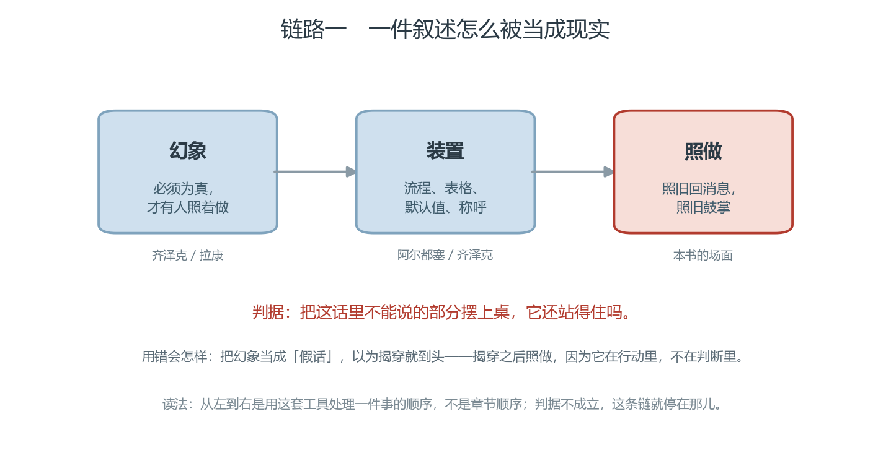

*读法：幻象到装置再到照做：这句话为什么必须被当成真的。判据见各链末尾，判据不成立，这条链就停在那儿。*

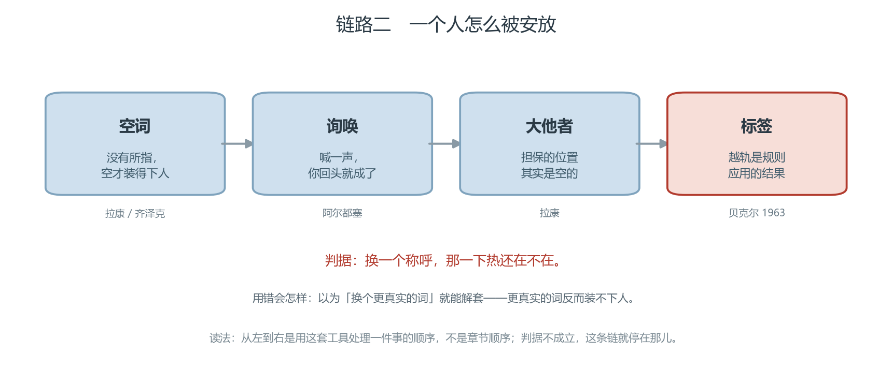

*读法：空词、询唤、大他者、标签：一个人怎么被安放。判据见各链末尾，判据不成立，这条链就停在那儿。*

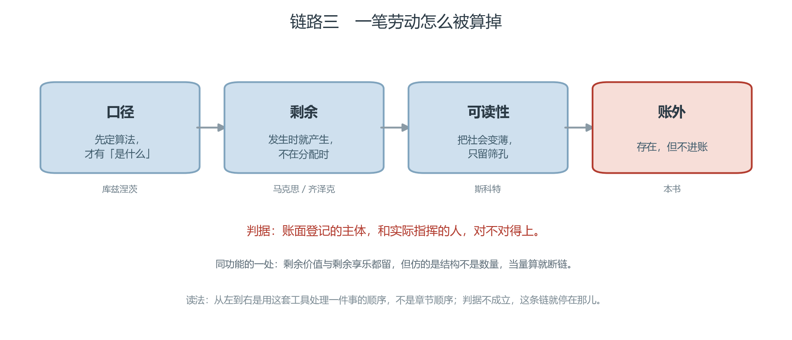

*读法：口径、剩余、可读性、账外：一笔劳动怎么被算掉。判据见各链末尾，判据不成立，这条链就停在那儿。*

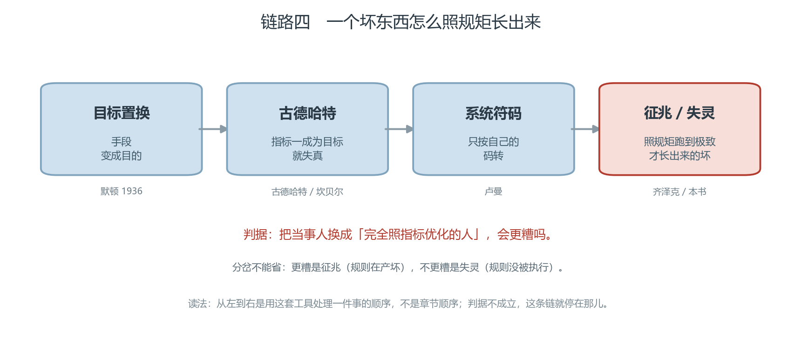

*读法：目标置换到征兆：坏东西为什么是照规矩长出来的。判据见各链末尾，判据不成立，这条链就停在那儿。*

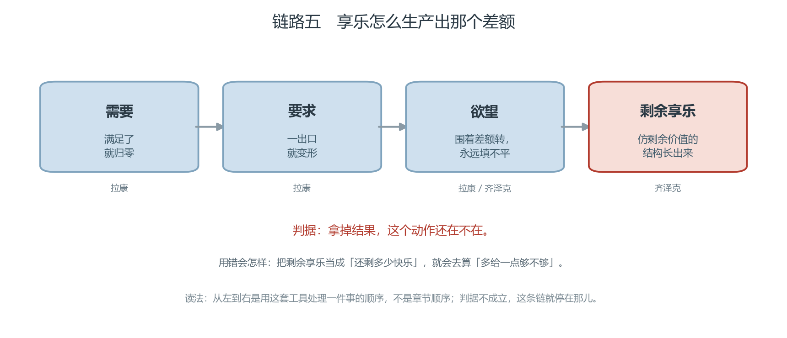

*读法：需要、要求、欲望、剩余享乐：差额怎么被生产出来。判据见各链末尾，判据不成立，这条链就停在那儿。*

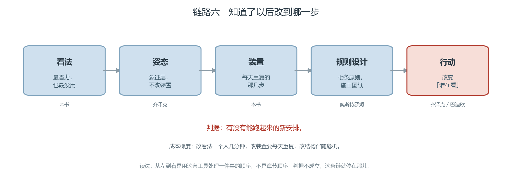

*读法：看法、姿态、装置、规则设计、行动：能改到哪一步。判据见各链末尾，判据不成立，这条链就停在那儿。*

核验底稿与原始抓取存于项目目录，不随书发行；正文只写「哪一类证据」，不写文件名。
